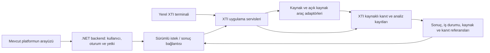

# XTI motoru ve mevcut .NET platformuna entegrasyon

**Karar:** 15 Kasım 2026 son kullanıcı yönlendirmesi.
**Mevcut sürüm:** 0.139.0 / şema 64.
**Durum:** ENG-01 yerel okuma sınırı uygulandı; .NET tüketicisi ve diğer
motor işleri planlıdır. [Çalışan v1 sözleşmesi](../ENGINE_CONTRACT.md).

Bu repo Python tabanlı **veri toplama, istihbarat ve analiz motorudur**.
Ürettiği kaynaklı bilgiler daha sonra mevcut .NET platformuna bağlanır.
Uygulama backend'i, giriş, kullanıcı oturumu, roller ve web deneyimi
.NET tarafında kalır. Bu repo ikinci bir uygulama backend'i veya kimlik
platformu geliştirmez. Yerel terminal kullanımı korunur.

Bu belge güncel teslim sırasıdır. Önceki
[kurumsal planın](ENTERPRISE_INTEGRATION_PLAN.md) XTI içinde web/backend/oturum
geliştirme kısımlarını değiştirir. [Bileşen seçimi](COMPONENT_SELECTION_PLAN.md)
bu sınıra göre güncellenmiştir. [0142 karar kaydı](../decisions/0142-xti-engine-dotnet-host.md)
ve [çalışan durum](../STATUS.md) plan ile uygulamayı ayırır.

## 1. Görev paylaşımı

| Alan | XTI motoru — bu repo | Mevcut .NET platformu |
|---|---|---|
| Kaynaklar | İnternetten izinli toplama, kaynak sağlığı, normalleştirme | Hangi yetkili kullanıcının hangi işi isteyebileceği |
| İstihbarat | Gözlem, IOC, kaynaklı CTI ilişkisi, olay adayı ve analiz | Sonuçların ürün içinde sunumu ve iş akışına katılması |
| Kalıcı kayıt | Özgün kanıt, analiz/rule sürümü, kaynak zamanı ve iş geçmişi | Kullanıcı, oturum, rol, uygulama ve ekip iş akışı kayıtları |
| Arama/izleme | Kayıtlı veri araması, izleme tanımı, değişim ve yerel bildirim olayı | Kullanıcıya sunum, abonelik yetkisi ve gerekirse dış bildirim kanalı |
| Vaka | Mevcut yerel vaka/karar geçmişini koruma; kaynaklı kanıt ve inceleme işlemleri | Gelecekteki ekip ataması, kullanıcı yetkisi, SLA ve ürün vaka deneyimi |
| Kapsam | Güvenilen çağrıdaki izinli hedef/veri alanını bütün işlemlerde uygulama | Kimlik/rol kararı; kullanıcı girdisini doğrulanmış motor kapsamına dönüştürme |
| Bağlantı | Sürümlü girdi/çıktı, işlem ve kanıt kimliği, hata/durum | Sözleşmeyi tüketen .NET adaptörü |

Motorun kanıt veritabanı ile .NET uygulamasının kullanıcı veritabanı ayrı
sorumluluklardır. .NET motor tablolarını doğrudan okuyup yazan bir katman
olarak tasarlanmaz; sözleşmeden veri alır. Üründe arama/ekran için kopya
gerekirse kaynak kimliği ve sürümü korunur, asıl kanıtın yerine geçmez.
Aynı vaka/durum iki tarafta bağımsız düzenlenip sessizce eşitlenmez; her
yazma işleminin sahibi açık tanımlanır. Mevcut kullanıcı verisi silinmez.

"Toplama oturumu" ve "monitor oturumu" motorun iş yürütme kayıtlarıdır;
.NET'e bırakılan kullanıcı giriş oturumuyla aynı şey değildir.

## 2. Bağımlılık politikası

1. **Yerel açık kaynak bileşenler önce:** Ayrıştırma, benzerlik ve standart
   veri işleme için uygun kütüphane/araç kullanılır. Kullanacağımız işlev,
   sürüm, lisans, bağımlılıklar ve geri dönüş davranışı kaydedilir.
2. **Küçük ve değiştirilebilir adaptörler:** Kaynak sağlayıcısı veya araç
   değişince temel veri modeli ve .NET bağlantısı yeniden yazılmaz.
   Gerekli biçim değişikliği sürümlü sözleşme ve açık veri geçişidir.
3. **Zorunlu harici platform yok:** OpenCTI, IntelOwl, ücretli SaaS veya
   bulut hesabı motorun temel kullanım koşulu yapılmaz. Gerekli olursa
   ölçülmüş ek faydayla ayrı, isteğe bağlı sağlayıcı olarak değerlendirilir.
4. **İnternet kaynağı ile yazılım bağımlılığı farklıdır:** Yeni açık kaynak
   verisi toplamak internet ve sağlayıcı erişimi gerektirir. Kaynak
   kesildiğinde saklı kanıt, arama ve yerel analiz çalışır; sonuçların eski
   olduğu gösterilir. Kesinti "tehdit yok" sayılmaz.
5. **Gerektiğinde kapasite:** Kafka, ek arama kümesi veya veri taşıma hedef
   yük ölçülmeden zorunlu hale gelmez. Standart kurulum sade kalır.

Motor için plan tercihleri: ad benzerliğinde RapidFuzz deneyi, haber
akışında feedparser, gerekirse HTML metni için Trafilatura, STIX
genişlemesinde stix2. Mevcut Sherlock/Maigret/theHarvester adaptörleri
korunur. FastAPI/Pydantic, Keycloak ve Cytoscape.js önceki seçilmiş
backend/panel işleri olarak bu repo kapsamından çıkarılmıştır. İleride
ince bir iç servis taşıma adaptörü gerekirse teknoloji ayrıca seçilir;
bu, Python'a kullanıcı/oturum backend'i eklemek anlamına gelmez.

## 3. Hedef akış

Şema hedef tasarımdır; mevcut .NET projesi bu çalışma sırasında incelenmedi
ve bağlanmadı. Bütün teknik kararları o projenin dağıtımına dair varsayımla
vermek yerine veri sözleşmesi şimdi, taşıma biçimi uygun aşamada seçilir.

## 4. Önce sürümlü motor sözleşmesi

Eski `--json` komutları kendi biçimini korur; genel sürümlü entegrasyon
sözleşmesi değildir. Sonuçlar çoğunlukla `ok/data`, hatalar `ok/error`
şeklindedir. Kısmi sonuç `ok:false` ile veri taşıyabilir; hata stderr'de
olabilir. Bazı izleme komutları birden çok JSON çıktı verir. İç toplama
yürütme sürümü, dış istemci sözleşme sürümü yerine kullanılamaz.

0.139.0, ayrı `engine` komutuyla ilk üç salt okunur işlemi v1 biçiminde
sunar. İstek sürümü/kimliği, izinli işlem/parametreler, yapılandırılmış
kayıt referansı, kaynak durumu, sayfalama ve hata kodları uygulanmıştır.
`request_id` yalnız ilişkilendirmedir; iş kimliği ve kalıcı tekrar önleme
henüz yoktur. Kapsam güvenilen başlatıcının seçtiği kişisel kayıt alanıdır;
paylaşımlı müşteri yetkisi tamamlandı sayılmaz. Daha geniş sözleşme sınırları:

| Bölüm | Tanımlanacak alan ve davranış |
|---|---|
| İstek | Sözleşme sürümü, istek kimliği, izinli işlem, doğrulanmış hedef/kapsam ve seçenekler |
| Sonuç | Sözleşme/motor sürümü, istek/iş kimliği, durum, kayıtlar ve özgün kanıt referansları |
| Kaynak | Kaynak zamanı ile toplama zamanı; son deneme/son başarı, eski/eksik/kısmi veri |
| Liste | Sayfalama, kararlı sıralama, toplam veya açık kısmi kapsam; sessiz kesme yok |
| Hata | Kararlı hata kodu, açıklama, yeniden denenebilirlik ve varsa korunmuş kısmi sonuç |
| Uyumluluk | Zorunlu alan/türler, bilinmeyen alan politikası, desteklenmeyen ana sürüm reddi |

İlk üç okuma senaryosu: kayıtlı verilerde arama, kayıt ayrıntısı ve kaynak durumu.
Temiz/boş/kısmi/hatalı/eski kaynak sonuçları örneklerle tanımlanır. Bu
örnekler motor ve .NET tüketicisinin ortak kabul verisi olur. JSON'un
ayrıştırılması tek başına sonucun iş anlamında geçerli olması değildir.
.NET `System.Text.Json` ile bu biçimleri okuyabilir; zorunlu alan ve
sürüm davranışı ayrıca uygulanır.
[JSON desteği](https://learn.microsoft.com/en-us/dotnet/standard/serialization/system-text-json/overview),
[zorunlu alanlar](https://learn.microsoft.com/en-us/dotnet/standard/serialization/system-text-json/required-properties).

### Taşıma kararı

İlk bağlantı doğrulaması, örnek çıktıları ve sonra izinli salt okunur
komutları tüketen küçük bir .NET adaptörüyle yapılır. Bu adaptör mevcut
.NET uygulamasını yeniden yazmaz. Aynı Linux ortamında süreç/JSON yolu
bir adaydır; ayrı makinelerde gerekirse iç HTTP veya başka taşıma seçilir.
Projenin .NET sürümü, işletim sistemi ve yerleşimi görülmeden kesin taşıma
çatısı seçilmez. Motorun mevcut `fcntl` kilidi nedeniyle Windows üzerinde
doğrudan aynı makine çalıştırması doğrulanmış kabul edilmez.

Süreç yolu seçilirse sabit çalıştırıcı ve izinli işlemler kullanılır;
serbest shell metni veya kullanıcıdan dosya yolu alınmaz. Argümanlar
ayrı değerler olarak iletilir. stdout/stderr birlikte ve boyut sınırıyla
okunur; insan için üretilen terminal metni ayrıştırılmaz. Beklemeyi iptal
etme, süreci durdurma ve kalıcı işi iptal etme ayrı davranışlardır.
[Argüman iletimi](https://learn.microsoft.com/en-us/dotnet/api/system.diagnostics.processstartinfo.argumentlist),
[çıktı okuma](https://learn.microsoft.com/en-us/dotnet/api/system.diagnostics.processstartinfo.redirectstandardoutput),
[bekleme/iptal](https://learn.microsoft.com/en-us/dotnet/api/system.diagnostics.process.waitforexitasync).

### Uzun süren işler

Mevcut toplama geçmişi ve kalıcı işler kullanılır; dış istemciden kabul,
iş kimliği, durum/sonuç okuma ve tekrar güvenliği ayrıca tamamlanır.
`collect` bugün senkron sonuç döndürür; erken kabul yanıtı varmış gibi
sunulmaz. Her web isteğinde sınırsız yeni süreç başlatılmaz.

Aynı istek kimliği ve aynı içerik tekrar geldiğinde mevcut iş tanınır;
aynı kimlikle farklı istek çatışma olarak reddedilir. Cevabın kaybolması
ikinci işi körlemesine başlatmaz. Başarılı, kısmi, başarısız, meşgul,
kesilmiş ve sonucu belirsiz durumlar gerçek motor durumlarıyla eşlenir.
İptal/kurtarma tamamlanmış kaynak kayıtlarını silmez. Bellek içi kuyruk
kalıcı kabul veya yeniden başlatma güvencesi değildir.

## 5. Kapsam ve yetki sınırı

.NET kullanıcıyı ve yetkisini doğrular. Motor, yalnız güvenilen bağlantıdan
gelen izinli kapsamı uygular; düz bir `tenant_id` veya `--data-dir` değeri
yetki sayılmaz. Yerel tek kullanıcı kipinden doğrudan ortak müşteri
veritabanına geçilmez. Mevcut kuruluş grupları güvenlik kiracısı değildir.

İlk kurumsal kabul tek kuruluşa ayrılmış motor/veri alanıyla yapılabilir.
Paylaşılan motor gerekecekse kapsam arama, iş, sonuç, kanıt dosyası,
bildirim, dışa aktarım ve LLM girdisinde korunmalıdır. Servis kimliği ve
veri alanı eşlemesini güvenilen sunucu belirler; istemcinin serbest girdisi
belirlemez. .NET'te kimlik yönetimi olması motoru açık, kapsam denetimsiz
bir hizmete dönüştürmez. Bu kapsam kabulü henüz yapılmadı.

## 6. Uygulama sırası

| Adım | Teslim | Tamamlanma ölçütü |
|---|---|---|
| **ENG-01 — Motor/.NET sözleşmesi** | 0.139.0: sürümlü yerel `search`, `record.get`, `sources.status` ve örnekleri uygulandı | Salt okuma, eski komut uyumu, tam/boş/hatalı/eski kaynak, kapsam reddi ve kayıt referansı kabulü; gerçek .NET tüketicisi ENG-05'te açık |
| **ENG-02 — Bileşen ve kaynak düzeni** | Mevcut port/adaptörlerin kullanımı; bileşen sürüm/kapsam/kurulum/sağlık kaydı | Yeni araç sonuçlarının ortak modele alınması, araç kapalıyken eski kanıtı okuyabilme; genel plugin platformu yeniden yazılmaz |
| **ENG-03 — Onaylı iki özellik** | Kaynaklar arası olay adayları ve kaydedilmiş genel arama bildirimleri | Kaynak/tarih ayrımı, sessiz başlangıç, tekrar önleme, tutarlı tam sonuç ve insan kararı; RapidFuzz yalnız fayda gösterirse |
| **ENG-04 — Haber ve kaynak genişlemesi** | feedparser ile RSS/Atom; sonra kanıtlanmış kapsam boşluğuna yeni kaynaklar | Kaynak atfı, tarih, tekilleştirme ve gerçek erişim; hata ile sonuç yokluğu ayrı |
| **ENG-05 — .NET bağlantı kabulü** | Salt okunur tüketici denemesi; ardından kalıcı iş başlatma/durum/sonuç ve seçilen taşıma | Gerçek iki taraflı test; sürüm, kısmi sonuç, sayfalama, cevap kaybı, tekrar, iptal ve yanlış kapsam |
| **ENG-06 — Motor işletimi** | Temiz Linux kurulum, kaynak kesintisi, yeniden başlatma, yedek/geri dönüş ve kapasite ölçümü | İlk adımdan itibaren yürür; gerçek kurumsal kullanımdan önce ilgili koşullar geçer |
| **ENG-07 — Sonraki motor yetenekleri** | Gerektikçe STIX/diğer paylaşım çıktıları, kapsamlı kaynak modülleri ve isteğe bağlı LLM | Her özellik kaynaklı sonuç sözleşmesiyle teslim edilir; model/sağlayıcı hatası çekirdeği durdurmaz |

ENG-01'in ilk yerel okuma teslimi tamamlandı. Sırada ENG-02 vardır; mevcut sınırların gerekli kısmını netleştirir;
her özelliği bekletecek genel bir çatı projesi değildir. ENG-03 bununla
paralel gelişebilir. ENG-05'in salt okunur denemesi ENG-01'den sonra erken
yapılabilir; bütün kaynakların tamamlanmasını beklemez. LLM'nin küçük
kalite deneyi de .NET veya bütün özelliklerin bitmesine bağlı değildir.

Yeni kaynaklar önce ücretsiz ve uygun açık kaynak erişimiyle denenir.
Kapsamları, koşulları ve katkıları görünürdür. Bütün internet, kesintisiz
ücretsiz kaynak veya ölçülmemiş kurumsal kapasite taahhüdü verilmez.

## 7. Korunan mevcut iş ve kapsam

Mevcut terminal, kanıt geçmişi, kuruluş raporu, kişisel vaka/inceleme,
bildirim ve toplama oturumları korunur. Şema veya kayıt kimliği bu plan
değişikliğiyle değişmez. Otomatik HTML arşivi kaldırılmış olarak kalır;
elle rapor çıkarma kullanılabilir. Ürün/sürüm/paket/CVE kapsamı, saldırı,
istismar ve otomatik engelleme/yama yeni plana dahil değildir.

E-posta/SMS, kullanıcı/rol/SSO, React ekranı ve MSSP ürün yönetimi bu
motorun yeni geliştirme işleri değildir. Mevcut manuel webhook gibi
uygulanmış aktarım yetenekleri silinmez; gelecekteki ürün kanalı ve
abonelik yönetimi .NET tarafının kararıdır.

## 8. İlk sonraki iş

**Bileşen ve kaynak düzeni:** mevcut araçların görev, sürüm, kurulum ve
sağlık sınırını küçük adaptörlerle netleştirmek. Olay adayları ve
kaydedilmiş genel arama bildirimleri bununla paralel ilerleyebilir.
V1 yerel okuma sözleşmesi 0.139.0'da kullanılabilir; .NET backend'i
geliştirilmedi veya bağlanmadı. Şema ve mevcut veriler korunur.
