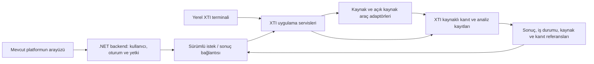

# XTI motoru yol haritası ve tüketici ekibe teslim sınırı

**Karar:** 16 Kasım 2026 son kullanıcı yönlendirmesi.
**Mevcut sürüm:** 0.147.1 / çekirdek şema 69, ayrı platform iş şeması 1.
**Durum:** ENG-01 yerel okuma sınırı ve ENG-02 mevcut araç kataloğu temeli
uygulandı; 11 maddelik mevcut motor sağlamlaştırma paketi tamamlandı.
ENG-03'ün kaynaklar arası olay adayları ile kayıtlı genel arama ve yerel
bildirim dilimleri uygulandı. ENG-04'ün ilk RSS/Atom haber teslimi de
uygulandı. 0.144.0 Tavily ile seçili firma/kuruluş/tedarikçi için tek
istekli web/haber araması ve kaynaklı geçmiş ekler. 0.145.0 kuruluş–tedarikçi
izleme grubunu, bütçeli düzenli Tavily toplamasını ve mevcut inbox bağlantısını
uygular. 0.146.0 RSS profillerini, seçilmiş haber araması/inbox bağlantısını
ve kuruluş raporundaki firma/tedarikçi içeriklerini ekler.
0.147.0 firma kayıt alanı ayrımını, kalıcı profil işi kabul/durum/sonuç/iptal
sözleşmesini, sade firma içerik görünümünü ve iki veritabanını birlikte
koruyan platform yedek/geri dönüşünü ekler.
[Platform kullanım sözleşmesi](../PLATFORM_ENGINE.md).
16 Kasım [canlı RSS kabulü](../NEWS_SOURCE_ACCEPTANCE.md) iki turda 70
kaydın tekrar kayıt/bildirim oluşturmadan korunmasını doğruladı. Tavily
anahtarı kullanıcı tercihiyle sonraya bırakıldı; gerçek Tavily kabulü
bekliyor. Kullanıcı hedefi firma adı/domainiyle ilgili içeriği bulup
göstermektir. Genel haber sayıları işletim ayrıntısıdır. Tam makale alma
ayrı bir zorunlu teslim adımı değildir; somut içerik ihtiyacıyla değerlendirilir.
.NET tüketicisi henüz bağlı değildir; bağlantıyı repoyu kullanan ekip yapar.
[Çalışan v1 sözleşmesi](../ENGINE_CONTRACT.md).

Bu repo Python tabanlı **veri toplama, istihbarat ve analiz motorudur**.
Ürettiği kaynaklı bilgileri repoyu kullanan ekip kendi platformuna bağlar.
Uygulama backend'i, giriş, kullanıcı oturumu, roller ve web deneyimi
.NET tarafında kalır. Bu repo ikinci bir uygulama backend'i veya kimlik
platformu geliştirmez. Yerel terminal kullanımı korunur.

**Son kullanıcı açıklaması:** Gelecekteki platform .NET ve PostgreSQL
kullanacak. Bugünkü geliştirme, deneme ve kişisel kullanım SQLite ile sürer.
.NET tüketicisi, platforma özgü bağlantı ve PostgreSQL yerleşimi/veri geçişi
repoyu kullanacak ekibin sorumluluğudur; bu repo bunları uygulama işi olarak
üstlenmez. Motorun görevi kararlı sözleşme, kaynaklı sonuç, örnekler ve
kullanım belgeleri sunmaktır. 0.147.0 motorun çok firmalı teslim sınırını
uygular; geniş STIX/TAXII ve LLM kullanıcı kararıyla bu teslimin dışındadır.
[0145 kararı](../decisions/0145-stabilization-first-local-engine.md).

Bu belge güncel teslim sırasıdır. Önceki
[kurumsal planın](ENTERPRISE_INTEGRATION_PLAN.md) XTI içinde web/backend/oturum
geliştirme kısımlarını değiştirir. [Bileşen seçimi](COMPONENT_SELECTION_PLAN.md)
bu sınıra göre güncellenmiştir. [0142 karar kaydı](../decisions/0142-xti-engine-dotnet-host.md)
ve [çalışan durum](../STATUS.md) plan ile uygulamayı ayırır.

### Firma içerikleri için kullanıcı hedefi — 16 Kasım 2026

Kullanıcı firma adını ve varsa domainini seçer; motor bu hedefle ilgili
bulunan içerikleri sunar. Aynı kapsam açıkça seçilmiş tedarikçilere de
uygulanabilir. Sonuçta şu bilgiler yeterlidir:

- İçerik başlığı, firma ile bağlantıyı gösteren mevcut bölüm veya açıklama.
- Özgün kaynak bağlantısı ve kaynak sağlıyorsa yayın tarihi.
- Hangi firma/tedarikçi için bulunduğu ve yeni ya da değişmiş olup olmadığı.

Kaynağın döndürdüğü bütün haberler, toplam indirme sayıları ve teknik
çalışma kimlikleri son kullanıcı akışının odağı değildir; işletim ve
kanıt incelemesi için korunur. Sayfalama ve kaynak hata/kapsam bilgileri
motor sözleşmesinden silinmez. Kullanıcıya başarılı aramada içerik
bulunamaması ile kontrolün tamamlanamaması açıkça ayrı anlatılır.

Mevcut `mentions` ve kuruluş içerik raporu bu akışın temelidir. Görünür
eşleşmesi olmayan sağlayıcı önerisi kesin firma eşleşmesi sayılmaz;
aynı adlı farklı kuruluşlar için domain ve eşleşen alan bilgisi korunur.
Genel RSS kataloğu bir kaynak adaptörüdür; kullanıcıdan tüm haberleri
gezmesi beklenmez. Tam metin çıkarımı yalnız bu hedefi karşılamak için
gerektiği ölçüde değerlendirilir; ayrı haber okuyucu ürünü veya bütün
makalelerin arşivi teslim koşulu değildir. Bu bölüm ürün yönüdür;
0.147.0'da `organizations content` ve `organization.content` bu sade
görünümü uygular. .NET ekranını repoyu kullanan ekip oluşturur.

## 1. Görev paylaşımı

| Alan | XTI motoru — bu repo | Repoyu kullanan ekip / .NET platformu |
|---|---|---|
| Kaynaklar | İnternetten izinli toplama, kaynak sağlığı, normalleştirme | Hangi yetkili kullanıcının hangi işi isteyebileceği |
| İstihbarat | Gözlem, IOC, kaynaklı CTI ilişkisi, olay adayı ve analiz | Sonuçların ürün içinde sunumu ve iş akışına katılması |
| Kalıcı kayıt | Özgün kanıt, analiz/rule sürümü, kaynak zamanı ve iş geçmişi | Kullanıcı, oturum, rol, uygulama ve ekip iş akışı kayıtları |
| Arama/izleme | Kayıtlı veri araması, izleme tanımı, değişim ve yerel bildirim olayı | Kullanıcıya sunum, abonelik yetkisi ve gerekirse dış bildirim kanalı |
| Vaka | Mevcut yerel vaka/karar geçmişini koruma; kaynaklı kanıt ve inceleme işlemleri | Gelecekteki ekip ataması, kullanıcı yetkisi, SLA ve ürün vaka deneyimi |
| Kapsam | Güvenilen çağrıdaki izinli hedef/veri alanını bütün işlemlerde uygulama | Kimlik/rol kararı; kullanıcı girdisini doğrulanmış motor kapsamına dönüştürme |
| Bağlantı | Sürümlü girdi/çıktı, işlem ve kanıt kimliği, hata/durum; örnekler ve belgeler | .NET adaptörünün geliştirilmesi, dağıtımı ve gerçek platform kabulü |

Motorun kanıt veritabanı ile .NET uygulamasının kullanıcı veritabanı ayrı
sorumluluklardır. .NET motor tablolarını doğrudan okuyup yazan bir katman
olarak tasarlanmaz; sözleşmeden veri alır. Üründe arama/ekran için kopya
gerekirse kaynak kimliği ve sürümü korunur, asıl kanıtın yerine geçmez.
Aynı vaka/durum iki tarafta bağımsız düzenlenip sessizce eşitlenmez; her
yazma işleminin sahibi açık tanımlanır. Mevcut kullanıcı verisi silinmez.

PostgreSQL'in gelecekteki fiziksel yerleşimi, motor kayıtlarının taşınma
kapsamı ve bağlantı teknolojisi repoyu kullanan ekip tarafından kendi
platformu incelenerek netleştirilir.
Ortak PostgreSQL sunucusu seçilmesi ortak tablo sahipliği veya müşteri
yetkisi anlamına gelmez. Gerekli bir geçişte kayıt kimlikleri, kaynak/kanıt
bağları, olay sırası, atomik bildirim/iş kayıtları ve yedekten dönüş ayrıca
doğrulanır; yalnız bağlantı adresini değiştirmek yeterli kabul edilmez.

"Toplama oturumu" ve "monitor oturumu" motorun iş yürütme kayıtlarıdır;
.NET'e bırakılan kullanıcı giriş oturumuyla aynı şey değildir.

## 2. Bağımlılık politikası

1. **Yerel açık kaynak bileşenler önce:** Ayrıştırma, benzerlik ve standart
   veri işleme için uygun kütüphane/araç kullanılır. Kullanacağımız işlev,
   sürüm, lisans, bağımlılıklar ve geri dönüş davranışı kaydedilir.
2. **Küçük ve değiştirilebilir adaptörler:** Kaynak sağlayıcısı veya araç
   değişince temel veri modeli ve .NET bağlantısı yeniden yazılmaz.
   Gerekli biçim değişikliği sürümlü sözleşme ve açık veri geçişidir.
3. **Zorunlu harici platform yok:** OpenCTI, IntelOwl, ücretli SaaS veya
   bulut hesabı motorun temel kullanım koşulu yapılmaz. Gerekli olursa
   ölçülmüş ek faydayla ayrı, isteğe bağlı sağlayıcı olarak değerlendirilir.
4. **İnternet kaynağı ile yazılım bağımlılığı farklıdır:** Yeni açık kaynak
   verisi toplamak internet ve sağlayıcı erişimi gerektirir. Kaynak
   kesildiğinde saklı kanıt, arama ve yerel analiz çalışır; sonuçların eski
   olduğu gösterilir. Kesinti "tehdit yok" sayılmaz.
5. **Gerektiğinde kapasite:** Kafka, ek arama kümesi veya veri taşıma hedef
   yük ölçülmeden zorunlu hale gelmez. Standart kurulum sade kalır.

İlk olay adayı teslimi mevcut kesin kuralları kullanır; RapidFuzz
kurulmadı. Ek ad benzerliği ancak ölçülmüş ihtiyaç ve faydayla denenir.
Haber akışında feedparser 6.0.14 ve feedparser-sgmllib 2.1.0, 0.143.0'da
uygulandı. Gerekirse HTML metni için Trafilatura ve STIX genişlemesinde
stix2 hâlâ plan tercihidir. Mevcut Sherlock/Maigret/theHarvester adaptörleri
korunur. FastAPI/Pydantic, Keycloak ve Cytoscape.js önceki seçilmiş
backend/panel işleri olarak bu repo kapsamından çıkarılmıştır. İleride
ince bir iç servis taşıma adaptörü gerekirse teknoloji ayrıca seçilir;
bu, Python'a kullanıcı/oturum backend'i eklemek anlamına gelmez.

## 3. Hedef akış

Şema hedef tasarımdır; .NET tarafını repoyu kullanan ekip geliştirir ve
bağlar. Bu repo veri sözleşmesini ve örnekleri sağlar; platforma özgü
taşıma/dağıtım kararı tüketici ekibe aittir.

## 4. Önce sürümlü motor sözleşmesi

Eski `--json` komutları kendi biçimini korur; genel sürümlü entegrasyon
sözleşmesi değildir. Sonuçlar çoğunlukla `ok/data`, hatalar `ok/error`
şeklindedir. Kısmi sonuç `ok:false` ile veri taşıyabilir; hata stderr'de
olabilir. Bazı izleme komutları birden çok JSON çıktı verir. İç toplama
yürütme sürümü, dış istemci sözleşme sürümü yerine kullanılamaz.

0.139.0, ayrı `engine` komutuyla ilk üç salt okunur işlemi v1 biçiminde
sunar. İstek sürümü/kimliği, izinli işlem/parametreler, yapılandırılmış
kayıt referansı, kaynak durumu, sayfalama ve hata kodları uygulanmıştır.
0.140.0 aynı v1 sınırına proje araçlarını okuyan `components.list` ekler;
önceki üç işlemin biçimi korunur.
0.141.0'daki `events candidates` yerel CLI/JSON komutudur; o teslim
engine v1'e yeni işlem eklemedi ve şema 64'ü korudu. 0.142.0'daki
`search-watch` da yerel CLI/JSON sınırındadır; dört mevcut engine v1
işlemi korunur. Kayıtlı arama geçmişi için şema 65'e açık, yedekli geçiş
gerekir; yeni ağ API'si veya engine işlemi eklenmez.
0.143.0, şema 66'da haber kanıtını saklar; engine v1'in dört işlemini
koruyarak `news/news_article` türünü ve üç yayıncı namespace'ini açıkça
ekler. Eski kayıtlı aramalar somut on tür kapsamını korur; haber izleme
kapsamı açık yeni/güncellenmiş tanımla seçilir.
Eski `engine` sözleşmesinde `request_id` yalnız ilişkilendirmedir; kapsam
güvenilen başlatıcının seçtiği kişisel kayıt alanıdır. 0.147.0 ayrı
`xti-platform` protokolüyle kayıtlı firma kapsamını ve kalıcı iş anahtarını
uygular. `request_id` burada da iş tekrar anahtarı değildir.
Sözleşme sınırları:

| Bölüm | Tanımlanacak alan ve davranış |
|---|---|
| İstek | Sözleşme sürümü, istek kimliği, izinli işlem, doğrulanmış hedef/kapsam ve seçenekler |
| Sonuç | Sözleşme/motor sürümü, istek/iş kimliği, durum, kayıtlar ve özgün kanıt referansları |
| Kaynak | Kaynak zamanı ile toplama zamanı; son deneme/son başarı, eski/eksik/kısmi veri |
| Liste | Sayfalama, kararlı sıralama, toplam veya açık kısmi kapsam; sessiz kesme yok |
| Hata | Kararlı hata kodu, açıklama, yeniden denenebilirlik ve varsa korunmuş kısmi sonuç |
| Uyumluluk | Zorunlu alan/türler, bilinmeyen alan politikası, desteklenmeyen ana sürüm reddi |

İlk üç okuma senaryosu: kayıtlı verilerde arama, kayıt ayrıntısı ve kaynak durumu.
Temiz/boş/kısmi/hatalı/eski kaynak sonuçları örneklerle tanımlanır. Bu
örnekler motor ve .NET tüketicisinin ortak kabul verisi olur. JSON'un
ayrıştırılması tek başına sonucun iş anlamında geçerli olması değildir.
.NET `System.Text.Json` ile bu biçimleri okuyabilir; zorunlu alan ve
sürüm davranışı ayrıca uygulanır.
[JSON desteği](https://learn.microsoft.com/en-us/dotnet/standard/serialization/system-text-json/overview),
[zorunlu alanlar](https://learn.microsoft.com/en-us/dotnet/standard/serialization/system-text-json/required-properties).

### Taşıma kararı

Tüketici ekip ilk bağlantıyı, örnek çıktıları ve sonra izinli salt okunur
komutları tüketen küçük bir .NET adaptörüyle doğrular. Bu adaptör mevcut
.NET uygulamasını yeniden yazmaz. Aynı Linux ortamında süreç/JSON yolu
bir adaydır; ayrı makinelerde gerekirse iç HTTP veya başka taşıma seçilir.
Projenin .NET sürümü, işletim sistemi ve yerleşimi görülmeden kesin taşıma
çatısı seçilmez. Motorun mevcut `fcntl` kilidi nedeniyle Windows üzerinde
doğrudan aynı makine çalıştırması doğrulanmış kabul edilmez.

Süreç yolu seçilirse sabit çalıştırıcı ve izinli işlemler kullanılır;
serbest shell metni veya kullanıcıdan dosya yolu alınmaz. Argümanlar
ayrı değerler olarak iletilir. stdout/stderr birlikte ve boyut sınırıyla
okunur; insan için üretilen terminal metni ayrıştırılmaz. Beklemeyi iptal
etme, süreci durdurma ve kalıcı işi iptal etme ayrı davranışlardır.
[Argüman iletimi](https://learn.microsoft.com/en-us/dotnet/api/system.diagnostics.processstartinfo.argumentlist),
[çıktı okuma](https://learn.microsoft.com/en-us/dotnet/api/system.diagnostics.processstartinfo.redirectstandardoutput),
[bekleme/iptal](https://learn.microsoft.com/en-us/dotnet/api/system.diagnostics.process.waitforexitasync).

### Uzun süren işler

0.147.0 kayıtlı profil ve açık profil sürümü için kalıcı `jobs.submit`,
`jobs.status`, `jobs.result`, `jobs.cancel` işlemlerini sağlar. Kuyruğa
kabul kaynak çağırmaz; güvenilen işletim süreci `platform worker` ile
bir işi yürütür. Eski `collect` senkron kalır. Tavily grup işleri bu
ilk platform kuyruğuna dahil değildir; mevcut bütçeli grup akışı korunur.

Aynı firma ve `idempotency_key` ile aynı istek mevcut işi döndürür;
farklı içerik çatışmadır. İşin profil/izleme/kaynak planı dondurulur,
çalışmadan önce yeniden doğrulanır. Kesintide kanıt ve tekrar anahtarları
korunur; belirsiz iş otomatik tekrarlanmaz. Kurtarma açık komuttur.
Geri yüklenen alan yeni `workspace_id` alır; eski bağlamın iş kabulleri
reddedilir, yedekteki bekleyen işler otomatik çalıştırılmaz.

## 5. Kapsam ve yetki sınırı

.NET kullanıcıyı ve yetkisini doğrular. Motor, yalnız güvenilen bağlantıdan
gelen izinli kapsamı uygular; düz bir `tenant_id` veya `--data-dir` değeri
yetki sayılmaz. Yerel tek kullanıcı kipinden doğrudan ortak müşteri
veritabanına geçilmez. Mevcut kuruluş grupları güvenlik kiracısı değildir.

0.147.0 tek motor kodunu ayrı firma kayıt alanlarıyla çalıştırır.
Güvenilen başlatıcı kayıt kökünü ve firmayı seçer; JSON isteği dosya yolu
veya firma alanı seçemez. Bilinmeyen/kapalı firma, güvensiz izin veya
yanlış dosya bağı reddedilir; kişisel alana geri dönüş yoktur. Her alanın
kanıt ve iş veritabanı ayrıdır. Aynı kayıt/iş kimliğiyle başka firmaya
erişim test edilir. Kuruluşlar bu alanın içindeki iş nesneleridir.

Bu sınır sunucu yöneticisine veya aynı servis hesabının dosya yazma
yetkisine karşı yalıtım değildir. Kullanıcı–firma yetkisi, güvenilen
başlatıcı ve servis hesabı tüketici ekipte kalır. Platform protokolünde
sunulmayan yerel yönetim komutları son kullanıcıya doğrudan açılmaz.
[Sınır ve kabul ayrıntısı](../PLATFORM_ENGINE.md).

## 6. Uygulama sırası

ENG kimlikleri önceki işleri takip etmek için korunur. Mevcut STB paketi
ve ENG-03'ün iki ilk teslimi tamamlandı. ENG-04'ün ilk haber teslimi
uygulandı; RSS toplama bağlantısı 0.146.0, platform teslim sınırı
0.147.0 ile eklendi. Gerçek .NET uygulaması dış ekibe aittir;
ENG-07 bu teslimin dışındadır.

| Adım | Teslim | Tamamlanma ölçütü |
|---|---|---|
| **ENG-01 — Motor/.NET sözleşmesi** | 0.139.0: sürümlü yerel `search`, `record.get`, `sources.status` ve örnekleri uygulandı | Salt okuma, eski komut uyumu, tam/boş/hatalı/eski kaynak, kapsam reddi ve kayıt referansı kabulü; gerçek .NET tüketicisi ENG-05'te açık |
| **ENG-02 — Bileşen ve kaynak düzeni** | 0.140.0: üç mevcut araç için ortak pin, açık yapılandırma ve yerel kurulum kataloğu; CLI/engine okuması uygulandı | Kurulum gözlemi canlı kaynak durumundan ayrı, araç yokken eski kanıt okunabilir, pin kayması testli; yeni araçlar aynı sınırla eklenir |
| **ENG-03 — Olay adayları ve genel arama izlemesi** | 0.141.0: olay adayları; 0.142.0: `search-watch`, yerel inbox ve sınırlı ön plan tekrarı uygulandı | Kaynak/tarih ayrımı, değişmez tanım ve tam sonuç/kapsam kanıtı, sessiz başlangıç, yeni/anlamlı değişmiş eşleşmede atomik bildirim; yalnız çıkarılma geçmişte kalır |
| **ENG-04 — Haber ve kaynak genişlemesi** | 0.143.0 RSS/Atom; 0.144.0 Tavily tekil arama; 0.145.0 bütçeli kuruluş/tedarikçi izleme; 0.146.0 RSS profili/zamanlama/inbox ve birleşik içerik raporu uygulandı. Gerçek Tavily kabulü ve ölçülmüş kaynak boşlukları sonraki kapsam | Kaynak atfı, kalıcı kanıt, eski sonuçları koruma; kesin hedef/sorgu kapsamı, kalıcı bütçe ve kesintide tekrar güvenliği; ilk sessiz başlangıç ve yeni/değişen içerik bildirimi |
| **ENG-05 — Tüketici ekibe teslim** | 0.147.0 firma kapsamı, kalıcı profil işleri, sade içerik, yedek/kurtarma ve platform rehberi; .NET adaptörü dış ekipte | Motor sözleşmesi, firma ayrımı ve gerçek süreç kesintisi sınanır; gerçek platform bağlantısı ve dağıtım kabulü tüketici ekipte |
| **ENG-06 — Motor işletimi** | Temiz Linux kurulum, kaynak kesintisi, yeniden başlatma, yedek/geri dönüş ve kapasite ölçümü; araç kurulum bütünlüğü ve kesinti sonrası geri dönüş | İlk adımdan itibaren yürür; gerçek kurumsal kullanımdan önce ilgili koşullar geçer |
| **ENG-07 — En sona ertelenen motor yetenekleri** | Gerektikçe geniş STIX/diğer paylaşım çıktıları ve isteğe bağlı LLM | İlk üç özellikten sonra değerlendirilir; kaynaklı sonuç sözleşmesi korunur, model/sağlayıcı hatası çekirdeği durdurmaz |

ENG-01'in ilk yerel okuma teslimi ve ENG-02'nin mevcut araç düzeni
tamamlandı. [Bileşen kataloğu](../COMPONENTS.md) tam bağımlılık/kurulum
bütünlüğü veya canlı çalışma kabulü değildir; ileri işletim işleri ENG-06'da
açıktır. İlk olay adayı, genel arama bildirimi ve üç yayıncıdan RSS/Atom
haber toplama dilimleri tamamlandı. Tavily kuruluş/tedarikçi grup izleme,
bütçe, zamanlama ve inbox bağlantısı da 0.145.0'da eklendi. RSS haberlerinin
`collect` profillerine ve zamanlamaya katılması ile birleşik içerik raporu
0.146.0'da eklendi ve RSS akışı iki gerçek kaynak turunda doğrulandı.
Tavily canlı kabulü anahtar eklenince yapılacak. Seçilen firma/tedarikçiyle
ilgili kaynaklı içeriklerin sade sunumu 0.147.0'da uygulandı.
Tam metin çıkarımı ve yeni kaynaklar ancak bu hedefte ölçülen ihtiyaçla
ele alınır; zorunlu ayrı teslim aşamaları değildir. Geniş paylaşım ve LLM en sondadır. Mevcut
özelliklerin kullanımı devam eder.

### ENG-03 ilk teslimi — 0.141.0

`events candidates` üç kaynağın son başarılı kayıtlarını aynı yerel
veritabanı okuma anında değerlendirir. Kaynakları yenileme ayrı işlemdir;
komut internete çıkmaz, veri veya yeni insan kararı yazmaz. Tam domain
filtresi, sayfalama, kaynak güncelliği ve son deneme/son başarı ayrımı
terminalde ve JSON'da görünür. Bu dilim şema 64'ü ve engine v1 işlemlerini
değiştirmez.

- ThreatCluster–RansomLook: mevcut kesin ad karşılaştırması korunur.
  Aynı grup ve en fazla 72 saat keşif farkı varsa “aynı olay olabilir”
  adayı gösterilir. Yalnız noktalama, harf büyüklüğü ve boşluk farklılığı
  olan adlar da aynı grup/zaman koşuluyla aday olabilir; sözcük veya
  şirket eki çıkarılmaz. Önceki kurala göre ilişkili olup bu eşiği
  geçmeyen çiftler yalnız kuruluş bağlamıdır. 72 saat olasılık puanı
  değildir.
- ThreatCluster–HIBP: tam website hostu/domain eşitliği yalnız ortak
  domain bağlamıdır. Tahmini ihlal günü, keşif zamanı, katalog zamanı ve
  toplama zamanı ayrı gösterilir; yıllar arayla görülen kayıtlar aynı
  olaya dönüştürülmez.
- RansomLook–HIBP adı eşleşmesi veya üç kaynak arasında geçişli bağlantı
  kurulmaz. Önceki ransomware insan kararı, özgün karşılaştırmaya ait
  karar ve güncel kanıtla uyuşup uyuşmadığı bilgisiyle ayrı gösterilir.
  Otomatik birleştirme, ihlal hükmü, yeni karar veya alarm üretilmez.

RapidFuzz bu teslim için gerekmedi ve kurulmadı. Yeni yaklaşık ad
eşleştirmesi ancak [ölçüm koşullarıyla](COMPONENT_SELECTION_PLAN.md)
yeniden değerlendirilir. Bu teslimin ardından kayıtlı genel arama
bildirimleri 0.142.0'da, ilk RSS/Atom haber kaynakları 0.143.0'da eklendi.

### ENG-03 ikinci teslimi — 0.142.0

`search-watch` genel aramanın on kayıt ailesini kalıcı bir izleme tanımına
bağlar. Ekleme/güncelleme, liste/ayrıntı, açık çalıştırma, çalışma kanıtı,
devre dışı bırakma ve sınırlı `monitor` komutları terminal/JSON üzerinden
kullanılır. Monitor yalnız terminal açıkken sonlu tur/süre bütçesiyle
yerel aramayı tekrarlar; internetten kaynak toplamaz veya daemon kurmaz.

- İlk çalışma, tanım değişikliği ve yeniden etkinleştirme sessiz bir
  başlangıçtır. Aynı tanımın sonraki ölçümünde yeni veya anlamlı biçimde
  değişmiş eşleşme ortak yerel kutuya bildirim ekler. Yalnız çıkarılma
  çalışma farkında kalır; yeni alarm üretmez. CTI kayıtlı aramalarının
  mevcut bildirim davranışı değiştirilmez.
- Her çalışma özgün tanım sürümünü, tam eşleşmeleri ve kaynak kapsamını
  dondurur. Sayfalama yalnız görünümü sınırlar; daha sonra kaynak veya
  tanım değişmesi eski çalışma kanıtını değiştirmez. Kaynak çalışması ya
  da toplama zamanı yenilendi diye aynı kayıt yeni eşleşmeye dönüşmez.
- Şema 65 beş boş tablo ekler: tanımlar, tanım olayları, tam sonuç
  snapshot'ları, çalışmalar ve bildirimler. `global_search_snapshots`
  aynı kanıtı içerik özetiyle tekilleştirir; ayrı bir sonuç öğeleri tablosu
  yoktur. Farklar kaydedilmiş tam snapshot'lardan üretilir; çalışma ve
  gerekli bildirim aynı transaction'da saklanır.
- Mevcut veriye geçiş açık `migrate` ile, benzersiz önceki-sürüm yedeği
  oluşturulduktan sonra yapılır. Okuma ve `setup` otomatik geçiş yapmaz.
  Şema 65'i desteklemeyen eski kod yeni veriyi açmaz; geri dönüş eski
  yedeği yeni bir veri yoluna restore ederek yapılır. Bu dönüş geçişten
  sonraki yeni kayıtları eski şemaya taşımaz; şema 65 verisi korunur.

Bu 0.142.0 tesliminde yeni kütüphane, ağ API'si veya engine v1 işlemi
eklenmedi. Ardından 0.143.0 haber teslimi uygulandı; .NET bağlantısını tüketici ekip geliştirir.
Entegrasyon teslim hazırlığı, geniş paylaşım ve LLM en sonda kalır.

### ENG-04 ilk haber teslimi — 0.143.0

`news sources/refresh/list/show/status/run-show` komutları CISA News,
UK NCSC ve CERT-FR actualité akışlarını ayrı kaynak kimlikleriyle toplar.
Hazır `feedparser` kütüphanesi kullanılır; RSS/Atom ayrıştırıcısı yeniden
yazılmaz. HTTP alma, kaynak listesi, boyut/süre sınırı ve hata kaydı
XTI'da kalır. Makale sayfaları ve ekler otomatik açılmaz.

- Kaynak + GUID/Atom ID veya özgün bağlantı kalıcı haber kimliğidir;
  başlık/özet, yayıncı tarihleri ve XTI toplama zamanı ayrı saklanır.
  Akıştan düşen haber silinmez. Hata son başarılı kanıtı korur;
  geçerli boş akış ayrı başarılı çalışma olarak görünür.
- Başlık ve düz metin özet genel aramada ve `search-watch add … --kind news`
  tanımlarında bulunur. Haber toplama ile kayıtlı aramayı çalıştırma ayrı
  komutlardır. Bildirim mevcut inbox yoluyla gelir; aynı içerik yeniden
  görüldüğünde çalışma zamanı değişti diye alarm oluşturulmaz.
- Engine v1'in dört işlemi korunur; haber araması, kontrollü kayıt
  ayrıntısı ve kaynak durumu aynı okuma sınırına eklenir. Eski arama
  tanımları ve dondurulmuş çalışma kanıtları değiştirilmez.
- Şema 66, haber çalışmaları, içerik adresli akış görüntüleri ve birikimli
  haber görünümü için üç tablo ekler. Açık yedekli `migrate` kullanılır.
  Normal `setup` sabit haber paketlerini mevcut kurtarılabilir ortamda
  kurar; `--core-only` paket indirmeyen çekirdek seçimi olarak kalır.

Bu ilk teslim `collect` görevi, toplu kaynak yenilemesi, otomatik
zamanlama veya kuruluş raporuna haber ekleme yapmıyordu; ilgili profil,
zamanlama ve içerik raporu dilimleri 0.146.0'da eklendi. Yeni
kaynak ancak ücretsiz erişim, koşullar, sağlanan farklı veri ve hata
davranışı ölçüldükten sonra eklenir. [0148 kararı](../decisions/0148-publisher-news-feeds.md),
[çalışan kapsam ve kabul kaydı](../STATUS.md).

### Tamamlanan sağlamlaştırma ve korunan işletim sınırı

| Öncelik | Somut iş | Kabul kanıtı |
|---|---|---|
| **STB-01 — Doğrulama ve belge tutarlılığı** | Engine/bileşen testlerini hızlı CI'a katma, kurulum filtrelerini güncelleme, yanlış komut ve eski kapsam açıklamalarını düzeltme | Güncel hızlı paket, kaynak kataloğu testleri ve ağsız komut örnekleri geçer; uygulanan ile planlanan ayrılır |
| **STB-02 — Kurulum ve güncelleme** | Desteklenen temiz Linux ortamında klonlama, kurulum, tekrar kurulum, güncelleme ve araç ortamı geri dönüşünü doğrulama | Yeni makinede belgelenmiş adımlar çalışır; kesinti sonrası önceki çalışan ortam ve kayıtlar korunur |
| **STB-03 — Veri ve iş güvenilirliği** | Bozuk kayıt, yedek/restore, kesilmiş iş ve tekrar denemesini birlikte sınama; sır saklama ve erişim sınırını iyileştirme | Kanıt/karar kimliği kaybolmaz, aynı iş yanlışlıkla çoğalmaz, sırlar çıktıya taşınmaz; işletici kurtarma adımlarını uygulayabilir |
| **STB-04 — İşletim ve kapasite** | Kaynak hatası, ağ kesintisi, yeniden başlama, disk baskısı ve uzun süreli yerel çalışmayı ölçme | Sonuç/ölçüm, kullanılan makine ve veri hacmiyle kaydedilir; kaynak hatası boş başarı olmaz; ölçülmemiş SLA veya kapasite ilan edilmez |
| **STB-05 — Tüketici ekibin gelecekteki platform kabulü** | Repoyu kullanan ekip .NET bağlantısını, platform PostgreSQL yerleşimini ve gerekiyorsa veri geçişini gerçekleştirir; XTI sözleşme/örnek/belge sağlar | Gerçek iki taraflı akış ve dağıtım kabulü tüketici ekibe aittir; motorun veri/kanıt/iş bütünlüğü sorumluluğu bu repoda kalır |
| **STB-06 — Teslim paketi** | Kurulum/kullanım/kurtarma rehberi, sürüm değişikliği, desteklenen ortam ve bilinen sınırları yayımlama | Başka kişi sözlü yardımsız kurup temel senaryoyu tamamlar; açık işler ve hangi kabulün geçtiği görünürdür |

STB-01'in 0.140.1 dilimi bu incelemede belirlenen CI ve güncel kullanım
belgesi açıklarını kapatır. 0.140.2, STB-02 içinde theHarvester için
korunan eski ortam, ortak çalışma kilidi, kesinti günlüğü ve kurtarma
komutlarını ekler. Gerçek Ubuntu kurulumu için ayrı kabul işi eklendi;
çalıştırma sonucu [güncel durumda](../STATUS.md) ayrıca kaydedilir.
0.140.3 marka araçlarını ve XTI başlatıcısını aynı kurtarma/kilit düzenine
alır; marka Ubuntu kabulü veri korunması ve tekrar kontrolüyle genişletilir.
`cbea620` üzerinde iki gerçek Ubuntu kurulum işi başarılıdır: temiz
kurulum, tekrar, geçici kayıtların korunması, engine okuma ve yedekten
dönüş geçti; kilit/kesinti/kurtarma mekanizması çevrimdışı regresyonlarla
sınandı. 0.140.4 (`7060cec`) üzerinde önceki yayımlanmış 0.140.2'den
gerçek güncelleme, aynı şemada kod geri dönüşü ve gerçek araç kurucusu
kesintisinden kurtarma iki araç zincirinde de geçti.
[Çalıştırma kayıtları](../STATUS.md). Yerel motor kabulü ile gerçek .NET
üretim kabulü ayrı kaydedilir. SQLite ile STB-02–04 doğrulanabilir;
gelecekteki PostgreSQL dağıtımını bugün kurmak ön koşul değildir. Mevcut
platform görülmeden framework, sürücü, sunucu sürümü veya fiziksel veritabanı
ayrımı seçilmez. Özellik geliştirmesine dönüş tamamlanan kabul ve açık
işler üzerinden yeniden değerlendirilir.

0.140.4 ile STB-01–04 ve STB-06'nın aşağıda tanımlanan mevcut kişisel
motor kapsamı tamamlandı. STB-05 repoyu kullanan ekibin gerçek
.NET/PostgreSQL platform kabulüdür; bizim uygulama işimiz değildir.
Ölçümlü işletim kabulü 5.000 sentetik
domain, gerçek systemd ve 600 saniyelik tekrarla sınırlıdır; 7/24 hizmet
seviyesi veya işletim sistemi yeniden açılışı kabulü sayılmaz.

Yeni kaynaklar önce ücretsiz ve uygun açık kaynak erişimiyle denenir.
Kapsamları, koşulları ve katkıları görünürdür. Bütün internet, kesintisiz
ücretsiz kaynak veya ölçülmemiş kurumsal kapasite taahhüdü verilmez.

## 7. Korunan mevcut iş ve kapsam

Mevcut terminal, kanıt geçmişi, kuruluş raporu, kişisel vaka/inceleme,
bildirim ve toplama oturumları korunur. Şema veya kayıt kimliği bu plan
değişikliğiyle değişmez. Otomatik HTML arşivi kaldırılmış olarak kalır;
elle rapor çıkarma kullanılabilir. Ürün/sürüm/paket/CVE kapsamı, saldırı,
istismar ve otomatik engelleme/yama yeni plana dahil değildir.

E-posta/SMS, kullanıcı/rol/SSO, React ekranı ve MSSP ürün yönetimi bu
motorun yeni geliştirme işleri değildir. Mevcut manuel webhook gibi
uygulanmış aktarım yetenekleri silinmez; gelecekteki ürün kanalı ve
abonelik yönetimi .NET tarafının kararıdır.

## 8. Tamamlanan paket ve sonraki sınır

Mevcut motorun 11 maddelik kabul paketi tamamlandı. Kullanıcı
[başlangıç rehberiyle](../GETTING_STARTED.md) kurup terminalden çalışabilir;
güncelleme, yarım iş ve yedekten dönüş adımları aynı rehberdedir. V1 yerel
okuma sınırı ile üç aracın kurulum kataloğu kullanılabilir. 0.140.4'ün
sağlamlaştırma ve 0.141.0'ın olay adayı teslimi şema 64 kapsamındaydı;
0.142.0, mevcut kayıtları koruyan açık/yedekli şema 65 geçişini ekler.
0.143.0 aynı geçiş düzeniyle şema 66 haber tablolarını ekler.

Gerçek .NET/PostgreSQL bağlantısını hedef platform hazır olduğunda repoyu
kullanan ekip yapar. ENG-03'ün olay adayı ve kayıtlı genel arama dilimleri
uygulandı; ENG-04'ün ilk haber kaynakları da kullanılabilir. 0.146.0,
haberlerin toplama/zamanlama iş akışını ve kuruluş içerik raporunu ekledi.
0.147.0 sade içerik sunumunu, firma ayrımını, profil işi sözleşmesini ve
platform yedek/kurtarmasını uygular. Anahtar hazır olduğunda Tavily'nin
gerçek kullanım kabulü yapılır. Tam makale alma ayrı zorunlu iş değildir.
Geniş STIX/TAXII ve LLM bu teslimin dışındadır. Sonraki
değişiklikler aynı hata/kesinti/veri koruma ve kurulum kabulünden geçer.

## 9. Toplu sağlamlaştırma iş listesi ve bitiş ölçütleri

**15 Kasım 2026 kullanıcı yönlendirmesi:** Kalan işler birlikte çıkarılır;
değişikliklerin başarı, hata, kesinti ve uyumluluk ölçütleri koddan önce
belirlenir. Aşağıdaki liste mevcut STB sırasını ayrıntılandırır; yeni bir
ürün kapsamı değildir. İnceleme tabanı `66b4d56` / 0.140.3'tür.

Temiz Ubuntu kurulumu, sağlıklı tekrar, temel veri koruma ve araç kilit/
kurtarma testleri mevcut kabul kanıtıdır. Yedekleme, yarım iş kaydı,
tekrar deneme ve sır gizleme de uygulanmıştır. Aşağıdaki işlerin çoğu bu
parçaların birlikte ve gerçek süreçlerde doğrulanmasıdır. Doğrulama
eksikliği tek başına kod hatası sayılmaz; düzeltme somut bulguya dayanır.

| Sıra / kimlik | Yapılacak iş | Bittiğini gösterecek sonuç | Ortam |
|---|---|---|---|
| 1 / STB-02a | Önceki yayımlanmış sürümde araçlar ve örnek kayıtlar hazırlayıp mevcut sürüme güncelleme; desteklenen geri dönüş yolunu uygulama | Araçlar doğrulanır; kayıt/kanıt kimlikleri ve geçmiş korunur; engine okuması aynı anlamı taşır; dönüşün kod, araç ve veri kapsamı açık kaydedilir | Geçici Linux klonu; gerçek kullanıcı verisi kullanılmaz |
| 2 / STB-02b | Gerçek araç ortamını yeniden kurarken kontrollü kesinti ve açık kurtarma | Çalışan alt süreç varken ortam taşınmaz; önceki ortam kurtarma sonrası doğrulanır; veriler korunur; kurtarmayı tekrarlamak zarar vermez | Geçici Linux klonu; Maigret/Sherlock ve theHarvester ayrı |
| 3 / STB-03a | Desteklenen kayıt ailelerini, insan kararlarını, vaka/bildirim/tedarikçi ve iş geçmişini tek örnek kümede yedekleyip geri yükleme | Kimlikler, bağlar, geçmiş ve okunma durumları korunur; engine'in desteklediği okumalarda CLI/engine sonuçları eşdeğerdir; kaynak veriye yazılmaz | Geçici SQLite ve sentetik kanıt |
| 4 / STB-03b | Toplama kaydının öncesinde/sonrasında ve üst oturum kapanmadan kesinti; yalnız eksik işi sürdürme | Tamamlanan kaynak kaydı yeniden üretilmez; kanıt/bildirim çoğalmaz; eksik iş tamamlanır; eski oturum geçmişi korunur | Kontrollü kaynaklar ve gerçek alt süreçler |
| 5 / STB-03c | Toplama, devam, kurtarma ve yedek komutlarını aynı veri üzerinde eşzamanlı sınama | Aynı işin tek sahibi olur; çalışan iş devralınmaz; çakışma açık bildirilir; sağlam veri korunur | Geçici ortak veri alanı |
| 6 / STB-03d | Bozuk kayıt/kanıt bağı, bozuk yedek, dolu geri yükleme hedefi ve başarısız kurtarma | Yanlış başarı veya sessiz üstüne yazma olmaz; sağlam kayıt/yedek değiştirilmez; doğrulanmış kopyadan geri dönüş adımları uygulanabilir | Bozulmuş veri yalnız test kopyasında |
| 7 / STB-03e | Test sırlarının terminal, JSON, HTML, hata ve süreç çıktıları boyunca gizliliği; hassas dosya izinleri ve girdi sınırı | Test sırrı dış çıktıya taşınmaz; dosya izinleri doğrulanır; engine isteği keyfî komut/veri yolu seçemez; yedeklerin hassas içeriği belgelenir | Yerel test verisi; gerçek sır kullanılmaz |
| 8 / STB-04a | Kaynak zaman aşımı, bağlantı kesilmesi, 429/503, bozuk yanıt ve düzelme zinciri | Son başarılı veri korunur; hata boş başarı olmaz; bekleme/istek sınırları korunur; yalnız gereken iş sürdürülür | Kontrollü kaynak düzeneği; dış sağlayıcı zorlanmaz |
| 9 / STB-04b | Gerçek Linux zamanlayıcısını çalıştırma, durdurma, yeniden başlatma ve kaçırılmış zamanlama sonrası gecikmiş çalışmayı doğrulama | Çift çalışma oluşmaz; meşgul/kısmi/hatalı sonuç korunur; durdurma etkilidir; yedek ve kurtarma adımları gerçek hizmette işler; her kaçırılmış tur ayrı çalıştırılmaz | systemd kullanıcı oturumu olan geçici Linux ortamı |
| 10 / STB-04c | Büyüyen örnek veri, düşük disk ve uzun çalışma denemesi | Veri kaybı/yanlış başarı olmaz; süre, bellek ve disk ölçümleri makine/veri hacmiyle kaydedilir; deneme süresi ve kabul eşikleri başlamadan yazılır | İzole disk sınırı ve ölçülebilir Linux ortamı |
| 11 / STB-06a | Kurulum, güncelleme, günlük kullanım ve kurtarmayı tek teslim rehberinde doğrulama; CLI/engine uyumluluğunu ve CI kapsamını eşitleme | Yeni klonda komutlar çalışır; mevcut sözleşme korunur; son kodun ilgili ve genel testleri geçer; desteklenen ortam, sonuç commit'i ve kalan platform işleri görünürdür | Temiz klon; Linux adımları gerçek Linux'ta |

1–2 tamamlandıktan sonra 3–7, ardından 8–10 yürür; 11'in belgelendirmesi
her dilimde güncellenir ve sonunda baştan sona kabul yapılır. Bağımsız
incelemeler paralel yürüyebilir; aynı kalıcı veriyi veya kurulumu değiştiren
işler sırayla ilerler. Her satır ancak kendi kanıtı kaydedilince kapanır.
Sabit araç/Python sürümleri değişirse o sürüm geçişi ayrıca kabul gerektirir;
mevcut sürümün başarısı gelecekteki tüm yükseltmeleri kapsamaz.

Gerçek sürüm geçişi yayımlanmış 0.140.2 (`9cdf32c`) ile 0.140.4
(`7060cec`) arasında tamamlandı. Geçici klonda aynı proje yolu korundu;
eski sürümün gerçek araç ortamı ve sentetik kayıtları yeni kodla kullanıldı.
Önce eski sürümün kontrolü, sonra güncelleme, araç doğrulaması, engine
okuması, aynı şemada kod geri dönüşü ve yeniden güncelleme geçti.
Kurucu süreç kesintisi ayrı deneyde yapıldı; canlı alt süreç kilidi korudu,
sonlandırıldıktan sonra iki kez kurtarma önceki ortamı ve kayıtları korudu.
[İki araç zincirinin gerçek kabulü](https://github.com/mstdeveloper33/securehup_xti/actions/runs/43709965600).
Kullanıcının çalışan ortamı değiştirilmedi. Bu geçiş şema 64 ve aynı araç
pinleri içindir; farklı şema veya gelecekteki araç sürümleri ayrıca sınanır.

### Tamamlanma kaydı — 0.140.4 / `7060cec`

Tanımlanan 11 iş aşağıdaki somut kanıtlarla tamamlandı. Sonuç ve ölçümler
[STATUS](../STATUS.md) içinde; son kodun genel testleri ve gerçek Linux
senaryoları [aynı kabul turunda](https://github.com/mstdeveloper33/securehup_xti/actions/runs/43709965600)
başarıyla geçti.

| İşler | Durum | Gerçek kanıt ve kapsam |
|---|---|---|
| 1–2: güncelleme ve araç kurtarma | Tamamlandı | Maigret/Sherlock ve theHarvester: eski sürüm → güncel → aynı şemada geri dönüş → güncel; gerçek paket alt süreci ve iki kez kurtarma |
| 3–7: veri, kesinti, eşzamanlılık, bozuk kayıt ve gizlilik | Tamamlandı | On arama ailesi ve ilişkili geçmişin tüm tablo/satır karşılaştırması; üç noktada gerçek süreç ölümü, rakip komutlar, bozuk kanıt/yedek reddi, çıktı gizliliği ve özel dosya izinleri |
| 8: kaynak hatası ve düzelme | Tamamlandı | HIBP üretim HTTP sınırında kontrollü timeout/kopma/429/503/bozuk yanıt; gerçek CLI süreçleri, son başarının korunması ve eksik işin devamı. Canlı bütün sağlayıcı testi değildir |
| 9: Linux hizmeti | Tamamlandı | Gerçek systemd kullanıcı hizmeti/timer, meşgul iş reddi, durdurma/yeniden çalışma, kaçırılmış zamanın tek telafisi; işletim sistemi yeniden açılışı yok |
| 10: kapasite ve disk | Tamamlandı | 100/1.000/5.000 sentetik domain, izole 48 MiB düşük disk; 600,004 saniyede 50 tur, veri bütünlüğü ve yedek saklama; süre/RSS/disk eşikleri geçti |
| 11: teslim ve genel doğrulama | Tamamlandı | Son kodun genel ve hızlı testleri, temiz Linux kurulumları; başlangıç/güncelleme/kurtarma komutlarının geçici ortamda doğrulanması ve destek kapsamının kaydı |

Kurtarma kabulü fiziksel SQLite/şema/bağ bütünlüğünü ve seçili iş
anlamlarını sınar; her olası tarihî kaydın semantik doğruluğu veya bütün
gelecek veri hacimleri için garanti oluşturmaz. Bağımsız bir son
kullanıcının baştan sona kurulum yaptığı iddia edilmez; belgelenmiş
adımlar otomatik kabul ve yerel geçici komutlarla doğrulandı.

### Kod değişikliğinden önce ve teslimden önce

1. Beklenen davranış, etkilenen giriş/çıkış, veri/kanıt bağı ve geri dönüş
   yolu yazılır. Mevcut testlerin kapsadığı alan tekrar geliştirilmez.
2. Normal başarıya ek boş sonuç, kaynak hatası, bozuk veri, kesinti,
   tekrar ve eşzamanlı çalışma senaryolarından ilgili olanlar seçilir.
3. Değişiklik küçük bir sorumlulukta tutulur; iş mantığı terminal,
   veritabanı ve dış araçtan bağımsız kalır. Ortak davranışın kopyası
   yerine mevcut port/adaptör ve yardımcıları kullanılır.
4. Anlamlı regresyon senaryoları ve bağımsız inceleme geçmeden teslim
   kapatılmaz. Son test keşfinden sonra kod değişirse etkilenen kontroller
   yeniden çalıştırılır; son kodun hangi testlerden geçtiği açık yazılır.
5. Sonuç, test ortamı ve commit birlikte kaydedilir. Gerçek hata, henüz
   yapılmamış doğrulama, dış kaynak kesintisi ve yeni özellik ayrı izlenir.
   Yeni bulgu mevcut işin ölçütüyle ilişkilendirilir; kapsam büyümesi ayrıca
   görünür yazılır. Sorunsuz birkaç testten üretim garantisi çıkarılmaz.

### En sonda tüketici ekibe teslim sınırı

Biz motorun sürümlü sözleşmesini, örnek istek/yanıtlarını, kullanım ve
kurtarma belgelerini sağlarız. Eski engine v1 dört salt okunur işlem
sunar. 0.147.0 ayrı platform protokolüne firma kapsamı ve kalıcı profil
işi başlatma/durum/sonuç/iptal sınırını ekler; .NET adaptörü geliştirilmez.

STB-05'te .NET adaptörünü geliştirme, taşıma/dağıtım seçimi, gerçek iki
taraflı kabul ve platform PostgreSQL yerleşimi/veri geçişi repoyu kullanan
ekibe aittir. Bu işleri bizim uygulama listemize geri eklemeyiz. Tüketici
ekip motorun belgelenmiş kapsamını kullanır; ortak tablolu PostgreSQL
yalıtımı, HTTP servisi veya tüm yerel yazma işlemleri destekleniyormuş
gibi davranamaz.

### Sağlamlaştırmadan sonraki özellik sırası

ENG-03'ün kaynaklar arası olay adayları ilk dilimi 0.141.0'da, kayıtlı
genel arama ve yerel bildirimleri 0.142.0'da tamamlandı. ENG-04'ün üç
yayıncıdan RSS/Atom haber teslimi 0.143.0'da uygulandı. 0.144.0 tekil
Tavily aramasını, 0.145.0 bütçeli kuruluş/tedarikçi izlemesini, 0.146.0
RSS toplama/zamanlama bağlantısını ve kuruluş içerik raporunu ekledi.
[Canlı RSS kabulü](../NEWS_SOURCE_ACCEPTANCE.md) kaynak sınırlarını kaydeder;
kullanıcı hedefi seçilen firma/tedarikçiyle ilgili içeriği görmektir.
Genel haber sayıları işletim ayrıntısı olarak kalır. Tam makale alma
zorunlu sıradaki özellik değildir. Gerçek Tavily kabulü anahtar eklenince
yapılır; yeni kaynak ve metin çıkarımı yalnız ölçülmüş ihtiyaçla seçilir.
0.147.0 motorun firma kapsamlı iş başlatma/takip/içerik ve yedek/kurtarma
sözleşmesini ekler. Son doğrulamalar [STATUS](../STATUS.md) içinde
kaydedilir. ENG-07 geniş paylaşım ve isteğe bağlı LLM bu teslimin dışındadır.
Gerçek .NET bağlantısı dış ekibin işidir. Her yeni açık kaynak
bileşende görev, lisans, sabit sürüm, veri katkısı ve hata halinde çekirdek
davranışı önce değerlendirilir. Bekleyen özellikler uygulanmış sayılmaz;
ertelenmiş web/oturum kapsamı geri açılmaz.
