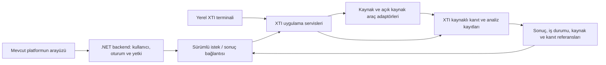

# XTI motoru ve mevcut .NET platformuna entegrasyon

**Karar:** 15 Kasım 2026 son kullanıcı yönlendirmesi.
**Mevcut sürüm:** 0.140.4 / şema 64.
**Durum:** ENG-01 yerel okuma sınırı ve ENG-02 mevcut araç kataloğu temeli
uygulandı. Yeni istihbarat özelliklerinden önce aşağıdaki STB sağlamlaştırma
sırası geçerlidir. .NET tüketicisi henüz bağlı değildir.
[Çalışan v1 sözleşmesi](../ENGINE_CONTRACT.md).

Bu repo Python tabanlı **veri toplama, istihbarat ve analiz motorudur**.
Ürettiği kaynaklı bilgiler daha sonra mevcut .NET platformuna bağlanır.
Uygulama backend'i, giriş, kullanıcı oturumu, roller ve web deneyimi
.NET tarafında kalır. Bu repo ikinci bir uygulama backend'i veya kimlik
platformu geliştirmez. Yerel terminal kullanımı korunur.

**Son kullanıcı açıklaması:** Gelecekteki platform .NET ve PostgreSQL
kullanacak. Bugünkü geliştirme, deneme ve kişisel kullanım SQLite ile sürer.
Bu bilgi şimdi PostgreSQL kurulumu veya veri taşıması başlatma talebi değildir.
Öncelik mevcut motorun kurulabilirliği, güvenilirliği ve bakım düzenidir.
[0145 kararı](../decisions/0145-stabilization-first-local-engine.md).

Bu belge güncel teslim sırasıdır. Önceki
[kurumsal planın](ENTERPRISE_INTEGRATION_PLAN.md) XTI içinde web/backend/oturum
geliştirme kısımlarını değiştirir. [Bileşen seçimi](COMPONENT_SELECTION_PLAN.md)
bu sınıra göre güncellenmiştir. [0142 karar kaydı](../decisions/0142-xti-engine-dotnet-host.md)
ve [çalışan durum](../STATUS.md) plan ile uygulamayı ayırır.

## 1. Görev paylaşımı

| Alan | XTI motoru — bu repo | Mevcut .NET platformu |
|---|---|---|
| Kaynaklar | İnternetten izinli toplama, kaynak sağlığı, normalleştirme | Hangi yetkili kullanıcının hangi işi isteyebileceği |
| İstihbarat | Gözlem, IOC, kaynaklı CTI ilişkisi, olay adayı ve analiz | Sonuçların ürün içinde sunumu ve iş akışına katılması |
| Kalıcı kayıt | Özgün kanıt, analiz/rule sürümü, kaynak zamanı ve iş geçmişi | Kullanıcı, oturum, rol, uygulama ve ekip iş akışı kayıtları |
| Arama/izleme | Kayıtlı veri araması, izleme tanımı, değişim ve yerel bildirim olayı | Kullanıcıya sunum, abonelik yetkisi ve gerekirse dış bildirim kanalı |
| Vaka | Mevcut yerel vaka/karar geçmişini koruma; kaynaklı kanıt ve inceleme işlemleri | Gelecekteki ekip ataması, kullanıcı yetkisi, SLA ve ürün vaka deneyimi |
| Kapsam | Güvenilen çağrıdaki izinli hedef/veri alanını bütün işlemlerde uygulama | Kimlik/rol kararı; kullanıcı girdisini doğrulanmış motor kapsamına dönüştürme |
| Bağlantı | Sürümlü girdi/çıktı, işlem ve kanıt kimliği, hata/durum | Sözleşmeyi tüketen .NET adaptörü |

Motorun kanıt veritabanı ile .NET uygulamasının kullanıcı veritabanı ayrı
sorumluluklardır. .NET motor tablolarını doğrudan okuyup yazan bir katman
olarak tasarlanmaz; sözleşmeden veri alır. Üründe arama/ekran için kopya
gerekirse kaynak kimliği ve sürümü korunur, asıl kanıtın yerine geçmez.
Aynı vaka/durum iki tarafta bağımsız düzenlenip sessizce eşitlenmez; her
yazma işleminin sahibi açık tanımlanır. Mevcut kullanıcı verisi silinmez.

PostgreSQL'in gelecekteki fiziksel yerleşimi, motor kayıtlarının taşınma
kapsamı ve bağlantı teknolojisi ilgili platform incelenince netleştirilir.
Ortak PostgreSQL sunucusu seçilmesi ortak tablo sahipliği veya müşteri
yetkisi anlamına gelmez. Gerekli bir geçişte kayıt kimlikleri, kaynak/kanıt
bağları, olay sırası, atomik bildirim/iş kayıtları ve yedekten dönüş ayrıca
doğrulanır; yalnız bağlantı adresini değiştirmek yeterli kabul edilmez.

"Toplama oturumu" ve "monitor oturumu" motorun iş yürütme kayıtlarıdır;
.NET'e bırakılan kullanıcı giriş oturumuyla aynı şey değildir.

## 2. Bağımlılık politikası

1. **Yerel açık kaynak bileşenler önce:** Ayrıştırma, benzerlik ve standart
   veri işleme için uygun kütüphane/araç kullanılır. Kullanacağımız işlev,
   sürüm, lisans, bağımlılıklar ve geri dönüş davranışı kaydedilir.
2. **Küçük ve değiştirilebilir adaptörler:** Kaynak sağlayıcısı veya araç
   değişince temel veri modeli ve .NET bağlantısı yeniden yazılmaz.
   Gerekli biçim değişikliği sürümlü sözleşme ve açık veri geçişidir.
3. **Zorunlu harici platform yok:** OpenCTI, IntelOwl, ücretli SaaS veya
   bulut hesabı motorun temel kullanım koşulu yapılmaz. Gerekli olursa
   ölçülmüş ek faydayla ayrı, isteğe bağlı sağlayıcı olarak değerlendirilir.
4. **İnternet kaynağı ile yazılım bağımlılığı farklıdır:** Yeni açık kaynak
   verisi toplamak internet ve sağlayıcı erişimi gerektirir. Kaynak
   kesildiğinde saklı kanıt, arama ve yerel analiz çalışır; sonuçların eski
   olduğu gösterilir. Kesinti "tehdit yok" sayılmaz.
5. **Gerektiğinde kapasite:** Kafka, ek arama kümesi veya veri taşıma hedef
   yük ölçülmeden zorunlu hale gelmez. Standart kurulum sade kalır.

Motor için plan tercihleri: ad benzerliğinde RapidFuzz deneyi, haber
akışında feedparser, gerekirse HTML metni için Trafilatura, STIX
genişlemesinde stix2. Mevcut Sherlock/Maigret/theHarvester adaptörleri
korunur. FastAPI/Pydantic, Keycloak ve Cytoscape.js önceki seçilmiş
backend/panel işleri olarak bu repo kapsamından çıkarılmıştır. İleride
ince bir iç servis taşıma adaptörü gerekirse teknoloji ayrıca seçilir;
bu, Python'a kullanıcı/oturum backend'i eklemek anlamına gelmez.

## 3. Hedef akış

Şema hedef tasarımdır; mevcut .NET projesi bu çalışma sırasında incelenmedi
ve bağlanmadı. Bütün teknik kararları o projenin dağıtımına dair varsayımla
vermek yerine veri sözleşmesi şimdi, taşıma biçimi uygun aşamada seçilir.

## 4. Önce sürümlü motor sözleşmesi

Eski `--json` komutları kendi biçimini korur; genel sürümlü entegrasyon
sözleşmesi değildir. Sonuçlar çoğunlukla `ok/data`, hatalar `ok/error`
şeklindedir. Kısmi sonuç `ok:false` ile veri taşıyabilir; hata stderr'de
olabilir. Bazı izleme komutları birden çok JSON çıktı verir. İç toplama
yürütme sürümü, dış istemci sözleşme sürümü yerine kullanılamaz.

0.139.0, ayrı `engine` komutuyla ilk üç salt okunur işlemi v1 biçiminde
sunar. İstek sürümü/kimliği, izinli işlem/parametreler, yapılandırılmış
kayıt referansı, kaynak durumu, sayfalama ve hata kodları uygulanmıştır.
0.140.0 aynı v1 sınırına proje araçlarını okuyan `components.list` ekler;
önceki üç işlemin biçimi korunur.
`request_id` yalnız ilişkilendirmedir; iş kimliği ve kalıcı tekrar önleme
henüz yoktur. Kapsam güvenilen başlatıcının seçtiği kişisel kayıt alanıdır;
paylaşımlı müşteri yetkisi tamamlandı sayılmaz. Daha geniş sözleşme sınırları:

| Bölüm | Tanımlanacak alan ve davranış |
|---|---|
| İstek | Sözleşme sürümü, istek kimliği, izinli işlem, doğrulanmış hedef/kapsam ve seçenekler |
| Sonuç | Sözleşme/motor sürümü, istek/iş kimliği, durum, kayıtlar ve özgün kanıt referansları |
| Kaynak | Kaynak zamanı ile toplama zamanı; son deneme/son başarı, eski/eksik/kısmi veri |
| Liste | Sayfalama, kararlı sıralama, toplam veya açık kısmi kapsam; sessiz kesme yok |
| Hata | Kararlı hata kodu, açıklama, yeniden denenebilirlik ve varsa korunmuş kısmi sonuç |
| Uyumluluk | Zorunlu alan/türler, bilinmeyen alan politikası, desteklenmeyen ana sürüm reddi |

İlk üç okuma senaryosu: kayıtlı verilerde arama, kayıt ayrıntısı ve kaynak durumu.
Temiz/boş/kısmi/hatalı/eski kaynak sonuçları örneklerle tanımlanır. Bu
örnekler motor ve .NET tüketicisinin ortak kabul verisi olur. JSON'un
ayrıştırılması tek başına sonucun iş anlamında geçerli olması değildir.
.NET `System.Text.Json` ile bu biçimleri okuyabilir; zorunlu alan ve
sürüm davranışı ayrıca uygulanır.
[JSON desteği](https://learn.microsoft.com/en-us/dotnet/standard/serialization/system-text-json/overview),
[zorunlu alanlar](https://learn.microsoft.com/en-us/dotnet/standard/serialization/system-text-json/required-properties).

### Taşıma kararı

İlk bağlantı doğrulaması, örnek çıktıları ve sonra izinli salt okunur
komutları tüketen küçük bir .NET adaptörüyle yapılır. Bu adaptör mevcut
.NET uygulamasını yeniden yazmaz. Aynı Linux ortamında süreç/JSON yolu
bir adaydır; ayrı makinelerde gerekirse iç HTTP veya başka taşıma seçilir.
Projenin .NET sürümü, işletim sistemi ve yerleşimi görülmeden kesin taşıma
çatısı seçilmez. Motorun mevcut `fcntl` kilidi nedeniyle Windows üzerinde
doğrudan aynı makine çalıştırması doğrulanmış kabul edilmez.

Süreç yolu seçilirse sabit çalıştırıcı ve izinli işlemler kullanılır;
serbest shell metni veya kullanıcıdan dosya yolu alınmaz. Argümanlar
ayrı değerler olarak iletilir. stdout/stderr birlikte ve boyut sınırıyla
okunur; insan için üretilen terminal metni ayrıştırılmaz. Beklemeyi iptal
etme, süreci durdurma ve kalıcı işi iptal etme ayrı davranışlardır.
[Argüman iletimi](https://learn.microsoft.com/en-us/dotnet/api/system.diagnostics.processstartinfo.argumentlist),
[çıktı okuma](https://learn.microsoft.com/en-us/dotnet/api/system.diagnostics.processstartinfo.redirectstandardoutput),
[bekleme/iptal](https://learn.microsoft.com/en-us/dotnet/api/system.diagnostics.process.waitforexitasync).

### Uzun süren işler

Mevcut toplama geçmişi ve kalıcı işler kullanılır; dış istemciden kabul,
iş kimliği, durum/sonuç okuma ve tekrar güvenliği ayrıca tamamlanır.
`collect` bugün senkron sonuç döndürür; erken kabul yanıtı varmış gibi
sunulmaz. Her web isteğinde sınırsız yeni süreç başlatılmaz.

Aynı istek kimliği ve aynı içerik tekrar geldiğinde mevcut iş tanınır;
aynı kimlikle farklı istek çatışma olarak reddedilir. Cevabın kaybolması
ikinci işi körlemesine başlatmaz. Başarılı, kısmi, başarısız, meşgul,
kesilmiş ve sonucu belirsiz durumlar gerçek motor durumlarıyla eşlenir.
İptal/kurtarma tamamlanmış kaynak kayıtlarını silmez. Bellek içi kuyruk
kalıcı kabul veya yeniden başlatma güvencesi değildir.

## 5. Kapsam ve yetki sınırı

.NET kullanıcıyı ve yetkisini doğrular. Motor, yalnız güvenilen bağlantıdan
gelen izinli kapsamı uygular; düz bir `tenant_id` veya `--data-dir` değeri
yetki sayılmaz. Yerel tek kullanıcı kipinden doğrudan ortak müşteri
veritabanına geçilmez. Mevcut kuruluş grupları güvenlik kiracısı değildir.

İlk kurumsal kabul tek kuruluşa ayrılmış motor/veri alanıyla yapılabilir.
Paylaşılan motor gerekecekse kapsam arama, iş, sonuç, kanıt dosyası,
bildirim, dışa aktarım ve LLM girdisinde korunmalıdır. Servis kimliği ve
veri alanı eşlemesini güvenilen sunucu belirler; istemcinin serbest girdisi
belirlemez. .NET'te kimlik yönetimi olması motoru açık, kapsam denetimsiz
bir hizmete dönüştürmez. Bu kapsam kabulü henüz yapılmadı.

## 6. Uygulama sırası

ENG kimlikleri önceki işleri takip etmek için korunur. Yeni özellikleri
öne alan eski sıra değişmiştir; güncel öncelik aşağıdaki STB adımlarıdır.

| Adım | Teslim | Tamamlanma ölçütü |
|---|---|---|
| **ENG-01 — Motor/.NET sözleşmesi** | 0.139.0: sürümlü yerel `search`, `record.get`, `sources.status` ve örnekleri uygulandı | Salt okuma, eski komut uyumu, tam/boş/hatalı/eski kaynak, kapsam reddi ve kayıt referansı kabulü; gerçek .NET tüketicisi ENG-05'te açık |
| **ENG-02 — Bileşen ve kaynak düzeni** | 0.140.0: üç mevcut araç için ortak pin, açık yapılandırma ve yerel kurulum kataloğu; CLI/engine okuması uygulandı | Kurulum gözlemi canlı kaynak durumundan ayrı, araç yokken eski kanıt okunabilir, pin kayması testli; yeni araçlar aynı sınırla eklenir |
| **ENG-03 — Bekleyen iki özellik** | Kaynaklar arası olay adayları ve kaydedilmiş genel arama bildirimleri; sağlamlaştırma önceliği nedeniyle bekliyor | Kaynak/tarih ayrımı, sessiz başlangıç, tekrar önleme, tutarlı tam sonuç ve insan kararı; RapidFuzz yalnız fayda gösterirse |
| **ENG-04 — Bekleyen haber ve kaynak genişlemesi** | feedparser ile RSS/Atom; sonra kanıtlanmış kapsam boşluğuna yeni kaynaklar | Kaynak atfı, tarih, tekilleştirme ve gerçek erişim; hata ile sonuç yokluğu ayrı |
| **ENG-05 — .NET bağlantı kabulü** | Salt okunur tüketici denemesi; ardından kalıcı iş başlatma/durum/sonuç ve seçilen taşıma | Gerçek iki taraflı test; sürüm, kısmi sonuç, sayfalama, cevap kaybı, tekrar, iptal ve yanlış kapsam |
| **ENG-06 — Motor işletimi** | Temiz Linux kurulum, kaynak kesintisi, yeniden başlatma, yedek/geri dönüş ve kapasite ölçümü; araç kurulum bütünlüğü ve kesinti sonrası geri dönüş | İlk adımdan itibaren yürür; gerçek kurumsal kullanımdan önce ilgili koşullar geçer |
| **ENG-07 — Sonraki motor yetenekleri** | Gerektikçe STIX/diğer paylaşım çıktıları, kapsamlı kaynak modülleri ve isteğe bağlı LLM | Her özellik kaynaklı sonuç sözleşmesiyle teslim edilir; model/sağlayıcı hatası çekirdeği durdurmaz |

ENG-01'in ilk yerel okuma teslimi ve ENG-02'nin mevcut araç düzeni
tamamlandı. [Bileşen kataloğu](../COMPONENTS.md) tam bağımlılık/kurulum
bütünlüğü veya canlı çalışma kabulü değildir; ileri işletim işleri ENG-06'da
açıktır. Olay adayları, genel arama bildirimi, RSS ve LLM geliştirmesi bu
sağlamlaştırma döneminde bekler. Mevcut özelliklerin kullanımı devam eder.

| Öncelik | Somut iş | Kabul kanıtı |
|---|---|---|
| **STB-01 — Doğrulama ve belge tutarlılığı** | Engine/bileşen testlerini hızlı CI'a katma, kurulum filtrelerini güncelleme, yanlış komut ve eski kapsam açıklamalarını düzeltme | Güncel hızlı paket, kaynak kataloğu testleri ve ağsız komut örnekleri geçer; uygulanan ile planlanan ayrılır |
| **STB-02 — Kurulum ve güncelleme** | Desteklenen temiz Linux ortamında klonlama, kurulum, tekrar kurulum, güncelleme ve araç ortamı geri dönüşünü doğrulama | Yeni makinede belgelenmiş adımlar çalışır; kesinti sonrası önceki çalışan ortam ve kayıtlar korunur |
| **STB-03 — Veri ve iş güvenilirliği** | Bozuk kayıt, yedek/restore, kesilmiş iş ve tekrar denemesini birlikte sınama; sır saklama ve erişim sınırını iyileştirme | Kanıt/karar kimliği kaybolmaz, aynı iş yanlışlıkla çoğalmaz, sırlar çıktıya taşınmaz; işletici kurtarma adımlarını uygulayabilir |
| **STB-04 — İşletim ve kapasite** | Kaynak hatası, ağ kesintisi, yeniden başlama, disk baskısı ve uzun süreli yerel çalışmayı ölçme | Sonuç/ölçüm, kullanılan makine ve veri hacmiyle kaydedilir; kaynak hatası boş başarı olmaz; ölçülmemiş SLA veya kapasite ilan edilmez |
| **STB-05 — Gelecekteki platform kabulü** | İlgili .NET uygulamasıyla okuma ve kalıcı iş sözleşmesini doğrulama; PostgreSQL yerleşimi ve gerekiyorsa veri geçişini somut platforma göre tasarlama | Gerçek iki taraflı akış, cevap kaybı/tekrar/kapsam denemeleri ve gerekiyorsa taşınan kayıtların eşdeğerliği; kullanıcı/rol yönetimi .NET'te kalır |
| **STB-06 — Teslim paketi** | Kurulum/kullanım/kurtarma rehberi, sürüm değişikliği, desteklenen ortam ve bilinen sınırları yayımlama | Başka kişi sözlü yardımsız kurup temel senaryoyu tamamlar; açık işler ve hangi kabulün geçtiği görünürdür |

STB-01'in 0.140.1 dilimi bu incelemede belirlenen CI ve güncel kullanım
belgesi açıklarını kapatır. 0.140.2, STB-02 içinde theHarvester için
korunan eski ortam, ortak çalışma kilidi, kesinti günlüğü ve kurtarma
komutlarını ekler. Gerçek Ubuntu kurulumu için ayrı kabul işi eklendi;
çalıştırma sonucu [güncel durumda](../STATUS.md) ayrıca kaydedilir.
0.140.3 marka araçlarını ve XTI başlatıcısını aynı kurtarma/kilit düzenine
alır; marka Ubuntu kabulü veri korunması ve tekrar kontrolüyle genişletilir.
`cbea620` üzerinde iki gerçek Ubuntu kurulum işi başarılıdır: temiz
kurulum, tekrar, geçici kayıtların korunması, engine okuma ve yedekten
dönüş geçti; kilit/kesinti/kurtarma mekanizması çevrimdışı regresyonlarla
sınandı. [Çalıştırma kayıtları](../STATUS.md). Önceki yayımlanmış XTI
sürümünden gerçek güncelleme ve gerçek araç ortamının yenilenmesi
sırasında kesinti/geri dönüş ayrıca açıktır. STB-02'nin bu ilk kabulü,
aşamanın bütün güncelleme kapsamını tamamlamaz.
STB-02–06 henüz bütünüyle tamamlanmış değildir. Yerel motor kabulü ile gerçek .NET
üretim kabulü ayrı kaydedilir. SQLite ile STB-02–04 ilerleyebilir;
gelecekteki PostgreSQL dağıtımını bugün kurmak ön koşul değildir. Mevcut
platform görülmeden framework, sürücü, sunucu sürümü veya fiziksel veritabanı
ayrımı seçilmez. Özellik geliştirmesine dönüş tamamlanan kabul ve açık
işler üzerinden yeniden değerlendirilir.

Yeni kaynaklar önce ücretsiz ve uygun açık kaynak erişimiyle denenir.
Kapsamları, koşulları ve katkıları görünürdür. Bütün internet, kesintisiz
ücretsiz kaynak veya ölçülmemiş kurumsal kapasite taahhüdü verilmez.

## 7. Korunan mevcut iş ve kapsam

Mevcut terminal, kanıt geçmişi, kuruluş raporu, kişisel vaka/inceleme,
bildirim ve toplama oturumları korunur. Şema veya kayıt kimliği bu plan
değişikliğiyle değişmez. Otomatik HTML arşivi kaldırılmış olarak kalır;
elle rapor çıkarma kullanılabilir. Ürün/sürüm/paket/CVE kapsamı, saldırı,
istismar ve otomatik engelleme/yama yeni plana dahil değildir.

E-posta/SMS, kullanıcı/rol/SSO, React ekranı ve MSSP ürün yönetimi bu
motorun yeni geliştirme işleri değildir. Mevcut manuel webhook gibi
uygulanmış aktarım yetenekleri silinmez; gelecekteki ürün kanalı ve
abonelik yönetimi .NET tarafının kararıdır.

## 8. İlk sonraki iş

**Sürüm güncelleme kabulünü tamamlama (STB-02):** temiz Ubuntu kabulü
geçti. Sırada önceki yayımlanmış sürümle oluşturulmuş araç ortamı ve
örnek kayıtları yeni sürüme taşıyarak kurulum/okuma/geri dönüşü doğrulama
vardır. Gerçek araç ortamını yenilerken kesinti ve açık kurtarma ayrıca
sınanır; mevcut çevrimdışı mekanizma testleri bu zincirin yerine geçmez.
Sonrasında STB-03 kapsamında kalıcı kanıt/iş kesintisi, yedek ve geri
yükleme zincirinin birlikte kabulü gelir.

V1 yerel okuma sınırı ile üç aracın kurulum kataloğu kullanılabilir.
.NET/PostgreSQL bağlantısı henüz uygulanmadı. Şema ve mevcut veriler korunur.

## 9. Toplu sağlamlaştırma iş listesi ve bitiş ölçütleri

**15 Kasım 2026 kullanıcı yönlendirmesi:** Kalan işler birlikte çıkarılır;
değişikliklerin başarı, hata, kesinti ve uyumluluk ölçütleri koddan önce
belirlenir. Aşağıdaki liste mevcut STB sırasını ayrıntılandırır; yeni bir
ürün kapsamı değildir. İnceleme tabanı `66b4d56` / 0.140.3'tür.

Temiz Ubuntu kurulumu, sağlıklı tekrar, temel veri koruma ve araç kilit/
kurtarma testleri mevcut kabul kanıtıdır. Yedekleme, yarım iş kaydı,
tekrar deneme ve sır gizleme de uygulanmıştır. Aşağıdaki işlerin çoğu bu
parçaların birlikte ve gerçek süreçlerde doğrulanmasıdır. Doğrulama
eksikliği tek başına kod hatası sayılmaz; düzeltme somut bulguya dayanır.

| Sıra / kimlik | Yapılacak iş | Bittiğini gösterecek sonuç | Ortam |
|---|---|---|---|
| 1 / STB-02a | Önceki yayımlanmış sürümde araçlar ve örnek kayıtlar hazırlayıp mevcut sürüme güncelleme; desteklenen geri dönüş yolunu uygulama | Araçlar doğrulanır; kayıt/kanıt kimlikleri ve geçmiş korunur; engine okuması aynı anlamı taşır; dönüşün kod, araç ve veri kapsamı açık kaydedilir | Geçici Linux klonu; gerçek kullanıcı verisi kullanılmaz |
| 2 / STB-02b | Gerçek araç ortamını yeniden kurarken kontrollü kesinti ve açık kurtarma | Çalışan alt süreç varken ortam taşınmaz; önceki ortam kurtarma sonrası doğrulanır; veriler korunur; kurtarmayı tekrarlamak zarar vermez | Geçici Linux klonu; Maigret/Sherlock ve theHarvester ayrı |
| 3 / STB-03a | Desteklenen kayıt ailelerini, insan kararlarını, vaka/bildirim/tedarikçi ve iş geçmişini tek örnek kümede yedekleyip geri yükleme | Kimlikler, bağlar, geçmiş ve okunma durumları korunur; engine'in desteklediği okumalarda CLI/engine sonuçları eşdeğerdir; kaynak veriye yazılmaz | Geçici SQLite ve sentetik kanıt |
| 4 / STB-03b | Toplama kaydının öncesinde/sonrasında ve üst oturum kapanmadan kesinti; yalnız eksik işi sürdürme | Tamamlanan kaynak kaydı yeniden üretilmez; kanıt/bildirim çoğalmaz; eksik iş tamamlanır; eski oturum geçmişi korunur | Kontrollü kaynaklar ve gerçek alt süreçler |
| 5 / STB-03c | Toplama, devam, kurtarma ve yedek komutlarını aynı veri üzerinde eşzamanlı sınama | Aynı işin tek sahibi olur; çalışan iş devralınmaz; çakışma açık bildirilir; sağlam veri korunur | Geçici ortak veri alanı |
| 6 / STB-03d | Bozuk kayıt/kanıt bağı, bozuk yedek, dolu geri yükleme hedefi ve başarısız kurtarma | Yanlış başarı veya sessiz üstüne yazma olmaz; sağlam kayıt/yedek değiştirilmez; doğrulanmış kopyadan geri dönüş adımları uygulanabilir | Bozulmuş veri yalnız test kopyasında |
| 7 / STB-03e | Test sırlarının terminal, JSON, HTML, hata ve süreç çıktıları boyunca gizliliği; hassas dosya izinleri ve girdi sınırı | Test sırrı dış çıktıya taşınmaz; dosya izinleri doğrulanır; engine isteği keyfî komut/veri yolu seçemez; yedeklerin hassas içeriği belgelenir | Yerel test verisi; gerçek sır kullanılmaz |
| 8 / STB-04a | Kaynak zaman aşımı, bağlantı kesilmesi, 429/503, bozuk yanıt ve düzelme zinciri | Son başarılı veri korunur; hata boş başarı olmaz; bekleme/istek sınırları korunur; yalnız gereken iş sürdürülür | Kontrollü kaynak düzeneği; dış sağlayıcı zorlanmaz |
| 9 / STB-04b | Gerçek Linux zamanlayıcısını çalıştırma, durdurma, yeniden başlatma ve kaçırılmış zamanlama sonrası gecikmiş çalışmayı doğrulama | Çift çalışma oluşmaz; meşgul/kısmi/hatalı sonuç korunur; durdurma etkilidir; yedek ve kurtarma adımları gerçek hizmette işler; her kaçırılmış tur ayrı çalıştırılmaz | systemd kullanıcı oturumu olan geçici Linux ortamı |
| 10 / STB-04c | Büyüyen örnek veri, düşük disk ve uzun çalışma denemesi | Veri kaybı/yanlış başarı olmaz; süre, bellek ve disk ölçümleri makine/veri hacmiyle kaydedilir; deneme süresi ve kabul eşikleri başlamadan yazılır | İzole disk sınırı ve ölçülebilir Linux ortamı |
| 11 / STB-06a | Kurulum, güncelleme, günlük kullanım ve kurtarmayı tek teslim rehberinde doğrulama; CLI/engine uyumluluğunu ve CI kapsamını eşitleme | Yeni klonda komutlar çalışır; mevcut sözleşme korunur; son kodun ilgili ve genel testleri geçer; desteklenen ortam, sonuç commit'i ve kalan platform işleri görünürdür | Temiz klon; Linux adımları gerçek Linux'ta |

1–2 tamamlandıktan sonra 3–7, ardından 8–10 yürür; 11'in belgelendirmesi
her dilimde güncellenir ve sonunda baştan sona kabul yapılır. Bağımsız
incelemeler paralel yürüyebilir; aynı kalıcı veriyi veya kurulumu değiştiren
işler sırayla ilerler. Her satır ancak kendi kanıtı kaydedilince kapanır.
Sabit araç/Python sürümleri değişirse o sürüm geçişi ayrıca kabul gerektirir;
mevcut sürümün başarısı gelecekteki tüm yükseltmeleri kapsamaz.

İlk sürüm geçişi denemesinin başlangıcı yayımlanmış 0.140.2 (`9cdf32c`),
hedefi 0.140.3 (`66b4d56`) olarak seçilmiştir. Geçici klonda aynı proje
yolu korunur; eski sürümde oluşturulan gerçek araç ortamı ve sentetik
kayıtlar yeni kodla kullanılır. Önce eski sürümün kontrolü, sonra güncelleme,
araç doğrulaması, engine okuması ve desteklenen geri dönüş sınanır. Kurulum
kesintisi ayrı deneyde yapılır; kullanıcının çalışan ortamı değiştirilmez.
Bu paragraf deney tasarımıdır, çalıştırılmış kabul sonucu değildir.

### Kod değişikliğinden önce ve teslimden önce

1. Beklenen davranış, etkilenen giriş/çıkış, veri/kanıt bağı ve geri dönüş
   yolu yazılır. Mevcut testlerin kapsadığı alan tekrar geliştirilmez.
2. Normal başarıya ek boş sonuç, kaynak hatası, bozuk veri, kesinti,
   tekrar ve eşzamanlı çalışma senaryolarından ilgili olanlar seçilir.
3. Değişiklik küçük bir sorumlulukta tutulur; iş mantığı terminal,
   veritabanı ve dış araçtan bağımsız kalır. Ortak davranışın kopyası
   yerine mevcut port/adaptör ve yardımcıları kullanılır.
4. Anlamlı regresyon senaryoları ve bağımsız inceleme geçmeden teslim
   kapatılmaz. Son test keşfinden sonra kod değişirse etkilenen kontroller
   yeniden çalıştırılır; son kodun hangi testlerden geçtiği açık yazılır.
5. Sonuç, test ortamı ve commit birlikte kaydedilir. Gerçek hata, henüz
   yapılmamış doğrulama, dış kaynak kesintisi ve yeni özellik ayrı izlenir.
   Yeni bulgu mevcut işin ölçütüyle ilişkilendirilir; kapsam büyümesi ayrıca
   görünür yazılır. Sorunsuz birkaç testten üretim garantisi çıkarılmaz.

### Gerçek platform geldiğinde yapılacaklar

STB-05 kapsamında mevcut .NET projesiyle dört okuma işleminin gerçek
tüketici kabulü yapılır. Sonra engine üzerinden kalıcı iş başlatma,
durum/sonuç okuma, cevap kaybında tekrar güvenliği ve kapsam denetimi
uygulanır. PostgreSQL yerleşimi ve gerekiyorsa veri taşıma aynı platform
incelenerek kararlaştırılır; kimlik/kanıt/karar geçmişi ve geri dönüş
eşdeğerliği doğrulanır. Bunlar bugünkü SQLite kabulünün bitiş koşulu
değildir; ilgili .NET kodu ve hedef çalışma ortamı gerektirir.

### Sağlamlaştırmadan sonraki özellik sırası

ENG-03 kaynaklar arası olay adayları ve kayıtlı genel arama bildirimleri;
ENG-04 RSS/Atom ve ölçülmüş katkısı olan kaynaklar; ENG-07 ihtiyaç halinde
paylaşım çıktıları ve isteğe bağlı LLM desteği. Her yeni açık kaynak
bileşende görev, lisans, sabit sürüm, veri katkısı ve hata halinde çekirdek
davranışı önce değerlendirilir. Bu liste bu özellikleri şimdi uygulamaya
alma veya ertelenmiş web/oturum kapsamını geri açma kararı değildir.
