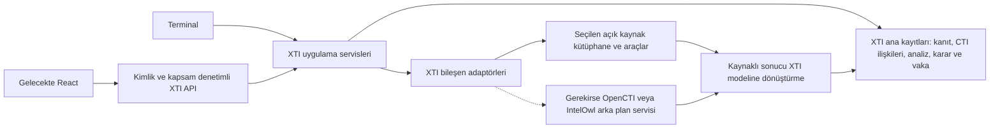

# XTI — Önceki kurumsal entegrasyon planı (tarihî)

**Yerine geçen plan:** [XTI motoru ve .NET entegrasyonu](ENGINE_INTEGRATION_ROADMAP.md).
15 Kasım 2026 son kullanıcı kararıyla bu dosyanın EIP teslim sırası ve
uygulama backend'i, kullanıcı oturumu, kimlik ve web geliştirme tercihleri
yürürlükten kalkmıştır. Bunlar mevcut .NET platformunun sorumluluğudur.
Bu repo veri toplama/analiz motoru ve sürümlü bağlantı sözleşmesi sağlar.
Aşağıdaki içerik önceki tasarımın tarihî kaydıdır; yeni iş seçimi veya
uygulanmış özellik kanıtı olarak kullanılmamalıdır. Bağımsız açık kaynak
bileşenler ve kaynaklı kanıt ilkeleri [0142 kararında](../decisions/0142-xti-engine-dotnet-host.md)
korunmuştur. ENG iş kimlikleri korunur; güncel öncelik motor planındaki
STB sağlamlaştırma adımlarıdır. Yeni istihbarat özellikleri bu dönemde bekler.

**Karar tarihi:** 15 Kasım 2026. **Mevcut uygulama:** 0.138.0 / şema 64.
**Durum:** Kullanıcının kurumsal hedefi ve entegrasyon önceliği kabul edildi;
bu belgede planlanan bağlantılar henüz uygulanmadı veya kurulmadı.

**Aynı gün kullanıcı netleştirmesi:** Tek ürün, ana geliştirme deposu ve
ürünün kalıcı kayıt merkezi **XTI** olacak. Toplama, analiz sonucu, CTI
ilişkisi, inceleme, vaka ve rapor XTI üzerinden kullanılacak. Kullanıcının
ayrı bir OpenCTI/IntelOwl projesini geliştirmesi veya kendi işini tamamlamak
için onların panellerine geçmesi gerekmeyecek. Açık kaynak bileşenler
XTI'nın yönettiği, değiştirilebilir yardımcılar olarak değerlendirilecek.

Bu plan bundan sonraki teslim sırasını belirler. Ana roadmap ve backlog'daki
eski kişisel kullanım önceliğini günceller; çalışan kapsamı değiştirmez.
Gerçek teslimlerin kaydı [STATUS](../STATUS.md), mimari karar
[0141](../decisions/0141-enterprise-integration-first.md) içindedir.

**Hazır bileşen seçimi:** [Seçim planı](COMPONENT_SELECTION_PLAN.md), ilk
iki özellikte yeniden kullanılacak XTI parçalarını, RapidFuzz deneyini,
haber için feedparser tercihini ve API/panel/paylaşım aşamalarındaki
bileşenleri belirler. Bunlar kurulum kabulü veya tamamlanmış özellik
değildir; gözlenen yayın sürümleri test edilmiş sürümlerden ayrı tutulur.

## 1. Hedef ve değişmeyen sınırlar

Hedef, analistlerin ve daha sonra birden fazla müşterinin kullanabileceği
kurumsal XTI platformudur. Ürün davranışı, veri modeli, yetkiler ve kullanıcı
deneyimi bu projede geliştirilir. Uygun açık kaynak kütüphane ve araçlarla
hazır yetenekler kullanılır. OpenCTI/IntelOwl bütün olarak zorunlu mimari
parçalar değildir; gerekiyorsa arka planda sonuç sağlayan adaylardır.
Seçim bağımsız bileşen, dar araç adaptörü ve bütün servis seçenekleri
karşılaştırılarak yapılır. Her yetenekte XTI'dan tamamlanabilen kullanıcı
işi teslim edilir; yalnız başka platforma bağlantı eklemek yeterli değildir.

Bugün ücretsiz yerel kullanım sürer. Kurumsal hedef; bütün servisleri bugün
kurma, ücretli API açma veya mevcut veriyi dışarı gönderme talimatı değildir.
Gelecekteki sunucu, veri erişimi, lisans ve işletim bütçeleri ayrı ölçülür.

- Savunmacı OSINT yönü korunur. Saldırı, istismar, otomatik engelleme veya
  yama yükleme eklenmez. Yeni aktif kontrol ve dosya gönderimi bir analiz
  platformunun kurulmasıyla kendiliğinden açılmaz.
- Sunucu içi envanter, ürün/sürüm, paket ve CVE/KEV/EPSS geliştirmesi aktif
  kapsam dışıdır. Eski veriler uyumluluk için korunur.
- Otomatik HTML rapor arşivi kaldırılmıştır. Elle HTML dışa aktarma kalır.
- API/React, takım ve paylaşım özellikleri artık aşağıdaki somut kurumsal
  aşamalardadır. E-posta/SMS, geniş marka ve takedown ayrı teslimlerdir.
- LLM isteğe bağlı gelecekteki yardımcıdır; kaynak veya doğrulama yerine
  geçmez. [Mevcut LLM planının](LLM_PLAN.md) kanıt ve yetki sınırları korunur.

## 2. Hangi işi hangi parça yapacak?

| Parça | Görevi | XTI'da koruyacağımız sorumluluk | Başlangıç kararı |
|---|---|---|---|
| XTI | İzleme, CTI araştırması, kaynaklı ilişkiler, analiz sonuçları, insan kararları, vaka ve rapor | Ürünün asıl kaydı, veri modeli, iş kuralları ve bütün kullanıcı deneyimi | Tek ana proje geliştirilir |
| Bağımsız açık kaynak bileşenler | Ayrıştırma, eşleştirme, analiz veya kaynak sorgusu gibi sınırlı görevler | Sürüm, lisans, kapsam, sonuçların ortak modele alınması ve testler | Somut ihtiyaçta ilk değerlendirilecek seçenek |
| OpenCTI | Seçilirse arka planda CTI bağlamı veya ilişki işlemleri sağlayan yardımcı | İlişki/rapor kanıtının kalıcı XTI kaydı, XTI'da araştırma, kapsam ve paylaşım kararı | Bağımsız bileşenlere göre faydası gösterilirse CE denemesi |
| IntelOwl | Seçilirse izinli araçlarla ek analiz çalıştıran yardımcı | Analiz seçimi, dışa giden veri, sonuçların XTI'da saklanması ve gösterimi | İlgili araca doğrudan adaptörle karşılaştırılan aday |
| Mevcut Sherlock/Maigret/theHarvester adaptörleri | Mevcut sınırlar içinde sosyal kullanıcı adı ve arşiv keşfi | Kapsam, kurulum sürümü, kaynak hatası ve insan değerlendirmesi | Korunur; aynı işi ikinci kez çalıştırmayız |
| Kimlik sağlayıcısı | Giriş, kurum hesabı, çok faktörlü doğrulama ve oturum | Her veri/iş için XTI erişim kararı ve müşteri kapsamı | Ekip aşamasında mevcut kurumsal sağlayıcı veya Keycloak değerlendirilir |
| Diğer platformlar | MISP paylaşımı veya kurumun vaka/SIEM sistemi gibi somut ihtiyaç | XTI kaydı ve kullanıcı iş akışı korunarak paylaşım/sonuç alma | Gereksinim çıktığında; ilk kuruluma topluca eklenmez |

OpenCTI resmî GraphQL API ve Python istemcisi sunar. IntelOwl resmî REST
API ve Python istemcisi sunar. Bütün servis seçilirse desteklenen bağlantı
yolu kullanılır. Bağımsız paket/araç seçilirse lisansı ve sürümü korunarak
XTI adaptörüne bağlanır. Başka projenin çekirdeğini sürekli değiştirmeyi
gerektiren bir fork varsayılan çözüm değildir; her iki yolun bakım maliyeti
ve XTI içinde tamamlanabilen davranışı değerlendirilir.
[OpenCTI API](https://docs.opencti.io/latest/reference/api/),
[PyCTI](https://docs.opencti.io/latest/development/python/),
[IntelOwl istemcisi](https://intelowlproject.github.io/docs/pyintelowl/).

Keycloak kimlik hizmeti adayıdır; onu kurmak XTI verisine erişim kurallarını
kendiliğinden tamamlamaz. MISP ise paylaşım ihtiyacı oluşursa değerlendirilir.
[Keycloak](https://www.keycloak.org/), [MISP](https://www.misp-project.org/).

## 3. Kurulum ve mimari

Aşağıdaki çizim hedef tasarımdır; bugün bağlı servisleri göstermez.

- **Yerel profil:** Bugünkü kolay kurulum korunur. OpenCTI, IntelOwl veya
  Docker zorunlu olmaz. Entegrasyonlar kapalıyken mevcut işler çalışır.
- **Bileşen laboratuvarı:** Aynı XTI deposundan yönetilen örnekler ve
  yapılandırmayla, seçilen paket/araç veya gerekirse servis denenir.
  Örnek veri alanı kullanıcı verisinden ayrıdır. Sürüm, lisans, kaynak
  tüketimi ve XTI içindeki kullanıcı işi ölçülür. Servis seçilirse Python
  istemcisinin kurulması o sunucuyu kurmuş sayılmaz.
- **Tek kuruluş ekip kurulumu:** Kimlik, yetki, API/React, işletim ve kurtarma
  kabulünden sonra ayrı dağıtım profili. Kurumun mevcut servislerine bağlanma
  seçeneği de bulunur.
- **Çok müşteri kurulumu:** Ayrı müşteri dağıtımları başlangıç adayıdır.
  Ortak servis kullanımı ancak uçtan uca ayrım ve maliyet doğrulanınca seçilir.

İş mantığı dış SDK'ları veya dış veritabanı şemasını bilmez. Okuma,
analiz isteği ve paylaşım ayrı küçük sözleşmelerdir. Dış veritabanına
doğrudan yazılmaz. Her platformun kendi bağımlılıkları ayrı tutulur;
XTI'nin mevcut Python ortamına bütün analiz araçları yüklenmez.

Kullanıcının işi XTI terminalinden ve ileride XTI React panelinden
tamamlanır. Dış ürüne yönlendirme veya onun ekranını açma kabul ölçütü
olamaz. Seçilen yardımcıların kurulum, yapılandırma, sürüm ve sağlık
tanımları bu repodan yönetilir; üçüncü taraf kaynak depolarını değiştirmek
normal geliştirme akışının parçası değildir. Tek ana kayıt merkezi mantıksal
sorumluluğu tanımlar; bütün bağımlılıkların aynı süreçte veya tek fiziksel
veritabanında çalışması şartı getirmez.

OpenCTI'nin kendi arama, kuyruk, önbellek ve nesne depolama bileşenleri;
IntelOwl'un kendi veritabanı ve iş çalıştırıcıları vardır. Bu, XTI'ye de
hemen Kafka veya ikinci bir arama kümesi ekleme gerekçesi değildir.
[OpenCTI dağıtımı](https://docs.opencti.io/latest/deployment/overview/),
[IntelOwl kurulumu](https://intelowlproject.github.io/docs/IntelOwl/installation/).

## 4. Verinin ve kararın sahibi

| Kayıt | Asıl kayıt / değişiklik sahibi | Bağlantı davranışı |
|---|---|---|
| İzlenen varlık, kapsam, tedarikçi, kullanıcı tercihi | XTI | Dış platformdaki aynı ad izleme kapsamını değiştirmez |
| Özgün gözlem, kaynak cevabı ve tarihî kanıt | Toplama kaynağı + XTI kanıt kaydı | Paylaşılmış görünüm yerel kanıtın yerine geçmez |
| İnsan kararı, vaka durumu ve görev | XTI | Yardımcı servis çıkarımı veya analiz sonucu vakayı kapatmaz |
| Analiz raporu | XTI'da saklanan kaynaklı rapor kaydı; üretici araç/IntelOwl ve asıl sağlayıcı ayrıca belirtilir | XTI'dan incelenir; yalnız uzak iş bağlantısına bırakılmaz |
| CTI ilişkisi/raporu | XTI'da sürümlü, kaynaklı ilişki/rapor kaydı; varsa OpenCTI uzak kimliği ayrıca tutulur | XTI'dan araştırılır; yardımcı çıkarımı otomatik kesin atıf olmaz |
| Teslim/alım, uzak kimlik eşlemesi ve hata | XTI entegrasyon kaydı | Tekrar, belirsizlik, kısmi başarı ve yeniden deneme görünürdür |

İlk entegrasyonda her alanın çift yönlü düzenlenmesi hedeflenmez. XTI'dan
seçili veri gönderme ve dış bağlam okuma ayrı işlemlerdir. Yerel ve uzak
kimlikler ile kurum/kurulum/kaynak/sürüm eşlemesi tutulur. Uzak silme veya
birleştirme yerel geçmişi silmez; açık bir dış olay olarak kaydedilir.

Aynı MITRE veya IOC kaydının doğrudan ve OpenCTI üzerinden gelmesi iki
bağımsız kaynak teyidi sayılmaz. Aracı servis ile asıl kaynak ayrı tutulur.
Yalnız isim benzerliği kayıt birleştirme gerekçesi olmaz. Benzer domain
adayı STIX'e aktarılınca kendiliğinden zararlı `Indicator` sayılmaz;
desteklenen gözlem ve rapor türleri anlamlarına uygun eşlenir.

Kaynak, gözlem/yayın/alınma tarihleri, belirsizlik, paylaşım işaretleri,
lisans/atıf ve dönüşüm sürümü taşınır. Dış bağlantı sonradan kaybolabileceği
için vaka kanıtı yalnız o bağlantıya bırakılmaz; saklama izni çerçevesinde
gerekli anlık kanıt korunur. Dışarıdan gelen karar yerel insan kararından
ayrı görünür. Kurumun başka vaka sistemiyle paylaşım yapılabilir; bu plan
XTI'nın kayıt sahipliğini veya kullanıcı iş akışını o sisteme devretmez.
Yardımcı bileşen değişince önceki kanıt, CTI bağları ve kararlar XTI'da
incelenebilir kalır; yeni analiz üretilemiyorsa eksik yetenek açık gösterilir.

## 5. Sıralı teslimler

Her satır ayrı, küçük sürümlere ayrılır. Süre tahmini donanım ve laboratuvar
sonuçları görülmeden verilmez. “Bağlandı” demek için gerçek servis kabulü
gerekir; yalnız sahte yanıtla geçen test yeterli değildir.

| İş | Somut teslim | Önkoşul ve tamamlanma kanıtı |
|---|---|---|
| **EIP-01 — Sınırlar ve bileşen seçimi** | XTI ana kayıt modeli ve kullanıcı senaryosu; görev başına bileşen ve mevcut kod kullanımı [seçim planında](COMPONENT_SELECTION_PLAN.md) | Araştırma/plan tercihleri kayıtlı; donanım, örnek iş yükü, kalite deneyi ve test edilmiş sürüm kilidi henüz tamamlanmadı |
| **EIP-02 — Analiz bileşeni denemesi** | Tek izinli pasif analiz, kalıcı XTI raporu ve XTI'dan inceleme | EIP-01; uygun araca doğrudan adaptör veya faydası doğrulanırsa IntelOwl. Eklenti kapsamı, hata ve tüketim ölçülür |
| **EIP-03 — CTI bileşeni denemesi** | XTI'dan ilişki araştırması ve kaynaklı bağlam; gerekirse OpenCTI arka plan adaptörü | EIP-01; kanıt ve ilişkiler XTI'da kalır, başka ürün ekranı gerekmez. Bütün OpenCTI kurulumu ve IntelOwl başarısı önkoşul değildir |
| **EIP-04 — Kalıcı bağlantılar** | Doğrulanmış prototipleri sürümlü adaptör, kalıcı iş/teslim kaydı, hata/kota/güncellik görünümü ve kurtarmaya dönüştürme | İlgili platformun EIP-02 veya EIP-03 kabulü; kesinti, cevap kaybı, yeniden başlatma ve servis kapalıyken yerel kullanım testleri; gerçek Linux kabulü |
| **EIP-05 — Onaylı 1 ve 2** | Kaynaklar arası olay adayları; platform genelinde kaydedilmiş aramalar ve yeni eşleşme bildirimleri | EIP-01 veri/sahiplik sözleşmesi. EIP-04 canlı kabulünü beklemek zorunda değildir; mevcut kanıtlarla ve entegrasyon kapalıyken çalışır |
| **EIP-06 — Kaynak kapsamı** | Önce haber/RSS; sonra ölçülmüş boşluğa göre yeni açık kaynak adaptörleri | EIP-01 kaynak kaydı; her kaynakta erişim, ek katkı ve hata/sıfır ayrımı. İlk bağlantılar doğrulanınca paralel ilerleyebilir |
| **EIP-07 — Tek kuruluşta ekip** | Sürümlü API, kimlik/rol, denetim kaydı, görev atama ve React kullanıcı akışı | EIP-04/05; yetki iptali ve erişim testleri; EIP-10 pilot işletim koşulları. Önce tek kuruma ayrılmış kurulum |
| **EIP-08 — Paylaşım ve iş akışı** | Gereken STIX nesneleri, TAXII/SIEM ve kurum vaka sistemi bağlantıları | Destek/anlam matrisi, paylaşım yetkisi, gerçek karşı uç testi. OpenCTI'nin mevcut uygun işlevleri önce değerlendirilir |
| **EIP-09 — Birden fazla müşteri** | Kuruma özel erişim, veri/iş/rapor ayrımı; sonra MSSP deneyimi | EIP-07 ve EIP-10. Dış servisler dahil ayrım kanıtı olmadan müşteri verisi alınmaz |
| **EIP-10 — İşletim ve kapasite** | İzleme, bakım, kapasite ölçümü, yedek/geri dönüş, destek ve hizmet hedefleri | EIP-01'den itibaren yürür. Pilot ve müşteri aşamalarından önce ilgili koşullar zorunludur; en sona bırakılmaz |
| **EIP-11 — İsteğe bağlı LLM** | Kaynaklı açıklama, günlük özet, vaka taslağı; sonrasında sınırlı soru-cevap | AIM planı. Yerel örneklerle bağımsız başlayabilir; takımda erişim kapsamı korunur, diğer bütün fazları beklemez |

İlk adım **EIP-01'de XTI içindeki işi ve kullanılacak bileşeni seçmek**;
ardından ilgili EIP-02/03 denemesi ve EIP-04 kalıcı adaptörüdür. EIP-05
yerel kanıtlarla paralel ilerleyebilir. Sıradaki teslim otomatik olarak
iki büyük platformu kurmak değildir. EIP-06 ve işletim çalışmaları uygun
noktada paraleldir.
API ve React, dış platformlara bağlanmanın önkoşulu değildir; ilk bağlantılar
terminalden kanıtlanır. Canlı kaynak erişimi sağlanamayan deneme “kısmi”
kalır; bunun için bütün bağımsız işleri durdurmayız.

### IntelOwl seçilirse denemenin sınırı

Önce önceden üretilmiş zararsız bir rapor okunur. Ardından kurulum sürümünde
davranışı incelenmiş tek pasif analizciyle kamuya açık bir IP/domain/hash
sorgulanır. İlk deneme dosya yükleme, hedefe yeni tarama veya otomatik
analiz zinciri içermez. Anahtarsız uygun kaynak tercih edilir; ücretli
kaynağa sessiz geçiş yapılmaz. Örnek rapor tek başına canlı kabul değildir.

Resmî istemci belgesinde boş analizci/connector listeleri bütün ilgili
eklentileri seçebilir, paylaşım seviyesi de varsayılan değer alır. Bu
nedenle boş liste “kapalı” kabul edilmez: seçilen sürümde açık izinli liste,
gereksiz dışa aktarıcıların kapatılması ve gerçek ağ davranışı sınanır.
Bir analizcinin pasifliği adıyla değil yaptığı işlemle doğrulanır.
İzinli analizci dışında hiçbir analizci, dışa aktarıcı veya pivot
çalışmadığı iş ve ağ kayıtlarıyla doğrulanır.
[İstemci sözleşmesi](https://intelowlproject.github.io/docs/pyintelowl/IntelOwlClass/),
[analizci kataloğu](https://intelowlproject.github.io/docs/IntelOwl/usage/).

### OpenCTI seçilirse denemenin sınırı

Tek kuruluşlu CE ortamına seçili domain/IP gözlemleri ve kaynaklı raporlar
gönderilir. Desteklenen nesne türü ve tarih anlamı önceden tanımlanır.
Gerekli yetkilere sahip ayrı entegrasyon hesabı kullanılır. OpenCTI'deki
görünüm ve kimlikler doğrulanır; ardından sınırlı dış bağlam okunur.
Yönetici token'ı varsayılan entegrasyon kimliği olmaz.
[Bağlayıcılar](https://docs.opencti.io/latest/deployment/connectors/).

### Önceden onaylanan iki özellik

1. **Olay ilişki adayları:** Mevcut iki ransomware kaynağı karşılaştırması
   genişletilerek HIBP kamu olaylarıyla birlikte kaynakları korunmuş
   inceleme sunulur. Aynı kuruluş farklı olaylar yaşayabilir; tarihlerin
   anlamı ve kesin domain dayanağı açıklanır. Haber ancak EIP-06 ile gerçekten
   toplandıktan sonra dahil edilir. Hazır grafik/analiz bileşenlerinden
   yararlanılır; ilişki modeli ve araştırma deneyimi XTI'ya ait kalır.
2. **Kaydedilmiş genel arama:** Mevcut on tür yerel arama ve CTI'ya özel
   kayıtlı aramalar temel alınır. Tanım/filtre ve sonuç kanıtı kaydedilir;
   ilk ölçüm sessizdir, sonraki yeni eşleşmeler bildirilir. Tekrar bildirim
   üretmez; kaynak hatası sonuç kaybolması sayılmaz. Toplanan veri üzerinden
   çalışır; her arama bütün internette yeni bir sorgu anlamına gelmez.

## 6. Her bağlantının kabul koşulları

- Sunucu, istemci, eklenti ve yapılandırma sürümü birlikte kaydedilir.
  Container digest/dağıtım bütünlüğü doğrulanır; kör `latest` güncellemesi
  yapılmaz. Alt araçların lisans ve destek durumu da kayıt altındadır.
- Kullanıcı işi bütünüyle XTI'dan tamamlanır. Sonuç/kanıt/ilişki XTI'nın
  ortak modelinde saklanır ve arama, vaka, raporda kullanılabilir.
  Yardımcı bileşen kapalıyken eski kayıtlar okunabilir kalır. Gerekli
  sonucu XTI'ya aktaramayan veya başka panel gerektiren aday kabul edilmez.
  Sağlayıcı değiştirme, mevcut kullanıcı komutlarını ve kayıt kimliklerini
  koruyan adaptör sözleşmesiyle sınanır; gerekli şema değişimi açık geçiştir.
- Kalıcı yerel iş kimliği, uzak iş/nesne kimliği, asıl kaynak ve kapsam
  taşınır. Boş, eski, kısmi, başarısız ve hiç çalışmamış sonuç ayrılır.
- Yerel veritabanı işlemi ile uzak API çağrısı atomik değildir. Gönderilecek
  iş önce kalıcı kaydedilir; cevap kaybolursa uzaktaki durum sorgulanır.
  Sonuç doğrulanamıyorsa belirsiz kalır, kör tekrar gönderim yapılmaz.
  Tam olarak bir kez ağ teslimi garantisi yerine tekrar güvenliği sınanır.
- 429, süre aşımı, kimlik iptali, şema değişimi, kısmi sonuç, bozuk yanıt ve
  kapalı servis senaryolarında eski kanıt ve yerel kullanım korunur.
- Dışa giden verinin kapsamı, sağlayıcısı ve amacı açıktır. TLP/etiket tek
  başına yetki kontrolü değildir. API anahtarları log veya repoya girmez.
- Sunucunun verdiği bağlantılar, dosyalar ve metinler güvenilmeyen girdidir;
  boyut, süre, yönlendirme, terminal/HTML gösterimi ve ağ hedefi sınırları
  uygulanır. Dış kaynak metni komut çalıştırmaz.
- Güncelleme önce ayrı ortamda denenir. Veri değişmişse yalnız eski servis
  imajına dönmek geri dönüş değildir; tutarlı yedek ve ayrı ortama gerçek
  geri yükleme doğrulanır. [OpenCTI yükseltmesi](https://docs.opencti.io/latest/deployment/upgrade/).
- Kayıt silme/saklama isteği, paylaşılmış kopyalar ve yedekler için de
  tanımlanır. Güncel silme işlemi ile korunması gereken denetim geçmişinin
  kapsamı ürün politikasında açık olur.

## 7. Kurumsal kullanım ve müşteri ayrımı

Bugünkü `OrganizationScope` bir gruplamadır; güvenlik sınırı değildir.
Ortak arama, bildirim kutusu ve depo doğrudan müşteri erişimine açılmaz.
Kimlik sağlayıcısı kullanıcıyı tanır; XTI her işlemde neyi görebileceğini
ve çalıştırabileceğini ayrıca denetler. Tarayıcıya servis yönetici anahtarı
verilmez. İlk React sürümü kanıtlı API işlemlerini kullanır.

OpenCTI CE Apache-2.0 kapsamındadır; EE ayrı lisanslıdır. Kuruluş bazlı
ayrım ve bazı ileri işletim özellikleri EE kapsamındadır. CE'deki bir etiket
veya ön yüzde filtre, müşteri yalıtımı kanıtı sayılmaz.
[Sürüm ayrımı](https://docs.opencti.io/latest/administration/enterprise/).

Çok müşteri aşamasında seçenekler: müşteri başına ayrı kurulum veya lisansı,
yetkisi ve davranışı doğrulanmış ortak servis. IntelOwl için de aynı ayrım
gereği geçerlidir. Tek ortak güçlü servis hesabıyla yalnız XTI ekranında
filtreleme yeterli görülmez. Bir müşterinin diğerinin verisine erişemediği
arama, grafik, API, dosya, iş, sonuç, önbellek, dışa aktarım, bildirim,
LLM bağlamı ve yedek/kurtarma yollarında sınanır.

Ekip pilotunda kullanıcı/rol, oturum ve anahtar iptali, denetim izi,
görev sahipliği, temel kurtarma ve erişim kabulü bulunur. Müşteri hizmetinde
bunlara veri yaşam döngüsü, müşteri taşıma/ayrılma, olay müdahalesi, destek
sorumlusu ve ölçülmüş hizmet hedefi eklenir. Bir dış ürünün lisanslı
özelliğini atlatmak veya güvenlik sınırını taklit etmek çözüm değildir.

## 8. Ücretsiz geliştirme, kapasite ve işletim

| Alan | Bugünkü yaklaşım | Kurumsal aşamada karar |
|---|---|---|
| Yazılım | Önce uygun bağımsız açık kaynak bileşen; gerekirse OpenCTI CE/IntelOwl arka plan denemesi | Gerekli sürüm/özellik, dağıtım ve SDK lisansları kayıtlı olmalı |
| Veri | Önce uygun ücretsiz ve açık kaynaklar | API anahtarı, kota, geçmiş veri, ticari kullanım ve paylaşım koşulları kaynak başına değerlendirilir |
| Donanım | Mevcut cihaz uygunsa ayrı denemeler | Birleşik bellek/CPU/disk, arşiv büyümesi ve eşzamanlı analiz ölçülür; uzaktaki deneme ortamı gerekebilir |
| İşletim | Yerel kurulum ve kontrollü deney | Sürekli sunucu, ayrı yedek, bakım, izleme ve destek için bütçe gerekir |
| Ölçek | SQLite yerel profilde kalır | Eşzamanlı yazma ve sorgu gereksinimine göre PostgreSQL, iş kuyruğu veya arama deposu seçilir |

IntelOwl ve resmî Python istemcisi AGPL-3.0 olarak yayımlanır; seçilen
dağıtım/entegrasyon modeli ve alt araçların lisansları ürün kararına dahil
edilir. API üzerinden bağlanmak bütün lisans değerlendirmesinin bittiği
anlamına gelmez. [IntelOwl lisansı](https://github.com/intelowlproject/IntelOwl/blob/master/LICENSE),
[Python istemcisi](https://github.com/intelowlproject/pyintelowl).

Resmî gereksinimler ilk tahmin için kullanılır; toplam kurulumun yeterliliği
kendi ölçümümüzle belirlenir. İlk kapasite kaydında cihaz/işletim sistemi,
kuruluş/varlık sayısı, günlük gözlem ve analiz hacmi, aynı anda kullanıcı,
saklama süresi, gecikme ve kurtarma beklentisi bulunur. Eşikler deneyden önce
kaydedilir. Veri kopyası üzerinde taşıma, sorgu, geri dönüş ve kesinti
ölçülmeden yeni veri altyapısına geçilmez. Mevcut geçmiş denetimlerinin ve
tek yazıcı kilidinin maliyeti de ölçüme dahildir.

## 9. “Geri kalmamak” nasıl ölçülecek?

Amaç seçilen kurumsal senaryoları karşılamaktır. Repo sayısı, komut sayısı
veya dış ürünün menüsünde bir özelliğin bulunması tamamlanma ölçüsü olmaz.

| Senaryo | Mevcut durum | Planlanan sağlama yolu | Kabul kanıtı |
|---|---|---|---|
| Kuruluşun dış riskini izleme | Yerel toplama, rapor ve değişim akışları var | XTI + katkısı ölçülmüş kaynaklar | Kaynak/güncellik boşluklarıyla gerçek günlük iş akışı |
| IP/domain/hash bağlamını zenginleştirme | Seçili yerel IOC kaynakları var | XTI analiz modülü + seçili araç veya IntelOwl adaptörü | Kalıcı XTI raporunda asıl kaynak, hata ve zaman görünür |
| Aktör/kampanya/rapor ilişkilerini araştırma | Temel CTI ve ATT&CK var | XTI araştırma modülü + uygun bileşen, gerekirse OpenCTI adaptörü | Örnek olayda araştırma XTI'dan tamamlanır; kaynaklı bağlar XTI'da kalır |
| İlişkili olay ve kayıtlı arama izleme | Dar ransomware/CTI parçaları var | EIP-05 | Aynı ad/farklı olay, tekrar ve kaynak kesintisi sınanır |
| Vaka altında çalışma | Kişisel vaka ve kanıt var | Ekip API/React ve gerektiğinde kurum vaka sistemi | Görev, karar, yetki ve kanıt zinciri korunur |
| SIEM/istihbarat paylaşımı | Sınırlı IOC STIX ve manuel webhook var | EIP-08; uygun OpenCTI paylaşım işlevleri | İkinci sistemde anlamı korunmuş alım ve tekrar deneyi |
| Birden fazla müşteri | Henüz yok | EIP-09 | Bütün erişim yollarında müşteri ayrımı testi |
| Sürekli hizmet | Linux gerçek hizmet kabulü ve uzun işletim ölçümü açık | EIP-10 | Hedef yükte çalışma, kesinti ve geri yükleme kayıtları |
| Geniş marka/dark web/kimlik kapsamı | Kısmi açık kaynaklar; birçok alan yok | Ayrı kaynak ve erişim programı | Tarihli gerçek kaynak kapsamı; erişilemeyen alanlar açık |
| LLM desteği | Planlı, uygulanmadı | EIP-11 | Kaynak atfı, yarar ve yanlış yorum ölçümü |

Her senaryo için işlev, veri kapsamı, doğruluk, güncellik, operasyon ve
güvenlik ayrı değerlendirilir. Aşamalar: **planlandı → prototip → gerçek
entegrasyon doğrulandı → pilotta ölçüldü → desteklenen hizmet**.
Bir aşamadaki başarı diğerlerini otomatik tamamlamaz. OpenCTI/IntelOwl
veya SOCRadar ile eşdeğerlik ancak aynı tanımlı senaryo ve karşılaştırılabilir
kanıt için söylenir; kapalı kaynak erişimi ve bütün ürün kapsamı garanti
edilmez. Karşılaştırma her önemli sürümde güncellenir.

## 10. Bir sonraki somut teslim

[Bileşen seçimi](COMPONENT_SELECTION_PLAN.md) doğrultusunda ilk somut iş,
onaylı olay adayları için kesin kuralların örneklerini ve RapidFuzz
karşılaştırmasını hazırlamaktır. Fayda gösterilirse dar benzerlik adaptörü
eklenir. Kaydedilmiş genel arama mevcut XTI altyapısıyla paralel ilerler;
haber aşamasında feedparser kullanılır. Sonuçlar XTI'da saklanır, aranır ve
incelenir. Bu görevler bütün OpenCTI/IntelOwl kurulumunu gerektirmez.

Bu plan güncellemesinde paket/servis kurulmadı, gerçek veri paylaşılmadı,
veritabanı değiştirilmedi ve yeni bir özellik çalışır ilan edilmedi.
