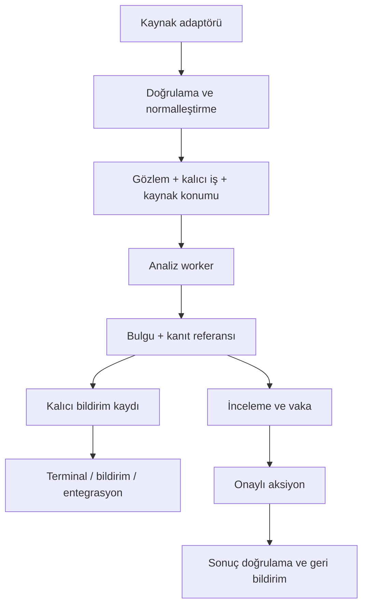

# XTI Platformu — Uçtan Uca Ana Yol Haritası

**Sürüm:** 0.133 · **Güncelleme tarihi:** 14 Kasım 2026 · **Durum:** Aktif hedef planı domain/marka koruması, dış yüzey kanıtı, IOC/CTI, dark web ve ransomware iddiaları, geniş marka koruması, tedarikçi riski, vaka/entegrasyon ve insan onaylı takedown kapsamıdır. Birleşik kaynak durumu 11 kaynak/iş akışının kurulum ve kayıt kanıtını tek terminal ekranında gösterir. Günlük toplama, inceleme, vaka ve tekrar kullanım rehberi ile bütünleşik testler tamamdır. Sonraki geliştirmeler gerçek kullanımda görülen kapsam açığına ve açık kaynak adaptör kabul ölçütlerine göre seçilecektir. Yerel API ve STIX/TAXII kullanıcı kararıyla beklemededir. Sunucu içi envanter, ürün/sürüm çıkarımı, paket takibi ve CVE/KEV/EPSS eşleştirmesi aktif plandan çıkarılmıştır. Gerçek ilerleme [STATUS.md](../STATUS.md) içinde izlenir.

0.88.0, güncel yerel IOC kaynak iddialarını yedi gösterge türünde STIX 2.1 Indicator Bundle dosyasına ağsız, salt-okunur ve atomik çıkarır. CTI nesne/ilişki kapsamı, TLP, içe aktarma ve TAXII ile kalıcı sistem zamanlaması/dış kanal aboneliği açık kalır.

0.89.0, seçilmiş birleşik yerel bildirimi hedefe özgü değişmez gövdeye tekilleştirir; HMAC-SHA256 imzalı HTTPS/443 gönderim ve her denemenin kalıcı sonucunu ekler. Otomatik olay aboneliği, toplu/due worker, zamanlayıcı ve sağlayıcıya özgü SIEM adaptörleri açık kalır.

0.90.0, `analyze DOMAIN` ile kayıtlı marka adayını, pasif alt alan adı durumunu, dış yüzey kanıtını, güncellik/boşlukları, açıklanabilir adayları ve kesin domain/IP IOC eşleşmelerini tek ağsız ve salt-okunur görünümde birleştirir. Ürün, sürüm, paket veya CVE sonucu üretmez.

0.91.0, kullanıcının açık seçimiyle Feodo IOC listesini aynı analiz akışında yeniler. Kaynak kesintisi eski geçerli kataloğu korur ve “eşleşme yok”tan ayrı raporlanır; varsayılan analiz ağsızdır.

0.92.0, CERT Polska'nın son-ay etkin domain listesini ikinci bağımsız ücretsiz IOC kaynağı olarak ekler. Kaynak iddiaları/çalışmaları birbirinden ayrılır; birleşik analiz kök domain, bütün kayıtlı marka/domain adayları ve son kanıt IP'lerini tam değerle karşılaştırır. Bu kaynak Polonya/son-ay kapsamıdır, küresel phishing kapsamı değildir.

0.93.0, resmî MITRE ATT&CK Enterprise v20.0 tam STIX paketinden etkin grup, kampanya, malware ve seçili ilişkileri atomik kaynak iddiaları olarak alır. Aynı veri çoğalmaz; geri çekme/yeniden etkinleşme geçmişi ve başka kaynaklar korunur. Teknik/taktik nesneleri, otomatik atıf ve TAXII bu ilk alt kümede yoktur.

0.94.0, son pasif keşif, web, e-posta, sınırlı servis ve CNAME kanıtlarını tek salt-okunur dış yüzey boşluk görünümünde birleştirir. Tamamlanmış boş kaynak yanıtı, kesinti ve kısmi kapsam ayrılır; her eksik bölüm için kullanıcıya açık sonraki komut verilir.

0.95.0, ThreatCluster'ın son 30 günlük anahtarsız kamu akışını `ransomware recent` ile güvenli canlı önizleme olarak bağlar. Kuruluş/domain/grup/ülke/sektör araması cihaz içinde yapılır; leak-site adresi ve ham metin çıktıya taşınmaz. Kayıt doğrulanmış ihlal sayılmaz ve bu ilk dilim geçmiş ya da bildirim yazmaz.

0.96.0, açık `ransomware refresh` ile doğrulanmış tam snapshot'ı yerel çalışma/öğe geçmişine kaydeder; ilk başlangıç çizgisini, yeni, değişen, aynı, pencereden çıkan ve kaynak hatası durumlarını ayırır. Ham leak-site adresi saklanmaz. Kuruluş/domain izleme ve yerel değişiklik bildirimi sonraki dilimdir.

0.97.0, kuruluş/domain ransomware izleme tanımlarını, sessiz ilk ölçümü ve sonraki yeni/değişen eşleşmelerin ortak yerel kutuya girişini ekler. Kuruluş yalnız kaynak kuruluş alanında, domain yalnız kaynak web hostunda eşleşir; pencereden çıkış kapatma sayılmaz ve tek başına bildirim üretmez.

0.98.0, `ransomware watch-refresh-all` ile kaynağı bir kez yeniler ve yalnız başarılı yeni snapshot ardından bütün etkin izlemeleri kararlı sırada çalıştırır. Sınır aşımı ağdan önce durur; kaynak hatası eski snapshot üzerinde izleme üretmez. Her izleme ayrı atomik kayıttır ve komut zamanlayıcı kurmaz.

0.99.0, `ransomware watch-monitor` ile aynı akışı terminal açıkken sınırlı tur, en az beş dakika aralık ve toplam süre bütçesiyle tekrarlar. Başarısız kaynak turu saklanır ve sonraki tur denenebilir; süre sınırı veya `Ctrl+C` tamamlanan kanıtı silmez. Kalıcı daemon kurulmaz.

0.100.0, her monitor çalışmasını ve tamamlanan turu kaynak/izleme çalışma bağlarıyla kalıcılaştırır. Ağsız liste/ayrıntı; tam, kısmi, kesilmiş, hatalı ve ani kapanma sonrası açık durumu ayırır. Sonraki elle çalışma geçmiş oturum sayacını değiştirmez; daemon veya otomatik devam eklenmez.

0.101.0, güncel kuruluş/domain izleme tanımını kayıtlı snapshot geçmişine uygulayan ağsız zaman çizelgesini ekler. Değişmeyen aynı kaynak kimliği yeni olay olmaz; güncelleme, eşleşme başlangıcı/bitişi, pencereden çıkış ve aynı kimliğin geri gelişi ayrılır. Kaynak kimlik alanı değişen benzer kayıtlar kanıtsız birleştirilmez.

0.102.0, yakın başarılı snapshot geçişlerinde kaynak kimliği değişmiş olabilecek kayıtları insan inceleme adayı olarak gösterir. En az iki ortak açıklanabilir alan gerekir; eşzamanlı, uzak veya zayıf benzerlikler elenir. Adaylar kimlik, zaman çizelgesi, alarm veya veritabanı durumunu değiştirmez.

0.103.0, kimlik değişimi adayına gerekçeli `aynı olay olabilir`, `farklı olay` veya `belirsiz` insan kararı ve silinmeyen olay zinciri ekler. Aynı karar idempotenttir; değişiklik önceki kararı korur. Karar kaynak kimliğini, zaman çizelgesini veya alarmı değiştirmez.

0.104.0, ikinci açık ransomware kaynağı için sürümlü kabul kapısını ve RansomLook'un yazmasız son-yedi-gün önizlemesini ekler. Yalnız grup, başlık ve keşif zamanı gösterilir; eksik ülke/sektör/domain/durum uydurulmaz. RansomLook modeli ThreatCluster geçmişinden ayrıdır; kalıcı ikinci-kaynak geçmişi ve kaynaklar arası insan incelemesi sonraki dar teslimdir.

0.105.0, RansomLook'un doğrulanmış yedi günlük tam snapshot'ını ayrı çalışma/fark tablolarına kaydeder. Başlangıç çizgisi, yeni, aynı, pencereden çıkış ve kaynak hatası ayrılır; son başarılı durum fark zincirinden yeniden kurulabilir. ThreatCluster geçmişiyle bağlantı veya otomatik birleştirme kurulmaz. Sonraki dar teslim RansomLook kuruluş-adı izlemesidir.

0.106.0, RansomLook'un yalnız kaynak kuruluş başlığına bakan ayrı, kalıcı izleme yaşam döngüsünü ekler. İlk çalışma ve tanım değişimi sessiz başlangıçtır; sonraki yeni eşleşmeler inceleme adayı, pencereden çıkış yalnız görünürlük değişimidir. Domain izleme, ortak inbox ve otomatik kaynak birleştirme yoktur. Sonraki dar teslim açıklanabilir kaynaklar arası karşılaştırmadır.

0.107.0, son başarılı yerel ThreatCluster ve RansomLook snapshot'larını ağsız ve salt-okunur karşılaştırır. Kuruluş adı tam aynı olmalı; ayrıca grup veya keşif zamanı eşleşmelidir. İki özgün claim, aynı/farklı alanlar ve kararlı karşılaştırma kimliği gösterilir; fuzzy eşleşme, otomatik birleştirme, alarm veya ihlal hükmü yoktur. Sonraki dar teslim kaynaklar arası insan inceleme adaylarıdır.

0.108.0, kaynak karşılaştırma kimliğine gerekçeli `aynı olay olabilir`, `farklı olay` veya `belirsiz` insan kararı ve silinmeyen olay zinciri ekler. İlk kararın iki özgün kaynak claim/snapshot kanıtı dondurulur; yeni snapshot eski karar dayanağını değiştirmez. Karar kaynak kayıtlarını birleştirmez, alarm/inbox veya ihlal hükmü üretmez. Sonraki aktif program geniş marka korumasının ilk ücretsiz ve yasal dar kaynağını kabul kapısından geçirmektir.

0.109.0, Maigret, Sherlock, theHarvester, Web-Check, Holehe ve olası telefon aracını sürümlü/ağsız kapıyla karşılaştırır. Maigret'in yalnız açık marka kullanıcı adını seçili sitelerde arayan ayrı ve isteğe bağlı adaptörü seçilir. Bu sürüm araç kurmaz, canlı sorgu veya veri yazımı yapmaz. Sonraki dar teslim sınırlı, yazmasız Maigret önizlemesidir.

0.110.0, Maigret 0.6.6'yı resmî reponun tam commit'inden isteğe bağlı kurar ve açık kullanıcı adını yalnız seçilen platformlarda yazmasız önizler. Upstream site veritabanı hash ile doğrulanıp geçici olarak seçilen platformlara daraltılır; ham yanıt ve profil ayrıntıları atılır. Bulgu sahiplik veya taklit kararı değildir. Sonraki dar teslim sessiz başlangıçlı kalıcı fark ve gerekçeli insan incelemesidir.

0.111.0, kullanıcı adı izlemesini kalıcı tanım, yaşam döngüsü, başarılı/başarısız çalışma ve platform sonucu olarak saklar. İlk çalışma sessizdir; sonraki yeni, değişen, artık raporlanmayan ve değişmeyen sonuçlar ayrılır. Kaynak hatası yokluk sayılmaz. Sonraki dar teslim gerekçeli insan incelemesi ve bilinen resmî/meşru profil ayrımıdır.

0.112.0, son başarılı güncel izleme sonucundaki tam profile gerekçeli `known_official`, `possible_impersonation` veya `uncertain` insan kararı bağlar. İlk kanıt dondurulur, karar değişiklikleri eklenir ve profil adresi değişince eski karar yeni adrese taşınmaz. Bu katman otomatik alarm veya sahiplik doğrulaması üretmez. 0.113.0 ile kullanıcının olası taklit işaretlediği aday ortak yerel kutuya bağlanmıştır.

0.113.0, yalnız yeni `possible_impersonation` insan kararını karar olayıyla aynı transaction içinde ortak yerel kutuya bağlar. Aday başına tek bildirim vardır; aynı profil tekrarında alarm çoğalmaz, profil adresi değişirse yeni aday ayrı bildirim olabilir. Bildirim tetikleyen karar kanıtını korur, güncel kararı ayrıca gösterir ve otomatik dış aksiyon üretmez. Sınır kontrollü toplu yürütme 0.114.0 ile tamamlanmıştır.

0.114.0, bütün etkin sosyal kullanıcı adı izlemelerini görünen ad ve kimliğe göre kararlı sırada bir kez çalıştırır. Varsayılan 10 ve açık üst sınır 100'dür; bütün kapsam sığmazsa ağdan ve yazmadan önce durur. Kaynak hatası ayrı başarısız çalışma olarak kaydedilip sonraki izlemeye geçilir; bütünlük hatası yeni işi durdururken tamamlanmış önceki transaction'ları korur. Komut ortak kilit altında ön plandadır ve otomatik taklit kararı, bildirim, zamanlayıcı veya daemon üretmez. Sınırlı sosyal ön plan tekrarı 0.115.0 ile tamamlanmıştır.

0.115.0, tek etkin sosyal kullanıcı adı izlemesini 1–1000 tur, en az beş dakika aralık ve en fazla yedi günlük yeni-tur bütçesiyle terminal ön planında tekrarlar. Monoton saat gerilemesi güvenli durur; kaynak hatası ayrı başarısız turdur ve sonraki tur denenebilir. Süre sınırı yeni turu engeller, `Ctrl+C` tamamlanan bağımsız çalışma kayıtlarını korur. Ortak kilit bütün monitor boyunca tutulur; kalıcı daemon, otomatik devam, taklit kararı veya bildirim yoktur. İkinci ücretsiz sosyal kaynak kapsam kapısı 0.116.0 ile tamamlanmıştır.

0.116.0, sabit Maigret ve Sherlock kataloglarını etkin HTTPS kullanıcı adı tanımı, normalleştirilmiş ad ve Public Suffix List kayıt köküyle ağsız karşılaştırır. Sherlock'un 455 uygun tanımından 103'ü/101 kayıt kökü eşleşmeyen kapsamdır; mevcut 10 platformda yeni katkı yoktur. Bütün katalog taraması yerine sekiz platformluk kısa liste sınırlı adaptör için kabul edilmiştir. Komut araç kurmaz/çalıştırmaz, kullanıcı adı sorgulamaz ve depolama açmaz. Sonraki dar teslim sabit Sherlock 0.16.2 ile kısa listeli yazmasız önizlemedir.

0.117.0, Sherlock 0.16.2'yi resmî tam commit'ten isteğe bağlı kurar; tam katalog özetini doğrulayıp yalnız sekiz platformluk kısa listeden seçilen tanımları geçici kapsama alır. Ek GitHub sürüm isteği yapan upstream CLI yerine sabit kütüphane işlevi yalıtılmış işçide çağrılır ve XTI kendi katı, dört alanlı NDJSON raporunu üretir. Önizleme veritabanı yazmaz; eşleşme sahiplik veya taklit hükmü değildir.

0.118.0, kalıcı sosyal izlemeyi değiştirilemez Maigret veya Sherlock kaynak kimliğine bağlar. Aynı kullanıcı adı farklı yerel izlemelerde iki kaynakla çalışabilir; sessiz başlangıç, fark, kaynak hatası ve tam profil insan kararı birbirine karışmaz. Şema 49 geçmişi yeniden yazılmadan Maigret'e bağlanır. Sonraki dar teslim geniş marka kaynaklarının sıradaki ücretsiz, yasal ve veri-minimize dilimini değerlendirmektir.

0.119.0, theHarvester'ın sabit upstream commit'indeki yalnız Common Crawl ve Wayback Archive P0 hostname sonuçlarını mevcut pasif alt alan adı aday akışına bağlar. Araç ayrı Python 3.14 ortamındadır; DNS, e-posta, kişi ve aktif işlemler kapalıdır. Katı JSONL doğrulaması kaynak kanıtlarını ayrı tutar. Şema 50→51 yalnız provider denetimlerini genişletir ve crt.sh geçmişini yedekli işlemsel geçişle korur.

0.120.0, insanın açıkça onayladığı tedarikçiyi kuruluş adı, değiştirilemez ana domain, ilişki türü, iş önemi ve gerekçeyle yerel envantere alır. Aynı isim farklı domainlerde ayrı kalır; bütün yaşam döngüsü eklemeli geçmişte korunur. Otomatik aday, olay bağlantısı ve risk puanı bu ilk dilimde yoktur.

0.121.0, etkin dış yüzey kapsamının kayıtlı son CNAME kanıtını ağsız inceleyerek farklı PSL kayıt kökünü yalnız teknik dış hizmet adayı olarak saklar. Aday kanıtları ve PSL profili eklemeli tutulur; artık görünmeyen aday tarihsel olur. Kabul yalnız önceden insan tarafından kaydedilmiş etkin tedarikçiye gerekçeli kararla bağlanır ve karar geri alınabilir. Kuruluş tahmini, otomatik birleşim, risk puanı ve alarm yoktur.

0.122.0, etkin insan onaylı tedarikçileri ThreatCluster ve RansomLook'un son başarılı yerel snapshot'larıyla salt okunur eşleştirir. Tam kuruluş adı ve ThreatCluster ilk-taraf web domaini ayrı dayanaklardır; aynı isimli kuruluşlar birleşmez. Kaynak hiç toplanmadı, kullanılabilir, son deneme hatasından sonra eski başarılı veri ve başarılı verisi olmayan hata durumları ayrılır. İddia doğrulanmış ihlal, etki, alarm veya risk puanı değildir.

0.123.0, tedarikçi envanteri, kabul edilmiş güncel CNAME bağı, iki kaynaklı iddia adayı, kaynak kapsamı ve iş önemini açıklanabilir inceleme kartında birleştirir. Beş sınırlı insan inceleme durumu; neden, eksik veri, zaman ve sonraki adımlarla gösterilir. Sayısal risk, doğrulanmış ihlal, alarm ve dış aksiyon yoktur. Bu sürüm tedarikçi çekirdek akışını tamamlar.

0.124.0, domain/marka bulgusu, insan kararlı sosyal profil, iki ayrı ransomware iddiası ve tedarikçi kartını kaynak kayıtları değiştirmeden insan yönetimli yerel vakaya bağlar. Görev, not, durum, sonuç, kapanış/yeniden açma ve tek zaman çizelgesi ağsız terminal/JSON görünümündedir. Açık görev kapanışı engeller; vaka kaynakları birleştirmez veya ihlal hükmü üretmez. Atama/rol/SLA takım ürününde kalır.

0.124.1, temiz klonda global Python ortamını değiştirmeden yerel kayıt alanını hazırlayan tekrar güvenli `./setup` akışını ve kısa kullanım belgesini ekler.

0.125.0, normal kuruluma sabit commit/katalog doğrulamalı atomik Maigret ve Sherlock ortamını ekler. Kullanıcı adı önizleme ve izlemeleri mevcut dar `safe`, elle incelenmiş 30/26 sitelik `extended` veya özel `--site` kapsamını seçebilir; bütün upstream katalog, kota aşma ve profil çıkarımı kapalıdır. Kalıcı izleme çözülen tam listeyi saklar. Şema 54 değişmez.

0.126.0, pasif yüzey sağlayıcılarını tek çalışma sözleşmesine bağlar; theHarvester kanıtının ayrıntıda okunmasını düzeltir ve crt.sh/theHarvester son kayıtlarını birbirinden bağımsız sağlık görünümünde gösterir. Sürümlü kabul kapısı Subfinder v2.17.0 normal CLI'sini makine-okunur kaynak hata/tamamlanma kanıtı ve bağımsız kapsam katkısı olmadığı için erteler. Komutlar ağsız/salt okunurdur; şema 54 değişmez.

0.127.0, `sources status` ile 11 kaynak/iş akışının kurulum ve geçmiş durumunu
birleştirir. Kısa tablo, ayrıntı, domain filtresi, kayıt yaşı ve sonraki komut
mevcuttur. Günlük kullanım rehberi ile toplama, inceleme, vaka ve tekrar
akışı test edilir. Yeni kaynak kapsamı veya arka plan zamanlayıcısı eklenmez.

0.128–0.132, arşiv taşıması ve süre/hata ayrımını, açık kaynak/izleme
seçimli birleşik toplamayı, sürümlü profilleri ve kesintide tamamlanan kanıtı
koruyan kalıcı oturum/eksik adım tekrarını ekler. Common Crawl'ın dış indeks
erişim sorunu açık kalır.

0.133.0, açık kuruluş bağlantılarını, günlük/haftalık değişim raporunu,
ATT&CK teknik/taktik kataloğunu, kaynakların gerçek katkı karşılaştırmasını,
RansomLook yerel bildirimlerini ve Linux profil zamanlama dosyalarıyla
doğrulanmış yedek/saklama bakımını tamamlar. Yeni sağlayıcı eklemek katkı
kanıtına bağlı kalır. Linux hizmeti açık etkinleştirme ister; bu macOS
ortamında canlı Linux çalışması doğrulanmış değildir. Sekiz teslimin kapsamı
[sıralı plandadır](ORDERED_INTEGRATION_PLAN.md); bütün uzun vadeli roadmap'in
bittiği anlamına gelmez.

0.134.0, [kuruluş raporu ve ücretsiz devam dilimini](ORGANIZATION_WORKFLOW_PLAN.md)
tamamlar: kuruluş birleşik görünümü, kapsamlı dönem/kaynak katkısı, kayıtlı
önce/sonra kanıtları, bildirim/vaka gezinmesi, doğrudan CTI ilişki bağlamı ve
HIBP kamu olay metadata kataloğu. Üyelikten sahiplik veya kaynak iddiasından
ihlal kararı üretilmez. HIBP hesap/parola sorgusu içermez; geniş dark web,
marka, LLM, React/API ve takım ürünü bu teslimle tamamlanmış sayılmaz.

**Başlangıç koşulları:** Kişisel kullanım, ücretli hizmet bütçesi yok, Python öncelikli geliştirme, terminalden kullanım, sınırlı veritabanı deneyimi. Donanım ve haftalık çalışma süresi henüz bilinmiyor.

0.135.0, HIBP kamu kataloğunu açık toplama görevi, profil ve mevcut Linux
zamanlama akışına bağlar. Kesintide tamamlanan kaynak korunur; yalnız eksik
işler tekrar edilir. 0.136.0 açık kuruluş HIBP izleme ve yerel bildirimlerini
ekler; tarihî scope, kaynak ve önce/sonra metadata birlikte korunur. HIBP
vaka bağları ve HTML rapor [sonraki ayrı adımlardır](PUBLIC_NOTICE_WORKFLOW_PLAN.md).

**Uzun vadeli hedef:** SOCRadar'ın kamuya açık ürün kapsamını karşılaştırma noktası olarak kullanan; kaynakları, tespitleri, kanıtları ve operasyonu ölçülebilen bir Extended Threat Intelligence platformu geliştirmek.

Bu belge uygulanacak tasarımı ve önerilen kabul hedeflerini tarif eder. Hiçbir performans değeri ölçülmüş mevcut ürün sonucu değildir. Rakibin özel verilerine, iç mimarisine veya bağımsız kalite ölçümlerine erişimimiz bulunmuyor. Kamuya açık özelliklerin bulunması, veri kapsamı ve hizmet kalitesinin eşdeğer olduğunu kanıtlamaz.

Diğer belgeler: [Yetenek ve kapsam matrisi](CAPABILITY_MATRIX.md), [uygulanabilir iş listesi](BACKLOG.md), [ilk dört çalışma döngüsü](FIRST_ITERATIONS.md).

## 1. Ürün neyi başarmalı?

Kullanıcı bir domain, marka veya kuruluş tanımladığında platform dış kaynaklardaki ilgili gözlemleri toplamalı; bunları bağlama oturtmalı; incelenebilir kanıtlarla bulgu üretmeli; kullanıcının kararını ve yapılan aksiyonun sonucunu izlemeli.

Uçtan uca akış:

1. **İstihbarat ihtiyacı:** Hangi varlığı, hangi tehdide karşı, hangi sıklıkta izliyoruz?
2. **Toplama:** Hangi kaynaktan, hangi erişim ve saklama koşullarıyla veri alıyoruz?
3. **Normalleştirme:** Domain, IP, URL, zaman, kuruluş ve gösterge bilgilerini ortak biçime getiriyoruz.
4. **Analiz:** İlişkileri, değişiklikleri, benzerlikleri ve risk işaretlerini değerlendiriyoruz.
5. **Doğrulama:** Bulguyu kanıtıyla inceliyor, güven düzeyini ve sınırlarını belirtiyoruz.
6. **Dağıtım:** Terminal, rapor, API veya entegrasyonla ilgili kişiye ulaştırıyoruz.
7. **Aksiyon:** İzleme, düzeltme, vaka açma veya onaylı kaldırma talebi oluşturuyoruz.
8. **Geri bildirim:** Yanlış alarmı, kapatılan riski ve kaynak sorununu kurallara yansıtıyoruz.

İlk kullanıcı tek kişidir. Sonraki ürün profilleri küçük güvenlik ekibi, kurum güvenlik analisti ve çok sayıda müşteriye hizmet veren MSSP olabilir. Her profile geçiş ayrı kabul kapısından geçer; kişisel uygulama kendiliğinden güvenli SaaS sayılmaz.

### 1.1. Değer ölçütleri

Ana ölçüt, incelenen bulgular içinden kullanıcı için doğrulanabilir ve aksiyon alınabilir olanların sayısıdır. Bunun yanında inceleme süresi ve alarm yükü takip edilir. Daha çok veri veya daha çok alarm tek başına başarı değildir.

İlk ürün soruları:

- Markama benzeyen yeni bir domain gözlendi mi; neden şüpheli?
- Bana ait bir DNS kaydı, TLS sertifikası veya internet servisi değişti mi?
- İzlenen domain veya IP güncel IOC kaynaklarında tam olarak geçiyor mu; kaynak ne kadar güncel?
- Aynı olay farklı kaynaklardan mı geliyor, yoksa ayrı olaylar mı?
- Sonuç çıkmamasının nedeni tehdit görülmemesi mi, kaynağın çalışmaması mı?

### 1.2. İlk sürümün sınırı

İlk sürüm: varlık kaydı, kayıtlı örnek veri, bir CT kaynak adaptörü, domain aday tespiti, açıklanabilir bulgular, terminalden inceleme, tekrar önleme, yedekleme ve kaynak sağlığı.

Dark web kaynak ağı, ücretli istihbarat akışları, çok kiracılı web uygulaması, otonom müdahale ve büyük ölçekli küme kurulumu sonraki fazların kapsamıdır. Bu maddeler yol haritasında izlenir; ilk sürümün teslimini bekletmez.

## 2. SOCRadar ile karşılaştırma yöntemi

SOCRadar'ın kamuya açık kapsamı; Cyber Threat Intelligence, Attack Surface Management, Brand Protection, Advanced Dark Web Monitoring ve Supply Chain Intelligence ürün ailelerini içerir. Alt özellikler ve paketler değişebildiğinden karşılaştırma tarihli tutulur. [Resmî modül listesi](https://socradar.io/modules/), [özellik ayrıntıları](https://socradar.io/product-features-details/)

Bizim matriste her yetenek şu boyutlarda değerlendirilir:

| Boyut | Sorulacak soru | Kabul kanıtı |
|---|---|---|
| İşlev | İlgili kullanıcı işi tamamlanabiliyor mu? | Uçtan uca kabul senaryosu |
| Veri kapsamı | Hangi kaynaklar, bölgeler, diller ve varlık tipleri kapsanıyor? | Tarihli kaynak envanteri ve açık boşluklar |
| Doğruluk | Doğru ve yanlış sonuçlar nasıl ölçülüyor? | Etiketli değerlendirme kümesi ve hata analizi |
| Güncellik | Kaynaktaki gözlem ne zaman işleniyor? | Kaynak gecikmesi ve işlem gecikmesi ayrı ölçümler |
| Operasyon | Kesinti, yedek, destek, vaka ve tekrar işleme nasıl yönetiliyor? | Tatbikat ve çalışma kayıtları |
| Güvenlik | Veri erişimi, sırlar, izolasyon ve denetim nasıl korunuyor? | Yetki testleri, inceleme ve denetim kanıtı |

Olgunluk ölçeği: **0 planlandı**, **1 prototip**, **2 tekrarlanabilir testlerle kullanılabilir**, **3 gerçek kullanımda ölçülmüş**, **4 desteklenebilir hizmet olarak işletiliyor**. Bir boyuttaki düşük değer diğerlerinin ortalamasıyla gizlenmez. Rakibin ilgili boyutu bilinmiyorsa karşılaştırma sonucu **bilinmiyor** olur.

Bir özelliğe “kapsam tamamlandı” demek için kullanıcı senaryosu, veri sınırları, kabul testi ve ölçüm raporu gerekir. “Rakiple eşdeğer” demek için ayrıca aynı tanımlı kapsam üzerinde karşılaştırılabilir kanıt gerekir. Kamuya kapalı kaynak kapsamı için eşdeğerlik iddiası yapılmaz.

Karşılaştırma üç ayda bir gözden geçirilir. Yeni özellik; kaynak adresi, görülme tarihi, mevcut/önizleme/planlanan durumu ve bizim karşılığımızla kaydedilir. Pazarlama sayfalarındaki araç sayıları doğrudan mühendislik hedefi yapılmaz.

## 3. Başlangıç mimari kararları

| Konu | İlk karar | Gerekçe / yeniden değerlendirme koşulu |
|---|---|---|
| Ana dil | Desteklenen bir Python sürümü; sürüm geliştirmeye başlarken sabitlenir | Tek dilde öğrenme ve bakım; CPU darboğazı ölçülürse ilgili işi ayır |
| Uygulama | Modüler monolit, tek kod deposu | Sınırları koruyarak az operasyon yükü |
| Giriş noktası | Typer komutları, Rich çıktıları | Terminalde anlaşılır kullanım; API aynı uygulama servislerine bağlanabilir |
| Veri saklama | Yerel SQLite | Ayrı veritabanı sunucusu yönetmeden kalıcılık |
| Kanıt | Yerel dosya deposu + veritabanında referans, boyut ve özet | Büyük içerik ile sorgulanabilir metaveriyi ayırma |
| İş yönetimi | Kalıcı iş tablosu, başlangıçta sınırlı worker ve kısa yazma işlemleri | Yeniden başlatmada devam etme; yük ölçülmeden dağıtık sistem kurmama |
| Ağ işlemleri | asyncio ve sınırlı HTTP istemcileri | Eşzamanlılık, zaman aşımı ve kaynak başına hız sınırı |
| Sözleşmeler | Domain modelleri ve sınırda şema doğrulama | Bozuk veriyi iş mantığına taşımama |
| Test | pytest; gerçek davranış ve hata senaryoları | Yeniden işleme, eşleştirme ve kayıt bütünlüğünü doğrulama |
| Paketleme | pyproject.toml, kilitlenmiş bağımlılıklar; uv önerisi | Tekrarlanabilir kurulum |
| İlk dağıtım | Kullanıcının bilgisayarı | Sunucu ve bulut maliyetini erteleme |

Araçların resmî belgeleri: [Typer](https://typer.tiangolo.com/), [Rich](https://rich.readthedocs.io/en/stable/introduction.html), [Python SQLite](https://docs.python.org/3/library/sqlite3.html), [HTTPX async](https://www.python-httpx.org/async/), [Pydantic](https://docs.pydantic.dev/latest/), [pytest](https://docs.pytest.org/en/stable/), [uv](https://docs.astral.sh/uv/).

Python uygulamayı yönetir; tüm bağımlılıkların Python ile yazılmış olması gerekmez. Nmap gibi bir motor gerektiğinde tanımlı girdi/çıktı sözleşmesi olan adaptör arkasında çalışır. Dış program bağımlılığı, lisansı ve desteklenen sürümü açıkça kaydedilir.

asyncio ağ beklemelerini yönetir; CPU ağırlıklı eşleştirmeyi otomatik olarak çok çekirdeğe yaymaz. Önce aday azaltma, önbellek ve toplu işlem; sonra gerekiyorsa süreç tabanlı çalışanlar değerlendirilir.

SQLite aynı anda tek yazıcıya izin verir. Kısa işlemler ve kontrollü yazma düzeni başlangıç için uygundur; eşzamanlı yazma baskısı ölçülür. WAL kullanımı okuyucu/yazıcı etkileşimini iyileştirebilir, ancak çoklu yazıcı sınırını kaldırmaz. [SQLite kullanım rehberi](https://www.sqlite.org/whentouse.html), [WAL](https://www.sqlite.org/wal.html)

## 4. Modüller ve bağımlılık sınırları

Önerilen gelecekteki depo düzeni; bu dosyalar henüz oluşturulmuş ürün kodu değildir:

```text
src/xti/
  domain/                 # Varlık, gözlem, bulgu, olay ve temel kurallar
  application/            # Kullanım senaryoları ve iş akışları
  ports/                  # Depo, kuyruk, kaynak ve bildirim sözleşmeleri
  modules/
    assets/               # Varlık ve sahiplik
    phishing/             # Domain ve marka adayları
    easm/                 # Dış saldırı yüzeyi
    vulnerability/        # Zafiyet bağlamı
    cti/                  # IOC, aktör, kampanya, rapor
    darkweb/              # İzinli kaynaklardan metin gözlemleri
    identity/             # Kimlik maruziyeti bağlamı
    brand/                # Sosyal hesap, uygulama, VIP ve dolandırıcılık
    supply_chain/         # Tedarikçi ilişkileri ve risk olayları
    cases/                # İnceleme ve vaka akışı
    response/             # Onaylı aksiyonlar ve takedown
  adapters/
    storage/              # SQLite, ileride PostgreSQL
    sources/              # Kaynak bağlantıları ve kaynak özel ayrıştırıcılar
    evidence/             # Yerel kanıt, ileride nesne deposu
    integrations/         # Bildirim ve dış sistem bağlantıları
  interfaces/
    cli/                  # İlk arayüz
    tui/                  # İleride etkileşimli terminal
    api/                  # İleride HTTP API
  runtime/                # Worker, zamanlama, yaşam döngüsü
tests/
  fixtures/               # Sentetik veya paylaşım hakkı doğrulanmış örnekler
  unit/
  integration/
  acceptance/
  recovery/
docs/
  decisions/              # Mimari karar kayıtları
  runbooks/               # İşletim ve kurtarma yönergeleri
```

Domain katmanı Typer, SQLite, HTTP istemcisi ve arama motorunu import etmez. Modüller birbirlerinin tablolarına doğrudan yazmaz. Ortak kurallar küçük tutulur; kaynağa özel bir HTML ayrıştırıcısı çekirdeğe konmaz.

İlk sürümde dinamik eklenti pazarı kurulmaz. Modül kaydı açık bir liste olabilir. Yeni modül; kendi sözleşmesi, yapılandırması, veri dönüşümü, kabul örnekleri ve isteğe bağlı bağımlılıklarıyla eklenir. Playwright gibi ağır bir bağımlılık sıradan domain eşleştirme kurulumu için zorunlu olmaz.

### 4.1. Bir özelliği eklemenin standart yolu

1. Kullanıcı ihtiyacını ve kapsam dışı davranışı yaz.
2. Gerekli veri kaynağını ve erişim koşullarını doğrula.
3. Ortak modellere uyumu veya gerekçeli şema değişikliğini belirle.
4. Ayrıştırıcı, analiz kuralı ve uygulama senaryosunu ilgili modüle ekle.
5. Veritabanı değişikliği varsa sürümlü geçiş ve kurtarma planı ekle.
6. Pozitif, negatif, bozuk veri ve tekrar işleme örneklerini doğrula.
7. Kaynak sağlığı, maliyet ve hata ölçümlerini ekle.
8. CLI/API çıktısı ile kullanım açıklamasını tamamla.
9. Kabul kanıtını backlog ve yetenek matrisine bağla.

## 5. Veri akışı ve güvenilir işleme



Kaynak geçmişi tekrar okunabiliyorsa son işlenen konum saklanır. Gözlem ve takip işi kalıcılaşmadan kaynak konumu ilerletilmez. Kaynak tekrar okumayı desteklemiyorsa kesinti aralığı ve olası veri boşluğu açıkça kaydedilir; olmayan replay güvencesi vaat edilmez.

### 5.1. İş durumları

`pending → running → succeeded`; geçici hata için `retry_wait`, deneme sınırı dolarsa `failed`, kullanıcı durdurduysa `cancelled`. Çalışan iş süreli bir sahiplik kaydı taşır. Süresi dolan iş kontrollü olarak yeniden alınır; eski worker'ın geç gelen sonucu sahiplik belirteciyle reddedilir.

İşlerde kimlik, tür, şema sürümü, giriş referansı, çalışma zamanı, deneme sayısı, son hata sınıfı, lease süresi ve deduplication anahtarı tutulur. Sonsuz yeniden deneme ve sınırsız bellek kuyruğu kullanılmaz.

Bulgu ile gönderilecek bildirim kaydı aynı veritabanı işlemi içinde oluşturulur. Bu kalıcı gönderim listesi, dış sisteme gönderme başarısız olduğunda tekrar denenir. Dış sağlayıcı idempotency desteklemiyorsa “gönderildi ama yanıt kayboldu” durumunda tam olarak bir kez gönderim garanti edilemez; belirsiz durum ve tekrar politikası görünür olur.

### 5.2. Tekrarları ayıklama

Gözlem tekrarı, bulgu tekrarı ve bildirim tekrarı ayrı problemdir. Aynı sertifikada domainin iki kez geçmesi bir gözlem tekrarına yol açabilir; aynı domainin yeni tarihte yeni bir davranış göstermesi yeni kanıt olabilir.

Dosya deposu ile veritabanı tek bir transaction paylaşmaz. Kanıt önce geçici dosyaya yazılır, boyut/bütünlük kontrol edilir ve aynı dosya sistemi içinde atomik olarak son konumuna taşınır; ardından DB referansı kaydedilir. Yarım işlemlerin sahipsiz dosyaları kontrollü temizlenir; eksik referanslar tespit edilir. Gerekli kanıt güvenle saklanmadan ilgili checkpoint ilerletilmez. Kapatma noktaları ve kayıp dosya senaryoları G1/G3 testlerine dahildir.

Bulgu anahtarı varlık/çalışma alanı, kural, özne ve tanımlı zaman bağlamını içerir. Yeni kanıt mevcut bulguyu güncelleyebilir. Kuralın yeni sürümüyle yeniden analiz yapıldığında eski değerlendirme izi korunur. Bütün geçmiş gözlemleri tek bir domain satırına ezmekten kaçınılır.

### 5.3. Ortak veri modelleri

| Model | Ne tutar? | Temel alanlar / ilişki |
|---|---|---|
| Workspace | Kişisel projeyi veya ileride kurum bağlamını | Kimlik, ad, tercih ve saklama politikası |
| Asset | İzlenen domain, IP, marka, kişi veya uygulama | Tür, normalleştirilmiş değer, sahiplik durumu, kapsam |
| AssetRelation | Varlıklar arası zamanlı ilişki | Kaynak/hedef, ilişki türü, dayanak, güven, geçerlilik |
| Source | Veri kaynağı | Erişim yöntemi, koşullar, kota, sağlık, kapsam |
| CollectionRun | Bir toplama çalışması | Başlangıç/bitiş, sayaçlar, hatalar, kapsam ve boşluk |
| Observation | Kaynaktan gözlenen olay | Kaynak kaydı, özne, gözlem/alıntılama zamanı, içerik referansı |
| Evidence | Bulguyu destekleyen içerik | Dosya referansı, özet, boyut, içerik türü, erişim ve saklama sınıfı |
| DetectionRule | Sürümlü analiz kuralı | Kimlik, sürüm, eşikler, açıklama, test kümesi |
| Finding | Değerlendirilmiş bulgu | Kural, varlık, neden, önem, güven, durum, ilk/son görülme |
| FindingEvidence | Bulgu ile dayanak ilişkisi | Destekleyen/çelişen kanıt ve kaynak bilgisi |
| Feedback | Kullanıcının değerlendirmesi | Karar, gerekçe, tarih, ilgili kural sürümü |
| Job | Kalıcı iş | Durum, lease, deneme, zamanlama, girdi |
| Notification | Bildirim teslim kaydı | Kanal, alıcı kapsamı, idempotency, teslim/başarısızlık |
| Case | Birlikte incelenen bulgular | Sorumlu, durum, zaman çizelgesi, görev, sonuç |
| Indicator | Paylaşılabilir tehdit göstergesi | Tür, değer, kaynak, güven, geçerlilik, geri çekme |
| Entity / Relationship | Aktör, kampanya, malware, kuruluş ve bağlar | Kaynak atıfları, alternatif adlar, zaman ve güven |
| VulnerabilityRecord | CVE ve ilgili bağlam | Kaynak sürümü, CVSS/EPSS/KEV bilgileri, güncelleme zamanı |
| Exposure | Varlık ile zafiyet/yanlış yapılandırma ilişkisi | Eşleştirme dayanağı, doğrulama durumu, düzeltme |
| Vendor | İzlenen tedarikçi | Kuruluş kimliği, ilişki, iş kritiklik düzeyi |
| ResponseAction | Onaylı dış aksiyon | Taslak, onay, gönderim, sağlayıcı kaydı, sonuç |
| AuditEvent | Kritik işlem geçmişi | Kim, ne yaptı, hangi kapsamda, ne zaman, sonuç |

Bu tabloların tamamı ilk sürümde oluşturulmaz. Her faz ihtiyaç duyduğu modelleri sürümlü geçişle ekler. Workspace alanı ilk günden bulunabilir; tek başına kurumlar arası erişim izolasyonu sağlamaz.

### 5.4. Sözleşme ve veri kalitesi kuralları

- Kimlikler kararlı, zamanlar UTC ve zaman dilimi bilgili olur; ekranda kullanıcının saat dilimine çevrilir.
- `observed_at`, `ingested_at` ve `analyzed_at` ayrı tutulur; bilinmeyen kaynak zamanı uydurulmaz.
- Domain/URL normalleştirme kuralları sürümlenir; orijinal değer ve karşılaştırma değeri korunur.
- Ortak olay zarfı: `event_id`, `event_type`, `schema_version`, `source_id`, `source_record_id`, zamanlar, `subject`, `payload_ref`, veri sınıfı, izleme kimliği.
- Ortak kaynak gözlemleriyle kullanıcıya özel eşleşmeler ayrılır. Kullanıcıya ait kayıtlar kapsam taşır; genel gözlemler gelişigüzel tüm kullanıcılara açılmaz.
- Bilinmeyen şema sürümü sessizce işlenmez; uyumluluk hatası veya kontrollü karantina kaydı oluşur.
- Girdi boyutu, açılan arşiv boyutu, yönlendirme sayısı, metin uzunluğu ve çalışma süresi sınırlandırılır.
- Hash içerik değişimini denetlemeye yardımcı olur; tek başına kaynağın doğru veya güvenilir olduğunu kanıtlamaz.

## 6. Kaynak stratejisi ve veri ekonomisi

Kaynak eklemek için bir kayıt formu doldurulur: sahip/sağlayıcı, URL, toplama yöntemi, API anahtarı ihtiyacı, erişim koşulları, yeniden dağıtım hakkı, kota, tazelik beklentisi, geçmişe dönüş, kişisel veri sınıfı, tutma süresi, devre dışı bırakma yöntemi ve bakım sorumlusu.

Kaynağın ücretsiz görüntülenmesi, veriyi sınırsız çekme veya müşterilere yeniden satma izni anlamına gelmez. Erişim ve kullanım koşulları bağlayıcı entegrasyondan önce doğrulanır. Belirsiz koşul “doğrulanacak” olarak tutulur.

| Kaynak sınıfı | İlk kullanım | Sınır / maliyet bağımlılığı |
|---|---|---|
| Sentetik örnek dosyalar | Tekrarlanabilir geliştirme ve değerlendirme | Gerçek dünya kapsamını kanıtlamaz |
| CT logları veya erişilebilir CT akışı | Sertifikalarda görülen domainler | Tam yeni-domain kaydı değildir; uç nokta ve replay özellikleri doğrulanır |
| DNS ve TLS gözlemleri | Kendi/izinli varlıkların değişiklikleri | Sorgu hacmi, zaman aşımı ve TTL dikkate alınır |
| Resmî güvenlik duyuruları | Ürün ve zafiyet bağlamı | Ürün/sürüm eşleştirmesi ayrıca gerekir |
| CVE/NVD, KEV, EPSS | Zafiyet önceliklendirme bağlamı | Farklı anlamlar ve güncellenme zamanları; kota ve lisans ayrı izlenir |
| Kamuya açık rapor ve IOC kaynakları | CTI içeri alma ve kaynaklı ilişkilendirme | Güven düzeyi, izin ve paylaşım sınıfı farklı olabilir |
| Kullanıcının sağladığı dosya | Yetkili inceleme, veri taşıma | Boyut, biçim, hassas veri ve paylaşım hakkı kontrolü |
| Web, sosyal ağ ve mağaza kaynakları | Marka taklidi adayları | Resmî erişim, kota ve ücret bağımlılığı oluşabilir |
| Yetkili topluluk/dark web kaynakları | İlgili duyuru ve tehdit iddiaları | Kaynak erişimi, güvenliği ve sürekliliği ayrı iş yüküdür |
| Ticari istihbarat ve geçmiş DNS | Kapsam genişletme | Bütçe, sözleşme ve yeniden dağıtım koşulu gerektirir |

CT, sertifika şeffaflığı sağlar; gözlenen sertifika zamanı domainin kuruluş tarihi olarak kullanılmaz. [Certificate Transparency](https://certificate.transparency.dev/)

İlk sürümde bütün akış süresiz saklanmaz. Kontrollü ön eleme sonrası ilgili adaylar ve kanıtlar tutulur; elenen veri sayısı ve eleme kuralı sürümü kaydedilir. Saklanmayan veri üzerinde sonradan kapsamlı yeniden analiz yapılamayacağı raporda belirtilir.

Önerilen kişisel başlangıç politikası: ilgisiz ham içerik saklama kapalı; ilgili ham içerik için 7 günlük başlangıç sınırı; bulgu ve gerekli kanıt için 90 günlük başlangıç sınırı; daha uzun saklama kullanıcı tercihi ve disk bütçesine bağlı. Bunlar teknik varsayılan adaylarıdır; hassas veri ve kaynak koşulları daha kısa süre gerektirebilir.

Bir içerik bulgunun dayanağı olarak seçildiğinde kanıt saklama sınıfına alınır. Retention işlemi bekleyen işin girdisini veya aktif kanıt referansını sessizce silemez. Kaynak koşulu/silme talebi nedeniyle içerik kaldırılması gerekirse bulgu, silme nedeni ve tarihiyle “kanıt artık mevcut değil” durumunu taşır; hash üzerinden içerik yeniden varmış gibi sunulmaz.

## 7. Fazlar, bağımlılıklar ve çıkış kapıları

Fazlar tarih taahhüdü değildir. Bir fazın kapısı geçilmeden ona bağlı özellik üretime alınmaz. Arayüz, öğrenme, kaynak bakımı ve test çalışmaları fazlar boyunca sürer.

| Faz | Teslimat | Önkoşul | Kapı |
|---|---|---|---|
| R0 | Ürün sınırı, örnek senaryolar, değerlendirme tasarımı | Yok | G0 |
| R1 | Yerel omurga, varlık ve kalıcı veri | R0 | G1 |
| R2 | Domain/marka adayları, ilk uçtan uca MVP | R1 | G2 |
| R3 | Güvenilir toplama ve işletim | R2 | G3 |
| R4 | EASM ve varlık değişiklikleri | R3 | G4 |
| R5 | Aktif plan dışında: sunucu envanteri ve zafiyet eşleştirmesi | Kullanıcı kararıyla durduruldu | — |
| R6 | CTI bilgi tabanı, IOC ve vaka ilişkileri | R3; varlık korelasyonu için R4 | G6 |
| R7 | Dark web ve kimlik maruziyeti | R3, R6; kaynak/veri erişim kapısı | G7 |
| R8 | Geniş marka, VIP ve dolandırıcılık kapsamı | R2, R3, R6; bazı özellikler R7 | G8 |
| R9 | Tedarikçi risk ilişkileri | R4, R6; mevcutsa R7 | G9 |
| R10 | API, paylaşım, vaka ve onaylı aksiyonlar | R3, R6; aksiyona göre R7/R8 | G10 |
| R11 | Takım ürünü, web, çok kiracılı güvenlik | G3, G10; ürünleşme bütçesi | G11 |
| R12 | Gelecekte isteğe bağlı LLM analiz desteği; henüz uygulanmadı | Kayıtlı kaynak/kanıt ve vaka akışı; ayrılmış değerlendirme verisi; cihaz kapasitesi | G12 |
| R13 | Kaynak kapsamı ve hizmet olgunluğu | İlgili modül kapıları | G13 |

R6'nın temel IOC ve rapor işleri R4 çalışmalarıyla kaynak izin verdiğinde paralel yürüyebilir. Tek geliştiricide aynı anda bir ana özellik ve bir bakım işi sınırı önerilir.

### R0 — İhtiyaç, kapsam ve ilk doğrulama örnekleri

**Amaç:** “XTI yapıyoruz” hedefini gözlenebilir kullanıcı işlerine dönüştürmek.

**İşler:** Üç örnek izleme senaryosu; varlık ve sahiplik modeli; kişisel veri tercihleri; sıfır bütçe profili; ilk kabul örnekleri; belirsizlik listesi; kaynak seçim deneyi; veri sözlüğü; ilk mimari kararlar.

**G0:** Her senaryonun girdisi, beklenen çıktısı ve başarısızlık örneği yazılı. İlk kaynak için erişim yöntemi ve kapsamadığı alanlar belli. İş listesinde ilk dört çalışma döngüsü bağımlılık sırasına konmuş. Donanım ve zaman bilinmiyorsa bu alanlar açık varsayım olarak kalmış.

### R1 — Yerel omurga ve veri yaşam döngüsü

**Amaç:** Program kapansa da güvenilir biçimde yaşayan küçük uygulama.

**İşler:** Kurulum/paketleme; `init`, `doctor`, varlık ekle/listele; şema sürümü; repository sözleşmeleri; kalıcı işler; yerel kanıt deposu; yapılandırma; yapılandırılmış ve hassas verisi temizlenmiş log; backup/restore; migration hatası yönetimi.

**G1:** Temiz ortamda belgelenmiş kurulum tamamlanıyor. Varlık yeniden başlatmada korunuyor. Bozuk veri anlaşılır hata veriyor. Tutarlı yedek ayrı dizine geri yükleniyor. İş ortasında kapatma sonrası tanımlı tekrar davranışı doğrulanıyor. Veritabanı dosyası kullanıcının elle düzenlemesini gerektirmiyor.

### R2 — Domain ve phishing aday MVP'si

**Amaç:** İzlenen markaya benzer domainleri kanıtlı adaylar olarak sunmak.

**İşler:** CT adaptörü; domain/alt domain ayrımı; public suffix ve IDN normalleştirme; wildcard ve sertifika tekrarlarının yönetimi; marka anahtar kelimeleri; benzerlik ve ek sözcük kuralları; allowlist; kontrollü DNS/TLS zenginleştirme; aday gerekçesi; inceleme ve geri bildirim; JSON dışa aktarma.

**G2:** Kayıtlı örneklerden ve seçilen canlı kaynaktan aynı veri modeli oluşuyor. Benzerlik tek başına “doğrulanmış phishing” olarak etiketlenmiyor. Test kümesinde hem yakalanan hem kaçırılan adaylar raporlanıyor. Aynı gözlem tekrar oynatıldığında mükerrer bulgu oluşmuyor. Kaynak kapalıysa durum ekranda anlaşılıyor.

İlk kabul kümesi en az 100 çeşitli sentetik/etiketli örnekle başlar; sayı doğruluk güvencesi değildir. Kısa markalar, meşru benzer adlar, Türkçe karakterler, punycode, alt domain yanıltması ve tekrar sertifikaları bulunur. Alan adı benzerliği değerlendirmesi ile gerçek phishing doğrulaması ayrı görevler olarak ölçülür.

### R3 — Güvenilir toplama, ölçüm ve kurtarma

**Amaç:** Çalışan prototipi sürdürülebilir kişisel araca dönüştürmek.

**İşler:** Kaynak kaydı; checkpoint ve kesinti aralıkları; sınırlandırılmış kuyruk; yeniden deneme ve karantina; denetimli kapatma; retention; disk sınırı; ölçümler; kaynak başına kota; yedekleme takvimi; geri yükleme tatbikatı; sabit veriyle benchmark.

**G3:** Kontrollü uzun çalışma deneyi tamamlanmış; hedef başlangıçta 24 saat, sonra gerçek kullanımda 7 günlük gözlem. Sessiz iş kaybı yok; kaynak boşlukları raporlanıyor. Tekrar oynatma testinde beklenen sonuç sayıları tutarlı. Disk dolması ve API kesintisi kontrollü hataya dönüşüyor. Son yedeğin geri dönüş testi yapılmış. Bu sonuçlar 7/24 hizmet SLA'sı anlamına gelmez.

### R4 — Dış saldırı yüzeyi ve varlık ilişkileri

**Amaç:** İzlenen kuruluşun dışarıdan gözlenebilen varlıklarını ve değişikliklerini açıklamak.

**İşler:** Domain/subdomain, DNS/IP ve TLS ilişkileri; keşif yolu; sahiplik adayı/onaylı sahiplik ayrımı; değişim geçmişi; DNS/TLS ve sertifika süre kontrolleri; e-posta DNS yapılandırması; izinli servis/port erişilebilirliği; açık yönetim adresi adayları; bulut/API varlık adayları. Port kanıtından ürün, sürüm veya CVE tahmini yapılmaz.

**G4:** Her keşfedilen varlığın dayanağı ve kapsam durumu var. CDN veya paylaşımlı IP nedeniyle komşu kuruluşlar sahiplenilmiyor. Aktif tarama sadece tanımlı yetki kapsamına gidiyor. Bir portun açık olması “zafiyet doğrulandı” olarak sunulmuyor. Değişiklikler ilk/son gözlem zamanıyla izleniyor.

Varlık/maruziyet durumları güncel, veri bayat, kapsamdan çıktı ve doğrulanarak giderildi olarak ayrılır. DNS/HTTP zaman aşımı, kaynak kesintisi veya geçici olarak görünmeme bulguyu otomatik kapatmaz. Kapanış için doğrulama kanıtı ya da açık kullanıcı kararı gerekir.

### R5 — Aktif plan dışında

Sunucu içi envanter, ürün/sürüm tespiti, Ubuntu/Red Hat paket takibi ve CVE/KEV/EPSS eşleştirmesi aktif ürün kapsamından çıkarıldı. Daha önce tamamlanan yerel kod ve kayıt şemaları kullanıcı verisini bozmamak için korunur; birleşik analiz bu veriyi kullanmaz. Bu kapsam ancak gelecekte açık bir kullanıcı kararıyla yeniden etkinleştirilebilir.

### R6 — CTI bilgi tabanı, avcılık ve ilişkilendirme

**Amaç:** Gözlemleri kaynaklı ve zamanlı istihbarat bağlamına dönüştürmek.

**İşler:** IOC içeri alma/arama; güven ve geçerlilik; geri çekilen gösterge; actor/campaign/malware profilleri; kaynaklı raporlar; alternatif adlar; ATT&CK eşlemeleri; kaydedilmiş sorgular; izleme abonelikleri; vaka ilişkileri; ilişkisel depoda basit grafik sorguları; analist notları.

İzlenen domain/IP için itibar ve blacklist değişimleri de izlenir. Listeye giriş, listeden çıkış ve sağlayıcıya erişilememesi ayrı olaydır; tek bir sağlayıcının sonucu kesin zararlılık kararı olarak sunulmaz.

**G6:** Her önemli ilişki kaynağa dayanıyor. Birbirini kopyalayan iki rapor bağımsız iki teyit sayılmıyor. Aktör atfı belirsizliği korunuyor. Süresi dolan veya geri çekilen IOC yeni engelleme önerilerinde kullanılmıyor. İki ayrı olayın yanlış birleştirilmesi için negatif örnekler test edilmiş.

Kuruluş, aktör, kampanya ve olay birleştirme/ayırma kararları geri alınabilir ve kaynaklı olur. Yanlış birleşme ayrıldığında eski atıflar korunur; etkilenen bulgu ve ilişkiler yeniden değerlendirilir. Aynı isimli iki kuruluşun yanlış birleşip sonra ayrıldığı kabul senaryosu G6/G9'a dahildir.

### R7 — Dark web ve kimlik maruziyeti

**Amaç:** Erişim hakkı olan kaynaklardan kuruluşla ilgili tehdit iddialarını ve kimlik maruziyeti bağlamını işlemek.

**İşler:** Kaynak başına izole toplayıcı; forum/kanal/metin adaptörleri; Türkçe/İngilizce kuruluş eşleme; satış/iddia/haber ayrımı; ransomware duyuru takibi; tekrar yayımlanan içerik; iddia ile doğrulanmış sızıntı ayrımı; maskeli kimlik eşleştirme; yetkili örneklerden stealer/cihaz/oturum/servis metaverisi; kaynak güveni ve kısıtlı kanıt erişimi.

**G7:** Kaynak erişim ve veri kullanım kaydı tamam. Ham parolalar veya oturum sırları varsayılan ekran/log/rapora çıkmıyor. Sızıntı iddiası otomatik doğrulanmış ihlal sayılmıyor. Tarihi tekrar yayımlar yeni ihlal gibi gösterilmiyor. Kuruluş eşleştirmesi ve hassas alan temizleme testleri geçiyor. Kimlik bilgileriyle oturum açma veya token deneme yapılmıyor.

Canlı hassas veriye geçişten önce saklanmayacak alanlar, minimizasyon, gerekli kanıtın erişimi ve şifrelenmesi, anahtar saklama ve silme testi tamamlanır. Anahtar, veritabanının yanında korumasız tutulmaz. Bu kapı geçilene kadar sentetik veya önceden maskelenmiş örneklerle çalışılır. Aynı giriş kapısı R8'de kişisel/finansal veri için de geçerlidir.

Özel kaynak erişimi, tarihsel veri, dil kapsamı ve analist doğrulaması ayrı bağımlılıklardır. Bir crawler'ın çalışması kapsamın tamamlandığı anlamına gelmez. Kapalı veya ücretli kaynaklar sağlanmadıkça ilgili matris satırı açık kalır.

### R8 — Marka, sosyal hesap, uygulama, VIP ve dolandırıcılık

**Amaç:** Domain dışındaki marka taklitlerini inceleme akışına almak.

**İşler:** Yetkili sosyal ağ/mağaza bağlantıları; sahte hesap ve uygulama adayları; profil/isim/logo benzerliği; yüzey web ve kod deposu maruziyeti; marka kullanan kampanyalar; yönetici/VIP taklitleri; müşteri hesap maruziyeti bağlamı; uygun veri erişimi varsa finansal dolandırıcılık göstergeleri; tekrar ve sahiplik doğrulaması.

İlk ücretsiz araç kapısı Maigret'in dar ayrı adaptörünü seçmiştir. Canlı önizleme resmî repodaki sabit commit'i kullanarak yalnız açık kullanıcı adı, küçük site listesi ve sıkı süre/çıktı sınırlarıyla çalışır. Kalıcı izleme sessiz başlangıç ve kaynak hatası ayrımıyla fark üretir; insan kararı tam profil durumuna bağlanır ve adres değişince taşınmaz. Yalnız açık olası taklit insan kararı aday başına tekil ortak kutu bildirimi üretir; profil eşleşmesi otomatik taklit kararı değildir. Bütün etkin izlemeler sınır kontrollü, kararlı ve tek seferlik toplu çalıştırılabilir; tek izleme terminal ön planında sınırlı tekrarlanabilir. İkinci kapı Sherlock'un mevcut 10 platformda yeni kapsam vermediğini, fakat sabit katalogda 101 eşleşmeyen kayıt kökü taşıdığını ölçmüştür. Sekiz platformluk kısa liste artık sabit kütüphane işçisiyle yazmasız önizleme olarak çalışır; ek sürüm isteği yapan Sherlock CLI kullanılmaz. theHarvester yalnız Common Crawl ve Wayback Archive P0 hostname profiliyle mevcut pasif yüzey akışına alınmıştır. Web-Check'in tamamı, Holehe ve telefon hesabı yoklama yöntemleri kapsam dışında bırakılmıştır.

İleri phishing kapsamına, yalnız sahibi olunan/yetkili sitelerde açıkça yapılandırılan web işaretçisi ve referer telemetrisi eklenebilir. Toplanacak alanlar ve saklama sınırı belirlenir; botlar, eksik referer ve sahte sinyaller değerlendirilir. Tek bir geri çağrı site kopyalamanın kesin kanıtı sayılmaz.

**G8:** Her aday için orijinal marka varlığı, gözlenen hesap/uygulama ve eşleşme nedeni görünüyor. Meşru bayi, parodi veya benzer isimli kuruluş için negatif örnek var. Görsel benzerlik tek başına ihlal kararı vermiyor. Erişim kotaları ve kapsanmayan platformlar raporlanıyor. Canlı hassas finansal alanlar için minimizasyon, maskeleme, erişim ve şifreleme kontrolleri uygulanmış; silme ve yetkisiz okuma testleri geçmiş.

### R9 — Tedarikçi ve üçüncü taraf istihbaratı

**Amaç:** Dış olayların kullanıcının tedarikçi ilişkilerine etkisini göstermek.

**İşler:** Tedarikçi envanteri; kuruluş çözümleme; iş kritiklik düzeyi; kanıtlı domain ilişkileri; ihlal/ransomware/haber izleme; mevcut dış yüzey ve CTI bağlamını yeniden kullanma; ilişki zinciri; değişim ve olay bildirimi; açıklanabilir risk kartı.

Gözlenen dış bağımlılıklardan tedarikçi adayı önerilebilir; kullanıcı doğrulaması olmadan ilişki kesinleştirilmez. Bulguların NIST/ISO/CIS gibi kontrol çerçeveleriyle eşlemesi eklenirse çerçeve/sürüm, eşleme dayanağı ve kapsamı saklanır. Teknik eşleme uygunluk değerlendirmesi veya sertifikasyon sonucu değildir.

**G9:** Aynı isimli şirketler ve aynı hosting üzerinde bulunan kuruluşlar yanlış birleştirilmiyor. Bir tedarikçi olayından kullanıcı etkisine geçişte varsayımlar görünür. Veri yokluğu “güvenli” diye sunulmuyor. Skorun hangi modüllerden beslendiği ve son güncelleme zamanı gösteriliyor.

### R10 — Paylaşım, vaka yönetimi ve onaylı aksiyonlar

**Amaç:** İncelenen bilgiyi iş akışına taşımak ve sonucu takip etmek.

**İşler:** Vaka gruplama/atama/not/zaman çizelgesi; rapor şablonları; sürümlü API; webhook imzası ve teslim takibi; STIX dışa/içe aktarma; TAXII Collections; SIEM/SOAR ve talep sistemi adaptörleri; tekrar önleme; paylaşım işaretleri; takedown taslağı, onay, gönderim, sağlayıcı yanıtı, yeniden kontrol ve itiraz akışı.

**G10:** Entegrasyon kesintisinde iş kaybolmuyor, yeniden gönderim izleniyor. STIX biçim doğrulamasına ek anlam testleri geçiyor. Paylaşım sınıfı ve kaynak lisansı dışa aktarımı sınırlıyor. Bir gösterge değiştiğinde/geri çekildiğinde alıcıya güncelleme taşınabiliyor. Dış aksiyonun onayı, kapsamı, alıcısı ve kanıtı kayıtlı. Takedown talebi kabul edilmesi ile sitenin gerçekten kaldırılması ayrı durumlar.

Kişisel API varsayılan olarak yalnız yerel adrese bağlanır. Ağ erişimi açılmadan API/TAXII kimlik doğrulaması, kapsamlı yetki, TLS, sır yönetimi ve istek sınırları doğrulanır; yetkisiz istemci kabul testi G10'a dahildir. R11 daha kapsamlı kullanıcı/kurum yönetimini ekler, temel API güvenliği o faza ertelenmez.

Aksiyon onayı alıcıya, hedefe, kanıta ve gönderilecek içeriğin belirli sürümüne bağlanır. Bunlar değişirse onay geçersizleşir; gönderim worker'ı işlem anında onayı yeniden denetler. Teslim edildi, kullanıcı tarafından görüldü, inceleniyor, ertelendi ve çözüldü durumları ayrıdır. HTTP 200 veya e-posta teslimi incelemenin yapıldığını göstermez; hatırlatma ve tekrar açma politikası bulunur.

### R11 — Takım kullanımı, web ve çok kiracılı ürün

**Amaç:** Birden çok kullanıcıya güvenli, işletilebilir hizmet sunmak.

**İşler:** API üstünde web; erişilebilir arayüz; kuruluş/kullanıcı/rol modeli; oturum ve API anahtarı yönetimi; MFA/SSO ihtiyacı; yetki sınırları; PostgreSQL geçişi gerekiyorsa veri taşıma; tenant kapsamlı sorgular/cache/arama/kanıt/export/job; kota; audit; yedek ve felaket kurtarma; destek; sürüm ve bakım politikası; MSSP çalışma alanları; abonelik/ölçümleme yalnız ticarileşme kararından sonra.

**G11:** Kurumlar arası negatif erişim testleri tüm veri yollarında geçiyor. Dosya/arama/rapor/kuyruk üzerinden sızıntı denemeleri test edilmiş. Kimlik doğrulama ve yetkilendirme bağımsız incelenmiş. Geri yükleme, sürüm yükseltme ve rollback tatbikatı var. Hedef iş yükünde gecikme/kullanılabilirlik ölçülmüş. Destek ve olay müdahale sorumlusu atanmış. Güvenli müşteri kullanımına geçiş için bütçe ve işletim planı mevcut.

### R12 — AI destekli analiz ve denetimli iş akışları

**Plan durumu:** 13 Kasım 2026 kullanıcı kararıyla gelecekteki teslim planına isteğe bağlı LLM analiz desteği eklendi. Henüz model kurulmadı ve bu özellik uygulanmadı. İlk teslim kayıtlı kanıttan açıklama, günlük özet ve vaka taslağı üretir; web paneli, REST API veya tüm veri kaynaklarının tamamlanmasını gerektirmez. Araç kullanan çok adımlı otomasyon bu ilk kapsamın dışında kalır. Kullanım, aşamalar ve kabul ölçümleri [LLM planında](LLM_PLAN.md) tanımlıdır.

**Amaç:** İnceleme süresini azaltırken kanıt ve karar kalitesini korumak.

**İşler:** Önce LLM'siz sonuçla karşılaştırılan küçük model deneyi, kaynaklı bulgu/günlük/vaka özeti ve ilk sürümden itibaren model/prompt/veri sürüm kaydı. Sonraki teslimlerde salt okuma yerel sorgu asistanı, gerekçeli inceleme sırası ve ilişki önerileri. Kaynak iddiası, model yorumu ve insan kararı ayrı tutulur; model eksik kanıtı tamamlanmış sayamaz veya alarmı kendiliğinden kapatamaz.

**G12:** Kurallı temel yönteme karşı etiketli, ayrılmış test kümesinde ölçülmüş fayda var. Kaynaksız iddia, hatalı atıf, kaçırılan önemli bilgi ve analist inceleme süresi ölçülüyor. Toplanan içerikteki talimatlar model için yetki oluşturmuyor. İlk sürüm dış eylem gerçekleştirmiyor veya insan kararını değiştirmiyor. Dışa veri aktarımı ayrı ve açık seçime bağlı. Model kapalıyken veya yanıt vermediğinde mevcut toplama, alarm ve vaka akışı çalışıyor. Güncelleme sonrası kalite gerilerse önceki sürüme dönülebiliyor.

AI'ın kendi bildirdiği güven yüzdesi kalibre edilmiş doğruluk olasılığı sayılmaz. Önce mevcut cihazda çalışabilecek, kullanım koşulları uygun bir yerel model değerlendirilir; model adı Türkçe kalite, bellek ve süre ölçülmeden seçilmez. İleride harici API ayrı veri aktarımı ve bütçe kararıdır. Platform LLM olmadan çalışmaya devam eder; standart kurulum modele bağımlı hale getirilmez.

### R13 — Kapsam genişletme ve hizmet olgunluğu

**Amaç:** Özelliklerin varlığını, gerçek dünya kapsamı ve operasyon kalitesiyle desteklemek.

**İşler:** Yeni kaynak/dil/bölge onboarding; tarihsel veri; kaynak yedekliliği; lisanslı veri ortaklıkları; analist süreçleri; bağımsız güvenlik değerlendirmeleri; müşteri geri bildirimi; izleme nöbeti; hizmet hedefleri; gerektiğinde yüksek erişilebilirlik; uygun müşteri talebine göre bağımsız denetim/sertifikasyon programı.

**G13:** Her yetenek için olgunluk kanıtları, veri boşlukları, maliyet ve bakım sahibi var. Kamuya açık rakip kapsamına karşı açık kalan maddeler listelenmiş. Sertifika veya uygunluk yalnız gerçek bağımsız süreç tamamlandıysa belirtiliyor. Karşılaştırılabilir veri olmayan alanlarda eşdeğerlik iddiası yapılmıyor.

## 8. Skorlar, değerlendirme ve yanlış alarm yönetimi

Üç alan ayrılır: **önem** olası etkinin büyüklüğü; **güven** kanıtın iddiayı ne kadar desteklediği; **öncelik** kullanıcının bağlamında ne zaman incelenmesi gerektiği. Tek bir 0–100 puan bu açıklamaların yerine geçmez.

İlk sürümde kural gerekçeleri ve seviyeler kullanılır. Sayısal model eklendiğinde girdiler, ağırlıklar, eksik veri davranışı ve model sürümü kaydedilir. Bir kaynağın aynı iddiayı tekrar etmesi güveni sınırsız artırmaz. Allowlist kapsamlı, açıklamalı ve gerekiyorsa süreli olur.

Ölçümler:

- **Precision:** İncelenen pozitif adayların kaçının doğru olduğu; örnekleme yöntemiyle birlikte verilir.
- **Recall:** Etiketli değerlendirme kümesindeki beklenen pozitiflerin kaçı yakalandı? İnternet genelindeki bilinmeyen olaylar için recall iddia edilmez.
- **Yanlış alarm yükü:** Kullanıcı/izlenen varlık başına incelemeye düşen yanlış veya ilgisiz adaylar.
- **İnceleme süresi:** Bulgu açılmasından karara kadar geçen aktif süre; bekleme süresinden ayrılır.
- **Kaynak gecikmesi:** Kaynak zamanından alınma zamanına kadar; kaynak zamanı bilinmiyorsa bilinmiyor.
- **İşlem gecikmesi:** Alınmadan analize, analizden bildirime kadar p50/p95 süreleri.
- **Tekrar oranı:** Aynı olay için üretilen gereksiz bulgu/bildirim sayısı.
- **Kapsam:** Tanımlı kaynaklar ve varlık türleri içinde başarı; tüm internet yüzdesi gibi sunulmaz.

Eşikler değerlendirme kümesine bakılarak ayarlanır; final test kümesi ayar sırasında kullanılmaz. Zaman ve domain/kuruluş gruplarına göre ayrım yapılır; aynı olayın varyantları eğitim ve testte karşı karşıya gelerek sonucu şişirmemeli. Doğruluk iddiaları örnek sayısı, veri dönemi ve belirsizlikle raporlanır.

## 9. Test, sürüm ve kalite kapıları

Her iş için gereken test maliyeti riskle orantılı olur. Basit metin değişiklikleri için uygulamayı taklit eden testler yazılmaz. Veri kaybı, yanlış tespit, kapsam ihlali veya dış aksiyon riski taşıyan davranışlar için anlamlı test gerekir.

| Test sınıfı | Kritik örnek |
|---|---|
| Birim | IDN normalleştirme, kısa marka yanlış alarmı, eşik sınırı |
| Sözleşme | Kaynak ayrıştırıcısı ortak Observation üretir; bilinmeyen sürüm reddedilir |
| Entegrasyon | Gözlem, iş ve checkpoint tutarlı kaydolur |
| Yeniden işleme | Aynı veri 10 kez oynatıldığında beklenen tekil bulgu sayısı korunur |
| Kurtarma | Worker yazmadan/yazdıktan sonra kapanır; iş kaybolmaz |
| Backup/restore | Veritabanı ve kanıt dosyaları ayrı dizinde tutarlı açılır |
| Migration | Önceki sürüm verisi yeni sürüme taşınır; kesintide kurtarma yapılır |
| Güvenlik | SSRF, path traversal, kötü amaçlı HTML ve terminal kaçışları engellenir |
| Yetki | Başka workspace'in varlığı, kanıtı, arama sonucu veya export'u okunamaz |
| Performans | Sabit donanım/fixture ile p95 gecikme, RAM, disk ve kuyruk büyümesi ölçülür |
| Entegrasyon teslimi | Webhook yanıtı kaybolur; tekrar ve belirsiz durum doğru yönetilir |
| AI değerlendirmesi | Kaynaksız özet, içerik içi talimat, hassas veri ve yanlış aksiyon örnekleri |

Sürüm kabulü: gerekli testler, şema geçişi, değişiklik notu, kurulum örneği, geri dönüş yöntemi, ölçüm ve bilinen sınırlamalar tamam. CI ortamı ücretsiz kota içinde kullanılabilir; temel kontroller yerelde de çalışabilmeli. Çalışan ürün olmadığı için bugün bu testlerden geçmiş sayılmıyoruz.

## 10. Güvenlik ve veri koruma ürünün parçasıdır

Toplanan içerik güvenilmeyen girdidir. HTML/JS çalıştırma, dosya indirme ve aktif tarama kaynak katmanında sınırlandırılır. Zenginleştirme URL'leri özel IP, localhost, link-local, bulut metadata ve DNS yeniden çözümleme durumları için denetlenir; yönlendirmelerde denetim tekrarlanır. Terminale basılan içerikte ANSI/OSC kaçışları, kontrol karakterleri ve Rich işaretlemesi güvenli ele alınır.

Kanıt dosyalarının yolu kullanıcı girdisinden doğrudan üretilmez. Boyut ve içerik türü kontrol edilir. Şüpheli siteler ana tarayıcı oturumunda ve kişisel çerezlerle açılmaz; gerektiğinde yalıtılmış, sınırlandırılmış işleyici kullanılır.

Kimlik, token, kişisel veri ve finansal bilgiye erişim ihtiyaca göre sınırlandırılır; maskelenmiş görünüm varsayılandır. Veritabanı düz metin dosya olabileceği için cihaz/disk koruması ve dosya erişimi dikkate alınır. Hash'lenmiş e-posta tek başına anonimleştirme garantisi değildir. Sırlar kaynak koduna, örnek veriye veya loga yazılmaz.

Aktif tarama kapsamı açık varlık listesine dayanır. Kaynak erişimi için hesap/oturum atlatma, yetkisiz özel alanlara giriş veya edinilmiş kimlik bilgilerini deneme ürün işlevi olarak planlanmaz. Bu sınırlar, doğru veri toplama ve güvenilir müşteri işletimi için tasarım şartıdır.

Ticarileşme sırasında ülke, müşteri ve veri türüne göre sözleşme/gizlilik değerlendirmesi yapılır. Bu belge hukuki uygunluk veya sertifikasyon sonucu vermez. Silme, paylaşım ve saklama isteklerinin teknik karşılığı; ana veri, indeks, kanıt, dışa aktarım ve yedek yaşam döngülerinde tanımlanır.

## 11. Yedek, kurtarma ve işletim

SQLite yedeği aktif dosyayı gelişigüzel kopyalayarak alınmaz. Uygun backup API veya kontrollü tutarlı yöntem kullanılır; kanıt dosyalarıyla eşleşen manifest hazırlanır. [SQLite Backup API](https://www.sqlite.org/backup.html)

Kişisel kullanım için başlangıç önerisi günlük yedek zamanlaması ve bir çalışma oturumunda geri yüklemedir. Kabul edilen azami veri kaybı penceresi, son başarılı ve doğrulanmış yedeğin yaşına göre ölçülür; günlük zamanlama tek başına 24 saat güvencesi vermez. Kaçırılmış yedek, yaş aşımı uyarısı ve bilgisayar sonraki açıldığında tamamlanacak iş test edilir. Donanım/veri boyutu bilinmediği için R3'te gerçek süre ölçülüp hedef kesinleştirilir. Aynı diskteki kopya disk arızasına karşı yedek sayılmaz; ayrı ortam yoksa bu açık risk olarak görünür.

Çalışma yönergeleri: kaynak kesildi; kota doldu; şema değişti; disk dolmak üzere; iş takıldı; yanlış kural çok alarm üretti; yedek bozuk; model kullanılamıyor; sır sızdı; kaynak yanlış veri verdi. Her yönergede belirti, kontrol, geçici çözüm, kalıcı düzeltme ve doğrulama bulunur.

Ölçüm alanları: kaynak son başarı zamanı; hata ve ayrıştırma reddi; gözlem/iş sayısı; en eski bekleyen iş; retry/failed işleri; veritabanı kilit beklemesi; disk büyümesi; kanıt sayısı; bulgu/geri bildirim; teslim durumu; uygulama/kural/şema sürümü.

## 12. Ölçek büyütme kararları

Veri miktarı, kaynak sayısı ve iş yükü ölçülmeden “milyarlarca satırı milisaniyede” hedefi kapasite taahhüdü yapılmaz. Başlangıç benchmark'ı donanım, veri türü, indeks ve sorgu örneğini birlikte kaydeder.

| Gözlenen sorun | Önce denenecek | Sonraki karar | Geçişte doğrulanacak |
|---|---|---|---|
| Yazma kilidi işleri sürekli geciktiriyor | Kısa transaction, toplu kayıt, indeks ve yazma düzeni | PostgreSQL | Tipler, benzersizlik, JSON/zaman, sorgular, migration ve eşzamanlılık |
| İşler işleme hedefini sürekli aşıyor | Aday azaltma, profil, kontrollü worker sayısı | Ayrı worker makineleri ve uygun kuyruk | Teslim, sıra, tekrar, replay ve hata davranışı |
| Arama hedef gecikmesini aşıyor | İndeks, FTS, sorgu tasarımı ve retention | OpenSearch benzeri arama deposu | Yeniden indeksleme, yetki filtresi, indeks gecikmesi ve kaynak kayıt ilişkisi |
| Kanıt dosyaları yedeklemeyi zorluyor | Tutma süresi, sıkıştırma, tekilleştirme | Nesne depolama | Erişim, bütünlük, saklama, maliyet ve geri yükleme |
| CPU eşleştirme darboğazı | Aday indeksleri, önbellek, verimli algoritma | Süreç havuzu veya ayrılmış hesaplama servisi | Kararlı sonuç ve iş sahipliği |
| Bir modül diğerlerini sık bozuyor | Bağımlılık ve hata sınırı düzeltme | Ayrı dağıtılan servis | Sözleşme sürümü, bağımsız kurulum ve izleme |
| İlişki sorguları karmaşık ve yavaş | İlişkisel model ve indeksler | Gerekçeli graph veri deposu | Veri çoğaltma, senkronizasyon ve yedek |

PostgreSQL ve SQLite'ta tam metin araması bulunur; ayrı arama kümesi başlangıç şartı değildir. [PostgreSQL arama indeksleri](https://www.postgresql.org/docs/current/textsearch-indexes.html), [SQLite FTS5](https://www.sqlite.org/fts5.html)

Kafka, RabbitMQ ve diğer kuyruk/akış ürünleri farklı teslim ve replay modellerine sahiptir. Birbirlerinin yalnız isim değişikliğiyle yerine geçeceği varsayılmaz. Seçim anında iş akışı, sıralama, tekrar okuma, işletim ve lisans değerlendirmesi yapılır. Veritabanı/aracının değişmesi veri taşıma ve işletim testi gerektirir; port/adaptör tasarımı bu işi sınırlar, ortadan kaldırmaz.

Birden çok worker makinesine geçmeden ortak veri erişimi ve erişilebilir kanıt deposu çözülür. Yerel SQLite/WAL dosyasını paylaşımlı ağ diskine koymak ölçekleme yöntemi değildir. Merkezi uygulama/veri servisi veya PostgreSQL gibi uygun bir çözüm önkoşul olur.

## 13. Bütçe, insan kaynağı ve takvim

| Kaynak profili | Yapılabilecek kapsam | Açık sınır |
|---|---|---|
| B0 — Mevcut bilgisayar, ücretli hizmet yok | Yerel omurga, sınırlı kaynaklar, domain/EASM/CTI çekirdeği, terminal | Cihaz açık olduğu süre, disk, ücretsiz erişim ve kişisel bakım kapasitesi |
| B1 — Sürekli açık makine ve ayrı yedek | Daha düzenli toplama, daha uzun geçmiş, daha çok iş | Donanım/elektrik/ağ/yedek maliyeti |
| B2 — Lisanslı veri ve analist zamanı | Özel/tarihsel kaynaklar, kapsam ve doğrulama derinliği | Sözleşme, kaynak başına gider ve insan emeği |
| B3 — Müşteriye hizmet | Erişilebilirlik, güvenlik incelemesi, destek, çok kiracılı işletim | Sürekli operasyon, olay müdahalesi, denetim ve altyapı bütçesi |

Hiçbir ücretli kaynak, satın alma veya sunucu kurulumu bu belgeyle yapılmış değildir. İlgili faza gelindiğinde somut gereksinim ve maliyet çıkarılır. Bütçe açılmazsa bağımlı özellik kısıtlı prototip veya bekleyen iş olarak kalır.

Günlük ham veri tahmini: `gözlem/saniye × ortalama bayt × 86.400`. Örnek olarak 100 gözlem/saniye ve 1 KB/gözlem yaklaşık 8,64 GB/gün ham veri eder; indeks, tekrar, yedek ve dosya sistemi ek yükü hariçtir. Bu bir tasarım örneğidir, beklenen kaynak trafiği veya kapasite ölçümü değildir.

Takvim çalışma bloklarıyla yürütülür. İlk dört döngüden sonra gerçek hız ölçülür. Bir döngü bir ana kullanıcı sonucunu tamamlar; süre haftalık zaman ve öğrenme ihtiyacına bağlıdır. Her faz için veri erişimi, öğrenme, geliştirme, doğrulama ve bakım ayrı tahmin edilir.

Tam ürün kapsamı için şu an güvenilir bitiş tarihi verilemez. Özel kaynak ağı ve hizmet olgunluğu sürekli yatırımdır. İlk MVP'den sonra kilometre taşları üç aylık planlama pencerelerinde güncellenir; uzun vadeli maddeler ayrıntılı takvim taahhüdüne dönüştürülmez.

Başlangıçta ürün sahibi, geliştirici, analist ve işletim sorumlusu aynı kişi olabilir. Çok kullanıcılı hizmet öncesinde güvenlik incelemesi, veri kaynağı yönetimi, müşteri desteği ve kesinti müdahalesinin kim tarafından yapılacağı açıkça atanır. Kod üretimindeki hızlanma bu görevleri ortadan kaldırmaz.

## 14. Öğrenme yolu ve kullanıcı deneyimi

Kullanıcıdan SQL ile günlük işlem yapması beklenmez. Öğrenme, kullanılan özelliğe bağlanır:

| Öğrenme konusu | Ne zaman? | Pratik sonuç |
|---|---|---|
| Terminalde komut, yardım ve hata | R1 | `xti --help`, `xti doctor` çıktısını okuyabilme |
| Dosya, klasör ve yapılandırma | R1 | Verinin nerede tutulduğunu bilme |
| Tablo, satır, kimlik ve ilişki | R1 | Domain ile bulgunun neden ayrı kayıt olduğunu anlama |
| Transaction ve migration | R1–R3 | Yarım kayıt ve sürüm geçişi sorununu kavrama |
| Kaynak, API, kota ve zaman aşımı | R2–R3 | Kaynak yokluğu ile tehdit yokluğunu ayırma |
| Git, sürüm ve geri alma | R1 boyunca | Çalışan sürüme dönebilme |
| Yanlış alarm ve değerlendirme | R2 boyunca | Eşik değişikliğinin etkisini ölçme |
| Yedek, restore ve disk sınırı | R1–R3 | Kendi verisini geri getirebilme |
| Yetki, rol ve kurum kapsamı | R11 öncesi | Kişisel araç ile müşteri hizmeti farkını anlama |

Komutların ilerideki örnek kapsamı: `init`, `doctor`, `assets`, `sources`, `watch`, `jobs`, `findings`, `cases`, `reports`, `export`, `backup`, `restore`. Henüz uygulanmış komutlar değildir.

Çıktılar kısa açıklama, gerekçe ve sonraki adımı içerir. `--json` otomasyon için kararlı şema sunar; insan çıktısı bunu taklit etmek zorunda değildir. Komutlar başarısız olduğunda anlamlı çıkış kodu verir. Sırlar yardım metninde ve hata mesajında görünmez.

Etkileşimli terminal R3 sonrasında ihtiyaç doğrulanırsa eklenebilir. Web, uygulama servislerinin üstüne kurulur; tespit mantığı web katmanında yeniden yazılmaz. [Textual](https://textual.textualize.io/)

## 15. İşlerin yönetimi ve karar kayıtları

Her backlog işi: kimlik, faz, kullanıcı sonucu, önkoşul, teslimat, kabul kanıtı, boyut, kaynak profili, durum ve sorumlu taşır. Başlangıçta bütün uygulama işleri planlandı durumundadır; dokümanın yazılmış olması ürün özelliğinin tamamlandığı anlamına gelmez.

İş durumları: planlandı → hazır → geliştiriliyor → doğrulanıyor → tamamlandı. Dış bağımlılık bekleyenler ayrıca neden ve tekrar değerlendirme tarihi taşır. Tamamlandı kaydı test/çıktı kanıtına bağlanır.

Bir mimari karar kaydı şu soruları cevaplar: Hangi problem var? Hangi seçenekler değerlendirildi? Neden bu seçenek seçildi? Bedeli ve sınırı ne? Hangi ölçüm kararı yeniden açacak? İlk kayıtlar: modüler monolit, SQLite, kalıcı işler, kanıt deposu, kaynak kabulü, skor yaklaşımı ve AI erteleme.

Her çalışma döngüsü sonunda demo, veri kalitesi, bakım yükü ve riskler gözden geçirilir. Her sürüm sonunda backlog, kaynak envanteri ve yetenek matrisi güncellenir. Üç ayda bir kamuya açık rakip kapsamı yeniden doğrulanır; kapsam artışı otomatik olarak mevcut teslimatı bloke etmez.

## 16. Başlıca riskler ve erken işaretler

| Risk | Erken işaret | Karşılık |
|---|---|---|
| Altyapı işi ürünün önüne geçiyor | Haftalarca kullanıcıya görünen sonuç yok | İlk uçtan uca senaryoya geri dön |
| Veri hacmi kontrolsüz büyüyor | Disk/gün artışı ve eski işler birikiyor | Retention, kota, filtre ve kapasite ölçümü |
| Kaynak sessizce bozuluyor | Veri sıfır ama uygulama sağlıklı görünüyor | Kaynak tazeliği ve ayrıştırma reddi ölçümü |
| Yanlış alarm sistemi kullanılmaz yapıyor | İnceleme kuyruğu sürekli artıyor | Kural analizi, negatif örnek ve geri bildirim |
| Tek kaynak bağımlılığı | Kesintide kapsam tamamen kayboluyor | Boşluğu görünür kıl, uygun alternatif araştır |
| Kapsam iddiası kanıttan büyük | Özellik var fakat kaynak/yöntem bilinmiyor | Olgunluk boyutlarını ayrı raporla |
| Yapay zekâ hatası karar gibi sunuluyor | Kaynaksız iddia veya açıklanamayan skor | Kaynak zorunluluğu, değerlendirme ve sınırlı yetki |
| Veritabanı geçişi küçümseniyor | Yeni adaptör var fakat eski veri açılamıyor | Taşıma, geri dönüş ve eşzamanlılık tatbikatı |
| Çok kiracılı güvenlik erteleniyor | Tenant filtresi yalnız ekranda | API/depo/cache/dosya/job/export testleri |
| Kaynak koşulları ürüne uymuyor | Ticari yeniden paylaşım belirsiz | Lisans/erişim kaydı ve koşullu kapsam |
| Tek kişinin bakım kapasitesi aşılıyor | Yeni modül sonrası kaynaklar haftalarca bozuk | Eşzamanlı iş sınırı, bakım zamanı ve modül kapatma |

## 17. Başlangıç kararı

İlk teslim: bir varlık eklemek, kayıtlı domain örneklerini işlemek, gerekçeli aday bulguları listelemek, karar kaydetmek, uygulamayı yeniden başlatmak ve yedekten geri dönmek. Bu senaryo G1–G2'nin ilk dilimidir.

Canlı kaynak, güvenilir işletim ve diğer modüller bu temelin üstüne eklenir. Ayrıntılı ilk işler [FIRST_ITERATIONS.md](FIRST_ITERATIONS.md) içinde; tüm uzun vadeli yetenekler [CAPABILITY_MATRIX.md](CAPABILITY_MATRIX.md) içinde takip edilir.

## 18. Standartların üründeki karşılığı

Bu bölüm doğrulanmış standart tanımlarını, bizim uygulama kabul hedeflerimizden ayırır. Bir standardın adını kullanmak tam uyumluluk kanıtı değildir; desteklenen nesne, işlem ve sürümler yayımlanır.

| Standart / kaynak | Anlamı | Bizim uygulama hedefimiz |
|---|---|---|
| [STIX 2.1](https://oasis-open.github.io/cti-documentation/stix/intro.html) | Tehdit istihbaratının veri modeli ve serileştirilmesi | Indicator, observed data, report ve ilişkiler için tanımlı destek; kimlik/sürüm/zaman/referans/marking ve gidiş-dönüş testleri |
| [TAXII 2.1](https://oasis-open.github.io/cti-documentation/taxii/intro.html) | HTTPS üzerinden istihbarat alışverişi | Discovery, API root ve Collections; sayfalama, yetki, içerik türü ve ikinci istemci testi |
| [TLP 2.0](https://www.first.org/tlp/) | Bilginin paylaşım sınırı | TLP:AMBER+STRICT dahil sınırlamaları export ve bildirimde koruma; lisans ve erişim kontrolü ayrıca |
| [MITRE ATT&CK](https://attack.mitre.org/) | Taktik ve teknik bilgi tabanı | Teknik kimliği/sürümü ve eşleme kanıtı; yeterli kanıt yoksa atama yapmama |
| [CVE](https://www.cve.org/) | Ortak zafiyet kimliği ve kaydı | Değişen, reddedilen veya henüz yeterli açıklaması bulunmayan kayıtların yaşam döngüsü |
| [CVSS](https://www.first.org/cvss/) | Zafiyetin teknik şiddeti | Sürüm, vektör, skor ve sağlayıcıyı birlikte saklama; kurum riskinden ayrı gösterme |
| [EPSS](https://www.first.org/epss/) | Önümüzdeki 30 gün içinde istismar gözlenme olasılığı tahmini | Tarih/model/percentile; doğrudan kullanıcının zarar olasılığı gibi sunmama |
| [CISA KEV](https://github.com/cisagov/kev-data) | Bilinen istismar kayıtları | Kaynak güncellemesini izleme; listede yokluğu güvenli kabul etmeme |

TAXII 2.1'de Channels hizmeti tanımlı bir pub/sub özelliği olarak planlanmaz; ilk hedef Collections'tır. Bir STIX JSON dosyası üreten endpoint tek başına TAXII uygulaması sayılmaz.

Güvenlik uygulamalarında [OWASP SSRF rehberi](https://cheatsheetseries.owasp.org/cheatsheets/Server_Side_Request_Forgery_Prevention_Cheat_Sheet.html) URL zenginleştirme kontrolünü; [OWASP prompt injection açıklaması](https://genai.owasp.org/llmrisk/llm01-prompt-injection/) AI'ın dış içeriği talimat saymaması gereksinimini destekler. Bu kaynaklara atıf yapmak güvenlik testinin yerini tutmaz.

## 19. Kaynak ve kararların güncel tutulması

SOCRadar karşılaştırması 28 Ekim 2026'da kamuya açık sayfalara dayanır. Ana ürün ailesi dışında kimlik bağlamı, entegrasyon ve AI araç erişimi de matrise alınmıştır. [Identity & Access Intelligence](https://socradar.io/products/cyber-threat-intelligence/identity-and-access-intelligence/), [entegrasyonlar](https://socradar.io/integrations/), [Agentic Threat Intelligence](https://socradar.io/products/agentic-threat-intelligence/)

Rakip sayfalarındaki mevcut ve yakında gelecek özellikler ayrı kaydedilir. Örneğin genel API'de tanıtılan çok kiracılı işlemler ile belirli MCP kanalında önizleme/gelecek olarak etiketlenen işlev aynı kabul edilmez. Bu durum yayın kararı öncesi tekrar kontrol edilir. [API sayfası](https://socradar.io/socradar-apis/), [MCP sayfası](https://socradar.io/socradar-mcp-server/)

Doküman güncellemesinde tarih, değişen kapsam, yeni bağımlılık ve kabul ölçütü değişikliği kaydedilir. Geliştirme ilerledikçe plan sürümü artırılır; tamamlanma kanıtı olmadan olgunluk seviyeleri yükseltilmez.
